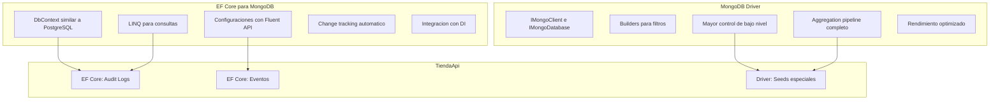
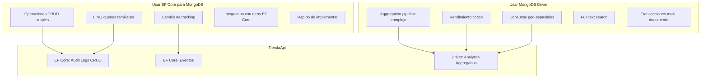
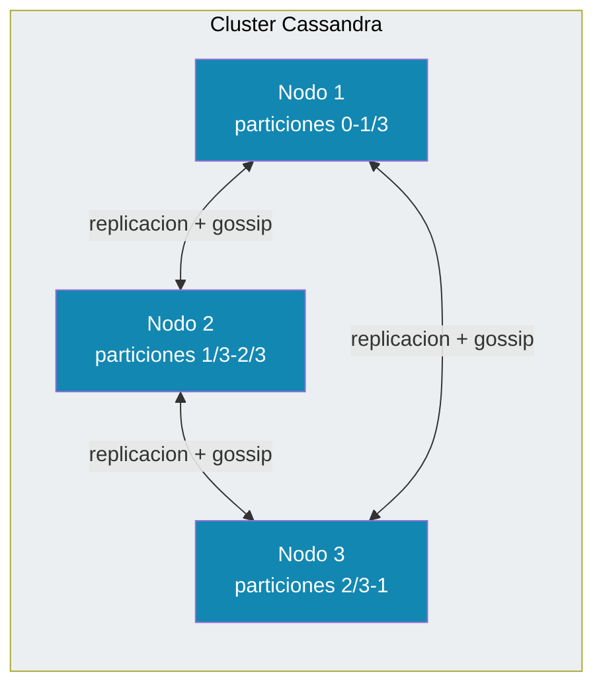
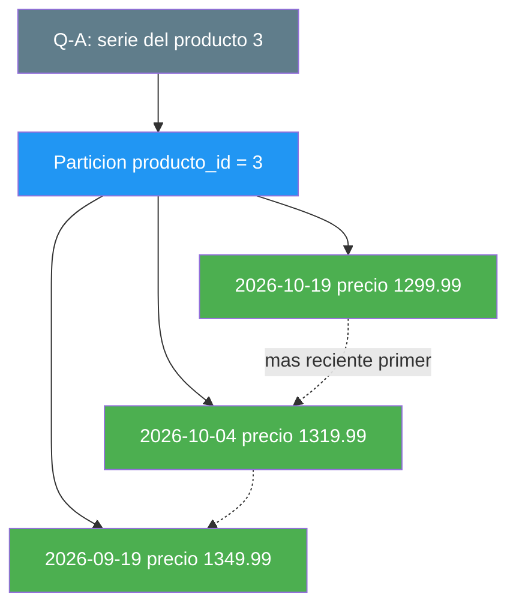
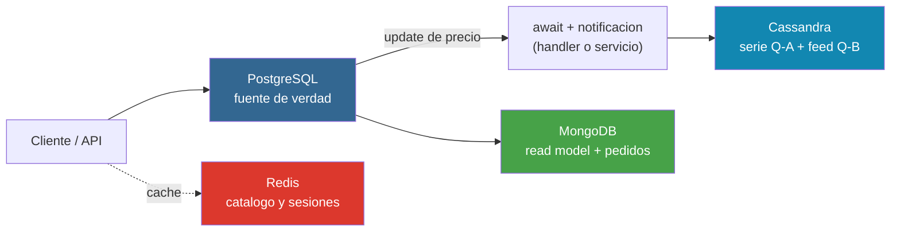

# 9. MongoDB y Cassandra

## Índice

[9. MongoDB y Cassandra](#9-mongodb-y-cassandra)
  - [9.1. EF Core para MongoDB vs MongoDB Driver](#91-ef-core-para-mongodb-vs-mongodb-driver)
  - [9.2. EF Core para MongoDB](#92-ef-core-para-mongodb)
  - [9.3. MongoDB Driver Nativo](#93-mongodb-driver-nativo)
  - [9.4. Embeber vs Referenciar: composición de documentos](#94-embeber-vs-referenciar-composicin-de-documentos)
  - [9.5. Repositorios con EF Core para MongoDB](#95-repositorios-con-ef-core-para-mongodb)
  - [9.6. Repositorios con MongoDB Driver](#96-repositorios-con-mongodb-driver)
  - [9.7. Aggregation Pipeline con MongoDB Driver](#97-aggregation-pipeline-con-mongodb-driver)
  - [9.8. Seed de Datos en MongoDB](#98-seed-de-datos-en-mongodb)
  - [9.9. Comparación: Cuándo Usar Cada Enfoque](#99-comparacin-cundo-usar-cada-enfoque)
  - [9.10. Cassandra: qué es, para qué nació y cómo trabaja](#910-cassandra-qu-es-para-qu-naci-y-cmo-trabaja)
  - [9.11. De las consultas a las tablas: modelar la tienda en Cassandra](#911-de-las-consultas-a-las-tablas-modelar-la-tienda-en-cassandra)
  - [9.12. Las clases, la caché y los cuatro almacenes de la tienda](#912-las-clases-la-cach-y-los-cuatro-almacenes-de-la-tienda)
  - [9.13. Testing de MongoDB y Cassandra](#913-testing-de-mongodb-y-cassandra)
  - [9.14. Preguntas para reflexionar](#914-preguntas-para-reflexionar)
  - [9.15. Resumen y Buenas Prácticas](#915-resumen-y-buenas-prcticas)

---

## 9.1. EF Core para MongoDB vs MongoDB Driver

El proyecto TiendaApi usa ambos enfoques. EF Core para MongoDB proporciona una experiencia similar a PostgreSQL, mientras que el MongoDB Driver nativo ofrece más control para operaciones específicas.

### Comparación de enfoques



---

## 9.2. EF Core para MongoDB

EF Core para MongoDB permite usar el mismo patrón que PostgreSQL: DbContext, configuraciones Fluent API, y repositories con el mismo Result Pattern.

### Instalación

```bash
dotnet add TiendaApi.Core package Microsoft.EntityFrameworkCore
dotnet add TiendaApi.Core package MongoDB.EntityFrameworkCore
```

### MongoDbContext

```csharp
using Microsoft.EntityFrameworkCore;
using TiendaApi.Core.Models.Mongo;

namespace TiendaApi.Core.Data;

public class TiendaMongoContext : DbContext
{
    public TiendaMongoContext(DbContextOptions<TiendaMongoContext> options)
        : base(options)
    {
    }

    // Colecciones en MongoDB
    public DbSet<AuditLog> AuditLogs { get; set; } = null!;
    public DbSet<Event> Events { get; set; } = null!;
    public DbSet<ProductView> ProductViews { get; set; } = null!;

    protected override void OnModelCreating(ModelBuilder modelBuilder)
    {
        base.OnModelCreating(modelBuilder);

        // Aplicar configuraciones
        modelBuilder.ApplyConfiguration(new AuditLogConfiguration());
        modelBuilder.ApplyConfiguration(new EventConfiguration());
    }
}
```

### Registro en Program.cs

```csharp
using Microsoft.EntityFrameworkCore;
using TiendaApi.Core.Data;

var builder = WebApplication.CreateBuilder(args);

// Configuración de MongoDB
var mongoConnection = builder.Configuration.GetConnectionString("MongoDB");
var mongoDatabaseName = builder.Configuration["MongoDb:DatabaseName"] ?? "TiendaDb";

// Registrar DbContext de MongoDB
builder.Services.AddDbContext<TiendaMongoContext>(options =>
{
    options.UseMongoDB(mongoConnection, mongoDatabaseName);
});

// Servicios que usan MongoDB
builder.Services.AddScoped<IAuditLogRepository, AuditLogRepository>();
builder.Services.AddScoped<IEventRepository, EventRepository>();

var app = builder.Build();
```

### Modelos para MongoDB con EF Core

```csharp
using MongoDB.EntityFrameworkCore;

namespace TiendaApi.Core.Models.Mongo;

[Collection("audit_logs")]
public class AuditLog
{
    [BsonId]
    [BsonRepresentation(MongoDB.Bson.BsonType.ObjectId)]
    public string Id { get; set; } = string.Empty;

    [BsonElement("timestamp")]
    public DateTime Timestamp { get; set; } = DateTime.UtcNow;

    [BsonElement("action")]
    public string Action { get; set; } = string.Empty;

    [BsonElement("entityType")]
    public string EntityType { get; set; } = string.Empty;

    [BsonElement("entityId")]
    public string? EntityId { get; set; }

    [BsonElement("userId")]
    public string? UserId { get; set; }

    [BsonElement("userEmail")]
    public string? UserEmail { get; set; }

    [BsonElement("oldValue")]
    public string? OldValue { get; set; }

    [BsonElement("newValue")]
    public string? NewValue { get; set; }

    [BsonElement("ipAddress")]
    public string? IpAddress { get; set; }

    [BsonElement("userAgent")]
    public string? UserAgent { get; set; }
}
```

### Configuración con Fluent API

```csharp
using Microsoft.EntityFrameworkCore;
using Microsoft.EntityFrameworkCore.Metadata.Builders;
using MongoDB.EntityFrameworkCore.Extensions;

namespace TiendaApi.Core.Data.Configurations;

public class AuditLogConfiguration : IEntityTypeConfiguration<AuditLog>
{
    public void Configure(EntityTypeBuilder<AuditLog> builder)
    {
        // Colección en MongoDB
        builder.ToCollection("audit_logs");

        // Clave primaria
        builder.HasKey(l => l.Id);

        // Propiedades
        builder.Property(l => l.Timestamp)
            .HasElementName("timestamp")
            .IsRequired();

        builder.Property(l => l.Action)
            .HasElementName("action")
            .HasMaxLength(50)
            .IsRequired();

        builder.Property(l => l.EntityType)
            .HasElementName("entityType")
            .HasMaxLength(50)
            .IsRequired();

        // Índices
        builder.HasIndex(l => l.Timestamp);
        builder.HasIndex(l => l.EntityType);
        builder.HasIndex(l => l.EntityId);
        builder.HasIndex(l => l.UserId);
    }
}
```

---

## 9.3. MongoDB Driver Nativo

Para operaciones específicas o cuando necesitas más control, puedes usar el MongoDB Driver nativo con IMongoClient.

### Instalación

```bash
dotnet add TiendaApi.Core package MongoDB.Driver
```

### Configuración del cliente

```csharp
using MongoDB.Driver;

var builder = WebApplication.CreateBuilder(args);

// Configuración de MongoDB
var mongoConnection = builder.Configuration.GetConnectionString("MongoDB");
var mongoDatabaseName = builder.Configuration["MongoDb:DatabaseName"] ?? "TiendaDb";

// Registrar cliente MongoDB como singleton
builder.Services.AddSingleton<IMongoClient>(sp =>
{
    var settings = MongoClientSettings.FromConnectionString(mongoConnection);
    settings.MaxConnectionIdleTime = TimeSpan.FromMinutes(5);
    settings.MaxConnectionPoolSize = 100;
    return new MongoClient(settings);
});

// Registrar base de datos con scoped
builder.Services.AddScoped(sp =>
{
    var client = sp.GetRequiredService<IMongoClient>();
    return client.GetDatabase(mongoDatabaseName);
});

// Colecciones con nombre de configuración
builder.Services.AddScoped<IMongoCollection<AuditLogDocument>>>(sp =>
{
    var database = sp.GetRequiredService<IMongoDatabase>();
    return database.GetCollection<AuditLogDocument>("audit_logs");
});

var app = builder.Build();
```

### Modelos para MongoDB Driver

```csharp
using MongoDB.Bson;
using MongoDB.Bson.Serialization.Attributes;

namespace TiendaApi.Core.Models.Mongo;

public class AuditLogDocument
{
    [BsonId]
    [BsonRepresentation(BsonType.ObjectId)]
    public string Id { get; set; } = string.Empty;

    [BsonElement("timestamp")]
    [BsonDateTimeOptions(Kind = DateTimeKind.Utc)]
    public DateTime Timestamp { get; set; } = DateTime.UtcNow;

    [BsonElement("action")]
    public string Action { get; set; } = string.Empty;

    [BsonElement("entityType")]
    public string EntityType { get; set; } = string.Empty;

    [BsonElement("entityId")]
    public string? EntityId { get; set; }

    [BsonElement("userId")]
    public string? UserId { get; set; }

    [BsonElement("userEmail")]
    public string? UserEmail { get; set; }

    [BsonElement("oldValue")]
    public BsonDocument? OldValue { get; set; }

    [BsonElement("newValue")]
    public BsonDocument? NewValue { get; set; }

    [BsonElement("ipAddress")]
    public string? IpAddress { get; set; }

    [BsonElement("userAgent")]
    public string? UserAgent { get; set; }
}
```

---

## 9.4. Embeber vs Referenciar: composición de documentos

En MongoDB no hay JOINs. Cuando necesitas datos de dos entidades, tienes dos opciones: **embeber** (copiar los datos dentro del mismo documento) o **referenciar** (guardar solo el ID y consultar por separado). Esta es **la decisión más importante** al diseñar un esquema NoSQL.

### La tabla de decisión

| Criterio | Embeber | Referenciar |
|----------|---------|-------------|
| **Datos que se leen juntos siempre** | ✅ Sí | ❌ No |
| **Datos que cambian a menudo** | ❌ No | ✅ Sí |
| **Colección que crece sin límite** | ❌ No | ✅ Sí |
| **Datos que se consultan independiente** | ❌ No | ✅ Sí |

> 🎓 **Ejemplo real (Netflix):** embebe la lista de "episodios" dentro de cada "serie" porque siempre se ven juntos. Pero usa referencias para los "actores" porque un actor aparece en múltiples series.

### Cómo se aplica en TiendaApi

El proyecto usa **composición** en el read model de productos — `CategoriaRead` se embebe como sub-documento dentro de `ProductoRead`:

```csharp
public class ProductoRead
{
    [BsonId]
    public long Id { get; set; }

    public string Nombre { get; set; } = string.Empty;

    // 🎓 Composición: la categoría se embebe como sub-documento
    // para responder "categoria { nombre }" sin join — contrato GraphQL.
    public CategoriaRead Categoria { get; set; } = new();

    public long CategoriaId { get; set; }  // FK también guardada para filtros
}

// Sub-documento embebido: solo lo mínimo (id + nombre)
public class CategoriaRead
{
    public long Id { get; set; }
    public string Nombre { get; set; } = string.Empty;
}
```

**¿Por qué embeber aquí?**
- GraphQL pide `categoria { nombre }` en cada query de productos → siempre se leen juntos
- El read model es de solo lectura (CQRS) → el dato cambia poco
- Evita un segundo lookup a MongoDB en cada request

**⚠️ Conocido:** al renombrar categoría, los documentos cacheados (`productos:{id}`) llevan `nombre` viejo hasta el TTL. Se mitiga invalidando el tag `productos` de OutputCache + TTL de 10 min (ver doc/14 §14.11).

### Entidades Owned en EF Core MongoDB

Cuando usas EF Core para MongoDB, el equivalente a los documentos embebidos son las **Owned Types**:

```csharp
public class Cliente
{
    [BsonId] public long Id { get; set; }
    public string Nombre { get; set; }

    // OwnsOne: embebe un solo objeto
    public Direccion Direccion { get; set; }
}

[Owned]  // ← marca la clase como documento embebido
public class Direccion
{
    public string Calle { get; set; }
    public string Ciudad { get; set; }
}
```

También puedes embeber colecciones con `OwnsMany`:

```csharp
[Owned]
public class LineaPedido
{
    public string Producto { get; set; }
    public int Cantidad { get; set; }
    public decimal PrecioUnitario { get; set; }
}
```

> 🎓 **Nota:** TiendaApi usa el **Driver nativo** (no EF Core) para MongoDB, así que la composición se hace directamente con clases POCO — no necesita `[Owned]`. El patrón es el mismo: los sub-documentos son clases normales.

### Referencias manuales (estilo SQL)

Cuando los datos cambian a menudo o se consultan por separado, usa **referencias** — solo guarda el ID:

```csharp
public class Producto
{
    [BsonId] public long Id { get; set; }
    public string Nombre { get; set; }

    // Referencia: solo el ID, no se embebe
    public long CategoriaId { get; set; }

    // No hay propiedad Categoria aquí — se consulta aparte
}
```

En TiendaApi, `CategoriaId` se guarda **junto con** la categoría embebida — tiene ambos porque los filtros usan el ID y GraphQL necesita el nombre.

### Límite de 16 MB

MongoDB limita cada documento a **16 MB**. No embebas colecciones que crecen sin límite (logs, historiales, listas de eventos). Para esos casos, usa referencias o una colección separada.

---

## 9.5. Repositorios con EF Core para MongoDB

Los repositorios usan el mismo patrón que PostgreSQL, facilitando la consistencia en el código.

### Interfaz del repositorio

```csharp
using TiendaApi.Core.Models.Mongo;

namespace TiendaApi.Core.Interfaces;

public interface IAuditLogRepository
{
    Task<AuditLog> AddAsync(AuditLog log);
    Task<List<AuditLog>> GetByEntityAsync(string entityType, string entityId);
    Task<List<AuditLog>> GetByUserAsync(string userId, int limit = 100);
    Task<List<AuditLog>> GetRecentAsync(int limit = 100);
    Task<long> CountByEntityTypeAsync(string entityType);
}
```

### Implementación con EF Core

```csharp
using Microsoft.EntityFrameworkCore;
using TiendaApi.Core.Data;
using TiendaApi.Core.Interfaces;
using TiendaApi.Core.Models.Mongo;

namespace TiendaApi.Core.Repositories;

public class AuditLogRepository(
    TiendaMongoContext context) : IAuditLogRepository
{
    private readonly DbSet<AuditLog> _logs = context.AuditLogs;

    public async Task<AuditLog> AddAsync(AuditLog log)
    {
        log.Id = Guid.NewGuid().ToString();
        log.Timestamp = DateTime.UtcNow;
        
        await _logs.AddAsync(log);
        await context.SaveChangesAsync();
        
        return log;
    }

    public async Task<List<AuditLog>> GetByEntityAsync(string entityType, string entityId)
    {
        return await _logs
            .Where(l => l.EntityType == entityType && l.EntityId == entityId)
            .OrderByDescending(l => l.Timestamp)
            .Take(100)
            .ToListAsync();
    }

    public async Task<List<AuditLog>> GetByUserAsync(string userId, int limit = 100)
    {
        return await _logs
            .Where(l => l.UserId == userId)
            .OrderByDescending(l => l.Timestamp)
            .Take(limit)
            .ToListAsync();
    }

    public async Task<List<AuditLog>> GetRecentAsync(int limit = 100)
    {
        return await _logs
            .OrderByDescending(l => l.Timestamp)
            .Take(limit)
            .ToListAsync();
    }

    public async Task<long> CountByEntityTypeAsync(string entityType)
    {
        return await _logs
            .CountAsync(l => l.EntityType == entityType);
    }
}
```

---

## 9.6. Repositorios con MongoDB Driver

Para operaciones que requieren el aggregation pipeline o mayor control:

```csharp
using MongoDB.Driver;
using TiendaApi.Core.Interfaces;
using TiendaApi.Core.Models.Mongo;

namespace TiendaApi.Core.Repositories.Mongo;

public class AuditLogMongoRepository : IAuditLogRepository
{
    private readonly IMongoCollection<AuditLogDocument> _collection;

    public AuditLogMongoRepository(IMongoDatabase database)
    {
        _collection = database.GetCollection<AuditLogDocument>("audit_logs");
        CreateIndexes();
    }

    private void CreateIndexes()
    {
        var indexKeys = Builders<AuditLogDocument>.IndexKeys
            .Ascending(l => l.Timestamp)
            .Ascending(l => l.EntityType)
            .Ascending(l => l.EntityId);

        var indexModel = new CreateIndexModel<AuditLogDocument>(
            indexKeys,
            new CreateIndexOptions { Name = "idx_entity_lookup" });

        _collection.Indexes.CreateOneAsync(indexModel);
    }

    public async Task<AuditLogDocument> AddAsync(AuditLogDocument log)
    {
        log.Id = Guid.NewGuid().ToString();
        log.Timestamp = DateTime.UtcNow;
        
        await _collection.InsertOneAsync(log);
        return log;
    }

    public async Task<List<AuditLogDocument>> GetByEntityAsync(
        string entityType, string entityId)
    {
        var filter = Builders<AuditLogDocument>.Filter.And(
            Builders<AuditLogDocument>.Filter.Eq(l => l.EntityType, entityType),
            Builders<AuditLogDocument>.Filter.Eq(l => l.EntityId, entityId)
        );

        return await _collection
            .Find(filter)
            .Sort(Builders<AuditLogDocument>.Sort.Descending(l => l.Timestamp))
            .Limit(100)
            .ToListAsync();
    }

    public async Task<List<AuditLogDocument>> GetByUserAsync(string userId, int limit = 100)
    {
        var filter = Builders<AuditLogDocument>.Filter.Eq(l => l.UserId, userId);
        
        return await _collection
            .Find(filter)
            .Sort(Builders<AuditLogDocument>.Sort.Descending(l => l.Timestamp))
            .Limit(limit)
            .ToListAsync();
    }

    public async Task<List<AuditLogDocument>> GetRecentAsync(int limit = 100)
    {
        return await _collection
            .Find(_ => true)
            .Sort(Builders<AuditLogDocument>.Sort.Descending(l => l.Timestamp))
            .Limit(limit)
            .ToListAsync();
    }
}
```

---

## 9.7. Aggregation Pipeline con MongoDB Driver

El aggregation pipeline es powerful para análisis y reportes:

```csharp
public class AnalyticsRepository
{
    private readonly IMongoCollection<AuditLogDocument> _collection;

    public AnalyticsRepository(IMongoDatabase database)
    {
        _collection = database.GetCollection<AuditLogDocument>("audit_logs");
    }

    public async Task<Dictionary<string, long>> GetActionCountsByDayAsync(DateTime from, DateTime to)
    {
        var pipeline = new BsonDocument[]
        {
            new("$match", new BsonDocument
            {
                ["timestamp"] = new BsonDocument
                {
                    ["$gte"] = from,
                    ["$lte"] = to
                }
            }),
            new("$group", new BsonDocument
            {
                ["_id"] = new BsonDocument
                {
                    ["action"] = "$action",
                    ["date"] = new BsonDocument("$dateToString", new BsonDocument
                    {
                        ["format"] = "%Y-%m-%d",
                        ["date"] = "$timestamp"
                    })
                },
                ["count"] = new BsonDocument("$sum", 1)
            }),
            new("$sort", new BsonDocument("_id.date", 1))
        };

        var results = await _collection.AggregateAsync<BsonDocument>(pipeline);
        
        return results.ToDictionary(
            r => r["_id"]["action"].AsString + "_" + r["_id"]["date"].AsString,
            r => r["count"].AsInt64
        );
    }

    public async Task<List<TopEntity>> GetTopEntitiesAsync(int limit = 10)
    {
        var pipeline = new BsonDocument[]
        {
            new("$group", new BsonDocument
            {
                ["_id"] = "$entityType",
                ["count"] = new BsonDocument("$sum", 1)
            }),
            new("$sort", new BsonDocument("count", -1)),
            new("$limit", limit)
        };

        var results = await _collection.AggregateAsync<BsonDocument>(pipeline);
        
        return results.Select(r => new TopEntity
        {
            EntityType = r["_id"].AsString,
            Count = r["count"].AsInt32
        }).ToList();
    }
}

public class TopEntity
{
    public string EntityType { get; set; } = string.Empty;
    public int Count { get; set; }
}
```

---

## 9.8. Seed de Datos en MongoDB

MongoDB no tiene migraciones como PostgreSQL, pero puedes poblar datos iniciales de varias formas.

### Opción 1: Con EF Core (como PostgreSQL)

```csharp
using Microsoft.EntityFrameworkCore;
using TiendaApi.Core.Data;
using TiendaApi.Core.Models.Mongo;

namespace TiendaApi.Core.Data.Seed;

public class MongoDbSeeder
{
    private readonly TiendaMongoContext _context;

    public MongoDbSeeder(TiendaMongoContext context)
    {
        _context = context;
    }

    public async Task SeedAsync()
    {
        if (await _context.AuditLogs.AnyAsync())
            return;

        var logs = new List<AuditLog>
        {
            new()
            {
                Action = "CREATE",
                EntityType = "Producto",
                EntityId = "1",
                UserId = "admin",
                UserEmail = "admin@tienda.com",
                NewValue = "Laptop Gaming - 1500",
                Timestamp = DateTime.UtcNow.AddDays(-5)
            },
            new()
            {
                Action = "UPDATE_STOCK",
                EntityType = "Producto",
                EntityId = "2",
                UserId = "admin",
                UserEmail = "admin@tienda.com",
                OldValue = "10",
                NewValue = "5",
                Timestamp = DateTime.UtcNow.AddDays(-2)
            }
        };

        await _context.AuditLogs.AddRangeAsync(logs);
        await _context.SaveChangesAsync();
    }
}
```

### Opción 2: Con MongoDB Driver Nativo

```csharp
using MongoDB.Bson;
using MongoDB.Driver;
using TiendaApi.Core.Models.Mongo;

namespace TiendaApi.Core.Data.Seed;

public class MongoDbDriverSeeder
{
    private readonly IMongoDatabase _database;

    public MongoDbDriverSeeder(IMongoDatabase database)
    {
        _database = database;
    }

    public async Task SeedAsync()
    {
        var collection = _database.GetCollection<BsonDocument>("audit_logs");

        if (await collection.CountDocumentsAsync(_ => true) > 0)
            return;

        var seedData = new List<BsonDocument>
        {
            new BsonDocument
            {
                ["_id"] = ObjectId.GenerateNewId(),
                ["timestamp"] = DateTime.UtcNow.AddDays(-5),
                ["action"] = "CREATE",
                ["entityType"] = "Producto",
                ["entityId"] = "1",
                ["userId"] = "admin",
                ["userEmail"] = "admin@tienda.com",
                ["newValue"] = "Laptop Gaming - 1500",
                ["oldValue"] = BsonNull.Value
            },
            new BsonDocument
            {
                ["_id"] = ObjectId.GenerateNewId(),
                ["timestamp"] = DateTime.UtcNow.AddDays(-2),
                ["action"] = "UPDATE_STOCK",
                ["entityType"] = "Producto",
                ["entityId"] = "2",
                ["userId"] = "admin",
                ["userEmail"] = "admin@tienda.com",
                ["newValue"] = "5",
                ["oldValue"] = "10"
            },
            new BsonDocument
            {
                ["_id"] = ObjectId.GenerateNewId(),
                ["timestamp"] = DateTime.UtcNow.AddHours(-1),
                ["action"] = "LOGIN",
                ["entityType"] = "User",
                ["entityId"] = "user123",
                ["userId"] = "user123",
                ["userEmail"] = "user@tienda.com",
                ["newValue"] = BsonNull.Value,
                ["oldValue"] = BsonNull.Value
            }
        };

        await collection.InsertManyAsync(seedData);
    }
}
```

### Opción 3: Con Fichero JSON

```json
// seed-audit-logs.json
[
  {
    "timestamp": "2024-01-10T10:00:00Z",
    "action": "CREATE",
    "entityType": "Producto",
    "entityId": "1",
    "userId": "admin",
    "userEmail": "admin@tienda.com",
    "newValue": "Laptop Gaming - 1500",
    "oldValue": null
  },
  {
    "timestamp": "2024-01-12T15:30:00Z",
    "action": "UPDATE_STOCK",
    "entityType": "Producto",
    "entityId": "2",
    "userId": "admin",
    "userEmail": "admin@tienda.com",
    "newValue": "5",
    "oldValue": "10"
  }
]
```

```csharp
using MongoDB.Bson;
using MongoDB.Bson.Serialization;
using MongoDB.Driver;

public class JsonSeeder
{
    private readonly IMongoDatabase _database;

    public JsonSeeder(IMongoDatabase database)
    {
        _database = database;
    }

    public async Task SeedFromJsonAsync(string filePath)
    {
        var json = await File.ReadAllTextAsync(filePath);
        var documents = BsonSerializer.Deserialize<List<BsonDocument>>(json);

        var collection = _database.GetCollection<BsonDocument>("audit_logs");

        if (await collection.CountDocumentsAsync(_ => true) > 0)
            return;

        await collection.InsertManyAsync(documents);
    }
}
```

### Opción 4: Registro Automático en Program.cs

```csharp
using Microsoft.EntityFrameworkCore;
using MongoDB.Driver;

var builder = WebApplication.CreateBuilder(args);

// Configurar MongoDB
var mongoConnection = builder.Configuration.GetConnectionString("MongoDB");
var mongoDatabaseName = builder.Configuration["MongoDb:DatabaseName"] ?? "TiendaDb";

// DbContext para EF Core
builder.Services.AddDbContext<TiendaMongoContext>(options =>
{
    options.UseMongoDB(mongoConnection, mongoDatabaseName);
});

// Cliente MongoDB nativo
builder.Services.AddSingleton<IMongoClient>(new MongoClient(mongoConnection));
builder.Services.AddScoped(sp =>
{
    var client = sp.GetRequiredService<IMongoClient>();
    return client.GetDatabase(mongoDatabaseName);
});

var app = builder.Build();

// Seed de datos
using (var scope = app.Services.CreateScope())
{
    var context = scope.ServiceProvider.GetRequiredService<TiendaMongoContext>();
    var mongoDatabase = scope.ServiceProvider.GetRequiredService<IMongoDatabase>();

    var efSeeder = new MongoDbSeeder(context);
    await efSeeder.SeedAsync();

    var driverSeeder = new MongoDbDriverSeeder(mongoDatabase);
    await driverSeeder.SeedAsync();
}
```

---

## 9.9. Comparación: Cuándo Usar Cada Enfoque



---
---

## 9.10. Cassandra: qué es, para qué nació y cómo trabaja

Antes de modelar nada, conviene presentar al personaje. **Apache Cassandra es una base de datos distribuida de columnas, nacida en Facebook en 2008** para un problema muy concreto: el buzón de mensajes de cientos de millones de usuarios, con una regla de negocio que un relacional clásico no sostenía — **que ningún punto de fallo individual pudiera tumbar la lectura**, y que las escrituras entraran sin planificar.

La tesis del diseño es directa de dos sistemas conocidos: la **partición horizontal y la alta disponibilidad de Dynamo** (Amazon) combinadas con el **modelo de columnas ordenadas de BigTable** (Google). De ahí salió un sistema con una filosofía propia:

**Primero se escribe, después se lee.** La escritura es la operación barata y garantizada; la lectura es la que se diseña.

Hoy lo usan plataformas con el mismo problema que el de su origen: **Discord** (el historial de mensajes de millones de canales), **Instagram** (la bandeja de entrada), **Apple** (iMessage)... en todos, series temporales y colas de actividad con **consultas conocidas de antemano y escrituras imposibles de planificar**.

### Cómo está construido: el clúster sin centro

Cassandra no tiene nodo maestro, ni un `PRIMARY` que mande, ni un nodo "el que sabe". La base de datos es **un conjunto de nodos idénticos**:



Cuatro ideas sostienen todo lo demás:

| Idea | Qué significa | Consecuencia para quien diseña |
|---|---|---|
| **Particionado de datos** | Cada fila se coloca en un nodo según su *token* (hash de la partition key); el clúster entero comparte el espacio de particiones | La partition key decide **dónde vive** el dato: leer una partición es leerla de sus nodos, no de "la tabla" |
| **Replicación** | Cada partición se copia en `N` nodos (el *replication factor*); no hay un dueño único | Si un nodo cae, otro atiende: **ningún punto de fallo individual** |
| **Gossip** | Los nodos se hablan entre sí para saber quién está vivo y qué tienen | No hay un directorio central que administrar: se añaden nodos y el clúster se reequilibra |
| **Consistencia configurable** | Cada lectura/escritura pide un nivel (`ONE`, `QUORUM`, `ALL...`): cuántas réplicas deben responder | Consistencia eventual por defecto entre réplicas; tú eliges cuándo pagar más por leer *lo último* |

**Por qué escribe tan rápido.** Una escritura no espera a recorrer discos ni a bloquear filas: va a un **commit log** (durabilidad) y a una **memtable** (en memoria), y en segundo plano se vacía a ficheros **inmutables (SSTables)** que luego se *compactan*. No hay índices que mantener en el momento del `INSERT`, ni filas que bloquear: **el `INSERT` es la operación natural**. El coste se paga al otro lado — en la **lectura**, que debe saber exactamente dónde mirar (por eso el diseño de tablas es el trabajo real), y en la **compactación**, que es trabajo de fondo del propio sistema.

> ⚠️ La consecuencia directa de "sin nodos maestros y sin bloqueos": **no hay transacciones entre tablas** como en SQL. Cada escritura es independiente; agruparlas con `BATCH` no crea una transacción (ya lo verás en el dual-write de la tienda).

### CQL: se parece a SQL, pero no obedece las mismas reglas

El lenguaje de consulta se llama **CQL** (`Cassandra Query Language`) y su sintaxis de `SELECT` engaña a quien viene de SQL. Los tipos que usa la tienda:

| Tipo CQL | Equivalente cercano | Dónde se usa en la tienda |
|---|---|---|
| `bigint` | `long` | Claves (`producto_id`, `usuario_id`) |
| `timestamp` | fecha y hora | Clustering temporal (`fecha`) |
| `date` | solo día (`YYYY-MM-DD`) | Partición diaria del informe (`cambios_precio_por_fecha`) |
| `double` | número decimal | Precios (el driver no mapea `decimal` a `System.Decimal`) |
| `text` | `string` | Nombres copiados (denormalización) |

Y las reglas que **no** son las de SQL:

- **El `WHERE` solo acepta las claves**: igualdad sobre la *partition key*, rangos sobre la *clustering key*, `IN` puntual sobre la partition key... **cualquier otra columna exige `ALLOW FILTERING`**, que en realidad significa *"escanea la tabla entera"* — la señal de que el diseño no encaja con la consulta.
- **No hay `JOIN`**: no existe la operación de cruzar tablas al leer. Los datos se cruzan **al escribir** (desnormalización).
- **No hay `GROUP BY` / `HAVING` ni subconsultas**: los cálculos se hacen **antes de guardar** (agregar al insertar) o en la aplicación.
- **No hay `ORDER BY` arbitrario**: el orden lo decide el `CLUSTERING ORDER BY` de la tabla; el `SELECT` solo lo respeta o lo invierte, no lo inventa.

```sql
-- Esto NO es una consulta de Cassandra (escaneo total + filtro):
SELECT * FROM historial_precios_por_producto WHERE precio > 1000 ALLOW FILTERING;

-- Esto SÍ: igualdad sobre partition key -> una particion, cero escaneos.
SELECT * FROM historial_precios_por_producto WHERE producto_id = 3 LIMIT 5;
```

> 💡 **La regla mental:** en SQL le preguntas a la base *"dame los que cumplan..."* y ella se busca la vida; en CQL le preguntas *"dame lo que hay en esta clave..."* y tú has tenido que saber la clave **antes de diseñar la tabla**. Ese cambio de responsable es el tema de la siguiente sección.

**Y por eso conviene con MongoDB, que acabas de ver en 9.1-9.9:** Mongo te deja preguntar casi lo que quieras sobre documentos flexibles; Cassandra te exige contestar antes *"¿qué vas a preguntar?"*. Son dos filosofías para dos problemas distintos — la comparación completa está en *Dos filosofías, cuatro almacenes*, y el modelo de la tienda, en *De las consultas a las tablas: modelar la tienda en Cassandra*.

### Dos filosofías, cuatro almacenes

| | **MongoDB (9.1-9.9)** | **Cassandra (9.10-9.14)** |
|---|---|---|
| Punto de partida | Los datos (colecciones, documentos) | Las consultas (la pizarra) |
| Esquema | Flexible; el documento se adapta | Diseñado antes del primer `INSERT` |
| Consultas | Cualquier filtro, `aggregate`, índices | Solo las que diseñas; sin `WHERE` arbitrarios |
| Relaciones | `lookup` (caro) o referencias/embebido | No existen: se **copia** (desnormalización) |
| Orden y límite | `sort` en cada consulta | Guardados en la tabla (`CLUSTERING ORDER BY`) |
| Escritura | Operación normal, con esquema flexible | La operación natural: sin índices ni bloqueos |
| Punto débil | Escrituras masivas, escalar a trozos | Consultas ad-hoc y actualizaciones arbitrarias |

En la tienda conviven con PostgreSQL (fuente de verdad del catálogo y los usuarios) y Redis (caché): cuatro almacenes, cada uno con su problema — la tabla completa está en *Los cuatro almacenes de la tienda*, más abajo.

---

## 9.11. De las consultas a las tablas: modelar la tienda en Cassandra

Con Cassandra presentado (9.10), el modelado empieza donde empieza siempre en este sistema: en la pizarra de consultas de la tienda. Esta sección traduce Q-A, Q-B y Q-C a tablas, claves y código real.

### Primero las consultas, después las tablas

El diseño empieza en una pizarra, no en un modelador de entidades. Las consultas de la tienda para sus series son:

| Consulta | Qué pregunta | Cómo se atiende |
|----------|--------------|-----------------|
| **Q-A** | ¿A cuánto estuvo el producto 3, y cómo ha ido cambiando? (pública, con `desde`/`hasta` y tope) | Leer la partición `producto_id = 3` entera, ordenada |
| **Q-B** | ¿Qué ha visto recientemente el usuario que está logueado? | Leer la partición `usuario_id = ...` con tope |
| **Q-C** | ¿Qué precios cambiaron en un periodo concreto (informe)? | `IN` sobre los días del rango: una partición por día |

Y las tres tablas que responden a esas consultas, **tal como las crea el esquema real de la aplicación** (`CassandraSchemaExtensions.InitializeSchemaAsync`, ejecutado en cada arranque):

```csharp
// Q-A: el histórico de precios de un producto. append-only, sin updates.
// Partition key = producto_id (leer el histórico es leer una partición);
// clustering key = fecha con orden DESC GUARDADO en la tabla: los puntos
// salen del más reciente al más antiguo sin ningún ORDER BY.
await session.ExecuteAsync(new SimpleStatement("""
    CREATE TABLE IF NOT EXISTS historial_precios_por_producto (
        producto_id bigint,
        fecha timestamp,
        precio double,
        PRIMARY KEY (producto_id, fecha)
    ) WITH CLUSTERING ORDER BY (fecha DESC)
    """));

// Q-C: qué precios cambiaron en un día (alimenta informes).
// La partición es EL DÍA (date), no el timestamp exacto: si fuera timestamp
// cada instante sería una partición diminuta e infinita. Acota el crecimiento
// por diseño.
await session.ExecuteAsync(new SimpleStatement("""
    CREATE TABLE IF NOT EXISTS cambios_precio_por_fecha (
        fecha date,
        producto_id bigint,
        precio double,
        PRIMARY KEY (fecha, producto_id)
    )
    """));

// Q-B: feed de actividad, últimos productos vistos por usuario.
// El TTL nativo (180 días) caduca las filas SOLO, sin jobs de purga,
// y acota el crecimiento de la partición.
await session.ExecuteAsync(new SimpleStatement("""
    CREATE TABLE IF NOT EXISTS vistas_por_usuario (
        usuario_id bigint,
        fecha timestamp,
        producto_id bigint,
        nombre text,                    // denormalización: el feed no hace cruces
        PRIMARY KEY (usuario_id, fecha)
    ) WITH CLUSTERING ORDER BY (fecha DESC)
        AND default_time_to_live = 15552000
    """));
```

Fíjate en lo que no aparece: ninguna clave foránea, ningún `JOIN`, ninguna vista materializada. El nombre del producto se copia en cada fila de Q-B porque leerlo de otra tabla exigiría un cruce que aquí no existe: **en Cassandra se paga de memoria lo que en un relacional se paga en tiempo de consulta**.

**Las cinco preguntas antes del primer `CREATE TABLE`** (en este orden):

1. ¿Qué valores conoce la aplicación cuando lanza la consulta?
2. ¿Qué valor debería llevarnos directamente a una partición?
3. ¿Necesitamos ordenar o recorrer un rango dentro de esa partición?
4. ¿Puede repetirse una fila? Si puede, ¿qué atributo completa la unicidad?
5. ¿Puede crecer esa partición sin techo?

Si por el nombre de la tabla no adivinas qué pregunta responde, la tabla está mal presentada y probablemente mal pensada: en Cassandra la tabla se llama por su consulta (`historial_precios_por_producto`, `vistas_por_usuario`).

### Partition key y clustering key

`PRIMARY KEY (producto_id, fecha)` esconde **dos decisiones distintas**:

- **Partition key** (`producto_id`): decide **dónde vive el dato** y qué lectura es barata. Todo el histórico de un producto está junto en la misma partición; leerla es una sola llamada a un solo nodo.
- **Clustering key** (`fecha DESC`): el **orden dentro** de la partición. Los puntos salen ordenados de serie, sin `ORDER BY` en el `SELECT`.



La lectura, en el repositorio real de la tienda — estilo *query-first*: cada método corresponde a una consulta de la pizarra:

```csharp
// Repositories/Historial/CassandraHistorialRepository.cs
public async Task<IReadOnlyList<HistorialPrecioDto>> GetHistorialPreciosAsync(
    long productoId, DateTime? desde, DateTime? hasta, int limit)
{
    // SELECT * FROM historial_precios_por_producto WHERE producto_id = ?
    //   [AND fecha >= ? AND fecha <= ?]   <- rango sobre CLUSTERING key: permitido
    //   LIMIT ?                           <- sin ORDER BY: el DESC lo guarda la tabla
    var query = _historial.Where(h => h.ProductoId == productoId);

    if (desde.HasValue)
        query = query.Where(h => h.Fecha >= desde.Value);

    if (hasta.HasValue)
        query = query.Where(h => h.Fecha <= hasta.Value);

    var filas = await query.Take(limit).ExecuteAsync();

    return filas
        .Select(h => new HistorialPrecioDto(ComoUtc(h.Fecha), h.Precio))
        .ToList();
}
```

Dos reglas de CQL que este método respeta sin decirlo:

- **Un rango sobre la partition key está prohibido**: `WHERE producto_id > 3` no existe. Por eso Q-C se resuelve con `fecha IN ('2026-10-28', ...)`: igualdades sobre la partición, una por día. Y el repositorio **acota el rango a 31 días** — más de 31 particiones en un `IN` no es una consulta razonable, y lo dice con una excepción explícita:

```csharp
// Q-C: "los cambios de esta semana" = IN con los días concretos = lookup
// puntual de N particiones. Un rango sobre la PARTITION key está prohibido
// en CQL: solo caben igualdades e IN.
var dias = hasta.DayNumber - desde.DayNumber + 1;
if (dias > 31)
    throw new ArgumentOutOfRangeException(nameof(hasta),
        "El rango no puede superar 31 días (se resolvería como IN de 31 particiones)");
```

- **El detalle del driver**: la columna CQL `date` de Q-C no la mapea el driver desde `DateTime` ("Unknown Cassandra target type"); el tipo correcto es `Cassandra.LocalDate` y el repositorio lo construye a mano con los tres números. Los `timestamp` en cambio se devuelven con `Kind=Unspecified` y el servicio los normaliza a UTC para que el JSON salga siempre con sufijo `Z`.

### Desnormalización: quién mantiene las copias al día

Cassandra no usa joins como mecanismo habitual de consulta, así que la misma información se guarda en varias tablas, **una por patrón de acceso**. Es la continuación directa de lo que viste con el embeber de Mongo (9.4): desnormalizar en Cassandra es embeber, con dos diferencias — no hay techo de 16 MB por documento, y la organización no la decide el tamaño del documento, sino la partition key que diseñas.

Se escribe de más para leer de menos. Registrar una visita muestra el patrón en su forma más simple; el dual-write de precios, en su forma completa: **un solo momento de negocio, dos tablas**. Así se escribe en la API Normal (el helper se llama dentro de `UpdateAsync` y `UpdatePartialAsync`):

```csharp
// Services/Productos/ProductoService.cs (API Normal)
private async Task RegistrarPrecioEnCassandra(Producto producto)
{
    try
    {
        await historialRepository.RegistrarPrecioAsync(producto.Id, (double)producto.Precio);
    }
    catch (Exception ex)
    {
        logger.LogWarning(ex,
            "Cassandra: no se pudo registrar el precio del producto {Id} (modo degradado)", producto.Id);
    }
}
```

Y así en la variante CQRS — **misma escritura, distinto cableado**: el comando lanza una notificación y el handler la escucha (la única bifurcación arquitectónica entre los dos repos gemelos):

```csharp
// Features/Productos/Notifications/PrecioHistoricoHandler.cs (CQRS)
public class PrecioHistoricoHandler(IHistorialRepository historialRepository)
    : INotificationHandler<ProductoActualizadoNotification>
{
    public async Task Handle(ProductoActualizadoNotification notification, CancellationToken cancellationToken)
    {
        try
        {
            await historialRepository.RegistrarPrecioAsync(
                notification.Producto.Id, (double)notification.Producto.Precio);
        }
        catch (Exception ex)
        {
            Log.Warning(ex, "Cassandra: no se pudo registrar el precio del producto {ProductoId} (modo degradado)",
                notification.Producto.Id);
        }
    }
}
```

Y en el repositorio, las dos escrituras — **dos `INSERT` independientes, sin `BATCH`**:

```csharp
// Repositories/Historial/CassandraHistorialRepository.cs
public async Task RegistrarPrecioAsync(long productoId, double precio)
{
    var ahora = DateTime.UtcNow;

    // 1) Q-A: una fila más en el histórico del producto (append-only, sin updates).
    await _historial.Insert(new HistorialPrecioPorProducto
    {
        ProductoId = productoId,
        Fecha = ahora,
        Precio = precio
    }).ExecuteAsync();

    // 2) Q-C: el informe del día. Dos tablas, dos inserts SIN transacción
    // repartida: si la segunda escritura fallara, la primera quedaría -
    // Cassandra prioriza la escritura rápida sobre la atomicidad repartida.
    await session.ExecuteAsync(new SimpleStatement(
        "INSERT INTO cambios_precio_por_fecha (fecha, producto_id, precio) VALUES (?, ?, ?)",
        new LocalDate(ahora.Year, ahora.Month, ahora.Day),
        productoId,
        precio));
}
```

Y ahí aparece la pregunta que nadie se hace en un relacional: **si la segunda escritura falla, quién se entera?** En la tienda la respuesta está decidida y documentada en el código:

| Quién mantiene las copias | Cómo funciona | Cuándo usarlo |
|---|---|---|
| **La aplicación escribe en todas las tablas** ✅ | Cada actualización genera tantas escrituras como tablas desnormalizadas, con `await` y `try/catch` | **Lo elegido aquí**: la coherencia depende de código que puedes leer y probar |
| Vistas materializadas | Cassandra deriva y mantiene una vista desde la tabla base | Casos concretos; tienen limitaciones y la escritura explícita es más predecible |
| Triggers | Una escritura dispara código en el servidor | Evitar: ocultan lógica y son difíciles de operar |

**Cuándo se escribe el dual-write** (los dos puntos del historial):

1. **En el CREATE**, el precio de nacimiento es el primer punto de la serie. Sin él, un producto que nunca se actualiza tendría el historial vacío para siempre, y "¿a cuánto estuvo desde que existe?" solo podría responderlo PostgreSQL.
2. **En el UPDATE, solo si el precio cambió de verdad** (el servicio captura el precio anterior antes de tocar el producto; en CQRS, la notificación lo arrastra en `PrecioAnterior`). El historial registra *cambios* de precio, no *eventos de edición*: cambiar solo el stock —o la imagen— no genera punto, y el informe Q-C solo cuenta cambios reales.

**Tres detalles más de ese código que no son cosméticos:**

1. **No es fire-and-forget.** El `await` está ahí a propósito: quien acaba de hacer el PATCH necesita poder leer el punto recién escrito en la misma sesión, y el flujo E2E no depende de carreras.
2. **Fail-open documentado.** Si Cassandra está caído, solo hay un warning: el update de PostgreSQL **nunca se tumba**. La tienda entera sigue siendo usable sin histórico ni feed.
3. **`BATCH` no es la solución.** CQL permite agrupar escrituras con `BATCH`, pero un batch **no convierte varias escrituras en una transacción SQL**, y los batches que abarcan muchas particiones son costosos. Aquí no se usa ninguno, y un test de integración comprueba que las dos escrituras existen por separado.

> ⚠️ Duplicar datos es una decisión de diseño válida; **lo anormal es duplicar sin saber quién mantiene las copias al día**. Esa pregunta, en una tabla: quién escribe, cuándo, y qué pasa si falla la segunda escritura.

### Qué no se denormaliza: el DTO mínimo de la serie

Un contraste que conviene dejar explícito, porque es la misma familia de decisiones con dos respuestas distintas:

| | **Feed (Q-B)** | **Serie de precios (Q-A)** |
|---|---|---|
| Cada fila es... | un producto **distinto** que no sabes de antemano | **el mismo** producto, conocido (está en la URL) |
| ¿Se copia la ficha? | **Sí**: `nombre` viaja en la fila porque resolverlo sería N cruces al leer | **No**: el DTO es solo `{ fecha, precio }` |
| Ejemplo de respuesta | `[{ "fecha": ..., "productoId": 1, "nombre": "Laptop Dell XPS 15" }, ...]` | `[{ "fecha": "2026-10-19T16:43:27Z", "precio": 1299.99 }, ...]` |

La regla general: **se copia (denormaliza) lo que no puedes resolver al leer**. En el feed no puedes: cada entrada apunta a un producto distinto y el feed debe pintarse de una sola lectura de la partición. En la serie sí puedes: el `{id}` de la petición ya identifica el producto, y si la ficha hiciera falta, se resuelve con **una sola** ida a PostgreSQL — la misma que ya se hace para el 404 (PostgreSQL es quien certifica que el producto existe; el servicio ni usa el resto del objeto).

Y hay una segunda razón, específica de las series: **la serie es append-only**. Si copiaras nombre o imagen en cada punto, un renombrado del producto dejaría los puntos históricos con nombres viejos y no podrías actualizarlos (habría que reescribir la partición entera). Un dato temporal se guarda como medida pura: **fecha y precio; nada que caduque dentro de un dato que no caduca**.


### Las consultas Q-A y Q-B paso a paso

**Q-A — la serie de precios (pública):**

1. **La pregunta**: "¿cómo ha cambiado este producto?" con rango opcional y tope. Conoce el producto → partition key `producto_id`.
2. **El orden**: temporal y descendente → clustering `fecha DESC`, guardado en la tabla.
3. **La tabla**: `historial_precios_por_producto` — una fila por cambio, append-only (nadie hace `UPDATE` de una fila vieja; el precio anterior se deriva al leer).

La lógica vive en la fachada, que es donde se toman las decisiones de contrato — **404 de PostgreSQL, límites acotados y fail-open, en un solo método**:

```csharp
// Services/Historial/HistorialService.cs
public async Task<Result<IReadOnlyList<HistorialPrecioDto>, DomainError>> GetHistorialPreciosAsync(
    long productoId, DateTime? desde, DateTime? hasta, int limit)
{
    // La fuente de verdad decide si el producto EXISTE: su 404 manda y
    // ni se consulta Cassandra.
    var producto = await productoRepository.FindByIdAsync(productoId);
    if (producto is null)
        return Result.Failure<IReadOnlyList<HistorialPrecioDto>, DomainError>(
            ProductoError.NotFound(productoId));

    // Rango invertido = error de validación (400 con errors por campo).
    if (desde.HasValue && hasta.HasValue && desde.Value > hasta.Value)
        return Result.Failure<IReadOnlyList<HistorialPrecioDto>, DomainError>(
            new ValidationError(
                "El rango de fechas no puede estar invertido",
                new Dictionary<string, string[]> { ["desde"] = ["No puede ser posterior a 'hasta'"] }));

    var limitEfectivo = Math.Clamp(limit, 1, 200);

    try
    {
        var serie = await historialRepository.GetHistorialPreciosAsync(
            productoId, desde, hasta, limitEfectivo);
        return Result.Success<IReadOnlyList<HistorialPrecioDto>, DomainError>(serie);
    }
    catch (Exception ex)
    {
        // Fail-open de lectura: nodo caído -> serie vacía, no error.
        logger.LogWarning(ex,
            "Cassandra no disponible: el historial del producto {Id} responde vacio (modo degradado)", productoId);
        return Result.Success<IReadOnlyList<HistorialPrecioDto>, DomainError>(Array.Empty<HistorialPrecioDto>());
    }
}
```

**Q-B — el feed del usuario (autenticado):**

1. **La pregunta**: "¿qué he visto yo últimamente?" → partition key `usuario_id` (los claims del JWT dan el id: no hay consulta previa).
2. **El orden**: temporal descendente → con `LIMIT` sobre la partición.
3. **La tabla**: `vistas_por_usuario`, con el **nombre del producto copiado en cada fila** — el feed se pinta sin ningún cruce.

```csharp
// Services/Historial/HistorialService.cs — la escritura del feed
public async Task<UnitResult<DomainError>> RegistrarVistaAsync(long usuarioId, long productoId)
{
    var producto = await productoRepository.FindByIdAsync(productoId);
    if (producto is null)
        return UnitResult.Failure<DomainError>(ProductoError.NotFound(productoId));

    try
    {
        // El nombre se copia a la fila (denormalización): el feed no hará cruces.
        await historialRepository.RegistrarVistaAsync(usuarioId, producto.Id, producto.Nombre);
    }
    catch (Exception ex)
    {
        logger.LogWarning(ex,
            "Cassandra: no se pudo registrar la vista del producto {Id} por el usuario {UsuarioId} (modo degradado)",
            productoId, usuarioId);
    }

    return UnitResult.Success<DomainError>();
}
```

Dos reglas de contrato que quedan en este método: **una partición vacía no es un error** (el usuario está autenticado y no ha visto nada → lista vacía, no 404 — por eso el feed no devuelve `Result`), y **el POST `/vista` responde 204 aunque Cassandra esté caído** (fail-open de escritura).

**Q-C — el informe por día** completa el cuadro: partición = `fecha` (`date`), y el repositorio traduce "el mes completo" en un `IN` de hasta 31 días, ordenando en la aplicación después (el `IN` no garantiza orden entre particiones).

**Anti-filtro:** en ningún punto hay `ORDER BY` ni `ALLOW FILTERING` en el `SELECT`. El orden lo da la tabla; el filtro es igualdad o rango sobre clave. Un test automatizado comprueba exactamente eso.

### Tamaño de particiones: TTL vs bucketing

Pregunta que casi nadie hace a tiempo: **¿cuánto crecerá cada partición?** Tres estrategias conviven en la tienda:

| Tabla | Estrategia | Por qué |
|---|---|---|
| `historial_precios_por_producto` | **Sin bucketing** (por ahora) | Un producto de este catálogo cambia de precio unas pocas veces al año: cien mil filas ≈ 100 MB, muy lejos del límite. Si el histórico creciera a escala, el truco es `PRIMARY KEY ((producto_id, anio), fecha)`: partición por año, pagando la lectura de varios buckets |
| `vistas_por_usuario` | **TTL nativo** (180 días = `default_time_to_live = 15552000`) | La partición del usuario crecería sin techo; el TTL la acota dentro del propio motor — sin trabajos de purga programados, sin cron, sin jobs. Las filas caducan solas |
| `cambios_precio_por_fecha` | **Bucketing natural** (la partición ES el día) | Techo garantizado por diseño. El coste del canje: "el mes" son hasta 31 lecturas de partición (`IN`) en vez de una |

El **bucketing reduce el tamaño y reparte la carga, pero varias particiones en el mismo informe son varias lecturas** — ese es el canje, y está asumido y acotado en el código (el tope de 31 días de más arriba). Particiones sobredimensionadas en series temporales son un problema real de producción: pasan de lecturas de milisegundos a lecturas de segundos.


### Metodología y anti-patrón: ALLOW FILTERING

**Metodología (en orden):**

1. Enumera las consultas reales de la aplicación (no las hipotéticas).
2. Para cada una: ¿qué valores conoces al preguntar? → partition key.
3. ¿Qué orden y qué rango necesitas dentro? → clustering key (y si son distintos para la misma partición, son **dos consultas → dos tablas**).
4. ¿Crece sin techo? → TTL o bucketing.
5. Escribe el `CREATE TABLE` y comprueba que **cada consulta se resuelve con igualdad o rango sobre clave, sin `ORDER BY` ni `ALLOW FILTERING`**.

**El anti-patrón:** `ALLOW FILTERING` hace que CQL acepte un `WHERE` que debería estar prohibido **escaneando más datos de los que devuelve**. Señal de que la consulta y el diseño no encajan: el problema casi nunca está en la consulta, está en la tabla que la atiende.

En la tienda esto no es una recomendación abstracta: hay un **test automatizado** que recorre los ficheros de las series y falla si aparece la cadena en el código:

```csharp
// TiendaApi.Tests .../CassandraHistorialRepositoryTests.cs
[Test]
public void CodigoDeLasSeries_SinAllowFiltering()
{
    var api = EncontrarRaizDelApi();
    var carpetas = new[]
    {
        Path.Combine(api, "Repositories", "Historial"),
        Path.Combine(api, "Services", "Historial"),
        Path.Combine(api, "Data", "Seed", "Cassandra")
    };

    var ficheros = carpetas
        .Where(Directory.Exists)
        .SelectMany(d => Directory.EnumerateFiles(d, "*.cs", SearchOption.AllDirectories))
        .ToList();

    ficheros.Should().NotBeEmpty("deben existir los ficheros de series del proyecto Api");

    foreach (var fichero in ficheros)
    {
        // Anti-patrón: ALLOW FILTERING escanea la tabla entera; el
        // diseño por particiones no debe necesitarlo jamás.
        File.ReadAllText(fichero).ToUpperInvariant().Should().NotContain("ALLOW FILTERING",
            $"el fichero {Path.GetFileName(fichero)} no debe depender de filtros en el servidor");
    }
}
```

**Errores comunes** (con su versión tienda): tabla general única y mil filtros encima; partition key de pocos valores (que una partición gigante se lleve toda la carga); pedido el orden al revés del `CLUSTERING ORDER BY`; unicidad olvidada (dos escrituras con la misma clave se solapan: la segunda **sobrescribe** a la primera — por eso el feed se ordena por `fecha` y no por `producto_id`); partición sin techo; y el propio `ALLOW FILTERING` como parche.

> 💡 **En Cassandra casi todos los problemas de rendimiento son problemas de diseño de tablas, no de hardware.** Antes de añadir nodos o índices, revisa la `PRIMARY KEY`.

### De un modelo relacional a Cassandra: la tienda paso a paso

Traducir lo que ya sabes es la mejor comprobación de que el método funciona:

**Paso 1 — el modelo y sus consultas de siempre.** En PostgreSQL el precio *actual* vive en `producto`; el histórico suele ser una tabla log con índice, y la pregunta clásica ("¿a cuánto estuvo hace tres semanas?") duele en SQL: tabla log, índice compuesto, trabajo de purga programado.

**Paso 2 — lo que sí se traduce.** "¿A cuánto estuvo el producto 3?" conoce al producto y pide orden temporal: **esa consulta es oro puro en Cassandra**. Pero hay una decisión de diseño previa en la tienda: **el histórico NO se guarda en PostgreSQL** — se guarda en Cassandra desde el primer día, porque el modelo por consultas nace con las series. En PostgreSQL solo queda el precio *actual*, que es lo que el catálogo necesita.

**Paso 3 — lo que no se traduce: `GROUP BY` y `HAVING`.** CQL no los tiene. La respuesta es **calcular al escribir y guardar el resultado**: exactamente lo que hace Q-C — una fila por día y producto que la aplicación inserta en el mismo dual-write. "¿Qué precios cambiaron hoy?" es una lectura directa de la partición del día.

**Paso 4 — el crecimiento** (ver *Tamaño de particiones: TTL vs bucketing*): TTL para el feed, bucketing natural para el informe, y el orden de magnitud razonado antes de que duela.

| Frente a SQL | Qué ganas | Qué pagas |
|---|---|---|
| Consultas frecuentes | Lectura directa en la partición: sin índice que elegir ni plan que calcular | Solo responden las consultas que diseñas |
| Series temporales | Orden temporal guardado en la tabla y TTL nativo para purgar | El informe por periodo necesita su propia tabla |
| Agregaciones | Ya vienen calculadas en la tabla-resumen (Q-C) | Alguien debe mantenerlas al escribir |
| Escala | El mismo esquema crece añadiendo nodos al clúster | Una consulta nueva obliga a replantear el modelo |

**La traducción de SQL a Cassandra no es de sintaxis, sino de responsabilidad:** en SQL el motor decide en cada consulta; en Cassandra lo decides tú una vez, en el modelo.

---

## 9.12. Las clases, la caché y los cuatro almacenes de la tienda

Las decisiones de modelo ya están tomadas; lo que falta es el andamiaje que las sostiene: las clases que hablan con Cassandra, dónde vive cada dato dentro de la tienda y la decisión de cachear —o no— lo que sirven los endpoints.

### Las clases de Cassandra que usa la tienda

**La sesión es singleton, no scoped.** Un único `ISession` compartido (thread-safe y multiplexor de conexiones) en lugar de un "contexto por petición" — y con una consecuencia directa para quien viene de EF Core: **no existe el equivalente al `DbContext` descartado**, porque el `ISession` no se desecha:

```csharp
// Infrastructures/CassandraConfig.cs
public static IServiceCollection AddCassandra(
    this IServiceCollection services,
    IConfiguration configuration)
{
    var settings = configuration
        .GetSection(CassandraSettings.SectionName)
        .Get<CassandraSettings>() ?? new CassandraSettings();

    var cluster = Cluster.Builder()
        .AddContactPoints(settings.Hosts)
        .WithPort(settings.Port)
        .Build();

    var session = cluster.Connect();

    services.AddSingleton(settings);
    services.AddSingleton<ISession>(session);

    return services;
}
```

**El esquema se crea al arranque, idempotente, y espera al nodo.** En Cassandra no hay migraciones de EF: el esquema se declara con `CREATE ... IF NOT EXISTS` y se puede ampliar en caliente. La imagen oficial tarda ~30-60 s en estar lista (es una JVM), de ahí el bucle de reintentos:

```csharp
// Infrastructures/CassandraSchemaExtensions.cs
for (var intento = 1; ; intento++)
{
    try
    {
        await session.ExecuteAsync(new SimpleStatement("SELECT now() FROM system.local"));
        break;
    }
    catch (NoHostAvailableException) when (intento < 30)
    {
        Log.Information("Cassandra aún no acepta conexiones (intento {Intento}/30)...", intento);
        await Task.Delay(TimeSpan.FromSeconds(2));
    }
}

await session.ExecuteAsync(new SimpleStatement(
    $"CREATE KEYSPACE IF NOT EXISTS {keyspace} " +
    "WITH replication = {'class': 'SimpleStrategy', 'replication_factor': 1}"));

session.ChangeKeyspace(keyspace);
// ... después, los tres CREATE TABLE de "Primero las consultas"
Log.Information("Esquema de Cassandra listo en el keyspace {Keyspace}", keyspace);
```

Si el nodo **no despierta**, el arranque no se rompe: la aplicación sigue en **modo degradado** — solo se pierden el histórico y el feed; el resto de la tienda no depende de Cassandra, y el log lo dice explícitamente.

**El seed es idempotente porque no puede depender de la memoria.** En desarrollo PostgreSQL se elimina y recrea en cada arranque, **pero el keyspace no** (`CREATE IF NOT EXISTS` + datos persistentes): sin la comprobación "¿ya hay filas?", el feed duplicaría sus vistas en cada arranque:

```csharp
// Data/Seed/Cassandra/CassandraSeeder.cs
var yaSembrado = (await vistas
    .Where(v => v.UsuarioId == 2)
    .Take(1)
    .ExecuteAsync()).Any();

if (yaSembrado)
{
    logger.LogInformation("Cassandra ya contiene vistas, omitiendo sembrado");
    return;
}
```

**Resumen de las clases:** TTL nativo (sin jobs de purga) · sin transacciones entre tablas (dos `INSERT` independientes, asumido y testeado) · `ISession` singleton · fail-open en la fachada · y **el 404 siempre es de PostgreSQL**: la existencia de productos y usuarios la certifica la fuente de verdad; Cassandra solo llena series.

### Los cuatro almacenes de la tienda

| Almacén | Modelo | Brilla cuando... | Se queda corto cuando... | En la tienda |
|---------|--------|------------------|---------------------------|--------------|
| **SQL (PostgreSQL)** | Tablas con relaciones y transacciones | Hay relaciones, transacciones y consultas ad-hoc | Escrituras masivas y escalado horizontal | Usuarios, categorías, catálogo con stock (**fuente de verdad**) |
| **MongoDB** | Documentos flexibles | El esquema cambia o se anida; las consultas varían | Joins entre colecciones y escrituras a volumen | *Read model* de productos (`productos_read`) y pedidos |
| **Cassandra** | Tablas por consulta, denormalizadas | Consultas conocidas de antemano y escrituras masivas | Consultas ad-hoc y actualizaciones arbitrarias | **Serie histórica de precios (Q-A) y feed de actividad por usuario (Q-B)** |
| **Redis** | Clave-valor en memoria | Latencia y caducidad: caché, colas, contadores | Durabilidad de verdad | Caché de catálogo y sesiones (doc 10) |



**Si la lista de consultas de tu aplicación no cabe en una pizarra, ninguna base de datos te va a salvar:** modelar primero es lo que separa un diseño que escala de un diseño que se paga con noches.

### La caché no se pone por costumbre

Casi todo el catálogo de la tienda sí lleva caché HTTP (`[OutputCache(Duration = 60)]` con `Tags`), y los endpoints de series **no la llevan**. La decisión contraria a la intuición merece su sección:

1. **Cassandra ya es el rendimiento**: partición + clustering hacen que `LIMIT` y el orden salgan del servidor — cachear una lectura de milisegundos no amortiza nada.
2. **La frescura manda**: cada update de precio escribe un punto nuevo; un `OutputCache` de 60 s serviría precios viejos justo después del PATCH y rompería el flujo E2E *"PUT precio → GET historial con el punto nuevo"*.
3. **El feed es dato por-usuario**: `OutputCache` **no varía por `Authorization`** por defecto → sin `VaryByClaim`, un usuario podría recibir el feed cacheado de otro.

> ✅ **Regla:** cachea solo si el cálculo es caro **y** la frescura se tolera **y** existe invalidación definida (`Tags`) — y **mide antes** de añadir capas. El contraste en la misma API: el catálogo sí cachea porque JOIN + paginación en PostgreSQL es cálculo caro y compartido; el historial, no.

---

## 9.13. Testing de MongoDB y Cassandra

Este documento **no repite el tratado completo de testing del proyecto**: cómo se montan los contenedores, cómo se ejecutan Newman, Bruno CLI y el runner de Automation, y toda la pirámide de tests están en **24-testing.md**. Aquí solo importa **qué se prueba de los dos almacenes que has visto en este doc**.

### Testing de MongoDB

El test más instructivo de Mongo es el del **seed idempotente** (9.8): antes de insertar, la colección se pregunta *"¿ya hay datos?"* — y el test lo comprueba mockeando la colección para cubrir los dos caminos:

```csharp
// TiendaApi.Tests/Unit/Services/MongoDbSeedServiceTests.cs
[Test]
public async Task SeedAsync_ColeccionVacia_InsertaPedidos()
{
    var count = 0L;
    _mockPedidosCollection.Setup(x => x.CountDocumentsAsync(
            It.IsAny<FilterDefinition<Pedido>>(),
            It.IsAny<CountOptions>(),
            It.IsAny<CancellationToken>()))
        .ReturnsAsync(count);

    _mockPedidosCollection.Setup(x => x.InsertManyAsync(
            It.IsAny<IEnumerable<Pedido>>(),
            It.IsAny<InsertManyOptions>(),
            It.IsAny<CancellationToken>()))
        .Returns(Task.CompletedTask);

    var act = async () => await _seedService.SeedAsync();

    await act.Should().NotThrowAsync();

    _mockPedidosCollection.Verify(
        x => x.InsertManyAsync(
            It.IsAny<IEnumerable<Pedido>>(),
            It.IsAny<InsertManyOptions>(),
            It.IsAny<CancellationToken>()),
        Times.Once);
}

[Test]
public async Task SeedAsync_ColeccionConDatos_NoInsertaNada()
{
    var count = 5L;
    _mockPedidosCollection.Setup(x => x.CountDocumentsAsync(
            It.IsAny<FilterDefinition<Pedido>>(),
            It.IsAny<CountOptions>(),
            It.IsAny<CancellationToken>()))
        .ReturnsAsync(count);

    var act = async () => await _seedService.SeedAsync();

    await act.Should().NotThrowAsync();

    _mockPedidosCollection.Verify(
        x => x.InsertManyAsync(
            It.IsAny<IEnumerable<Pedido>>(),
            It.IsAny<InsertManyOptions>(),
            It.IsAny<CancellationToken>()),
        Times.Never);
}
```

Con el mismo patrón (mock de la colección, verificación de lo que se insertó y lo que no) se prueban los repositorios de pedidos (`PedidosNativeRepositoryTests`, `PedidosEfCoreRepositoryTests`) y los servicios (`PedidosNativeServiceIntegrationTests`). Para la integración real hay un **`MongoDbContainer` compartido por assembly** (el `AssemblyContainerFixture`): un único contenedor para toda la suite y una base de datos por clase, para que los tests no se pisen entre ellos.

### Testing de Cassandra

**Unit** — los dos repositorios mockeados; se comprueba que, si Cassandra falla, **nada explota**:

```csharp
// TiendaApi.Tests .../HistorialServiceTests.cs
[Test]
public async Task GetHistorialPrecios_CassandraCaida_NoLanza_Y_DevuelveVacia()
{
    _productoRepository.Setup(r => r.FindByIdAsync(1))
        .ReturnsAsync(new Producto { Id = 1, Nombre = "Laptop" });
    _historialRepository.Setup(h => h.GetHistorialPreciosAsync(
            It.IsAny<long>(), It.IsAny<DateTime?>(), It.IsAny<DateTime?>(), It.IsAny<int>()))
        .ThrowsAsync(new InvalidOperationException("No hay contact points"));

    var act = async () => await _service.GetHistorialPreciosAsync(1, null, null, 50);
    var result = await act.Should().NotThrowAsync();

    result.Which.IsSuccess.Should().BeTrue();
    result.Which.Value.Should().BeEmpty();
}
```

**Integración** — un contenedor efímero real (**Testcontainers.Cassandra**) con **el mismo esquema de producción**, no un esquema de mentira. La garantía estrella: el orden DESC sale de la tabla, sin `ORDER BY`:

```csharp
// TiendaApi.Tests .../CassandraHistorialRepositoryTests.cs
[Test]
public async Task GetHistorialPrecios_OrdenDescPorClustering_SinOrderBy()
{
    // Tres puntos con fechas fijas: el orden DEBE salir solo de la tabla.
    await InsertarPuntoAsync(ProductoSerie, DateTime.UtcNow.AddDays(-30), 100.0);
    await InsertarPuntoAsync(ProductoSerie, DateTime.UtcNow.AddDays(-10), 200.0);
    await InsertarPuntoAsync(ProductoSerie, DateTime.UtcNow.AddDays(-1), 300.0);

    var serie = await _repositorio.GetHistorialPreciosAsync(ProductoSerie, null, null, 50);

    serie.Should().HaveCount(3);
    // Más reciente primero SIN ORDER BY en el SELECT: lo garantiza la
    // CLUSTERING KEY (fecha DESC) declarada en el esquema.
    serie.Select(p => p.Precio).Should().Equal(300.0, 200.0, 100.0);
    serie.Select(p => p.Fecha).Should().BeInDescendingOrder();
}
```

Además de este: partición vacía = lista vacía (no error), dual-write en las dos tablas, TTL en la tabla (`ttl(nombre) ≤ 15552000`), rango `desde`/`hasta` sobre clustering, y el grep de `ALLOW FILTERING`.

### E2E de los flujos de este doc

Los flujos completos corren en los cuatro runners (Automation, Bruno-Cli, Bruno-Local, Newman) y en los dos modos de autenticación: serie seed ordenada, `PUT precio` → **el punto nuevo aparece primero**, `3 POST vista` → feed ordenado con el límite por defecto, y los 401/404 de las rutas protegidas. La infraestructura (colecciones, entornos, rate limits y cómo se lanzan) vive en **24-testing.md**; aquí solo importa qué comprueban de este doc.

**Buenas prácticas aplicadas:**

- **Imagen unificada**: `cassandra:5.0`, exactamente la misma tag que el `docker-compose` local (mismo criterio que Postgres y Mongo: si cada vía usa una tag distinta, Docker acumula imágenes duplicadas).
- **Arranque perezoso del contenedor**: es una JVM (~1 min); solo arranca cuando un test la pide, para no pagarlo el resto de la suite.
- **Protocolo de las suites**: *reset del keyspace → API fresca → esperar salud sostenida → suite*. Con el feed creciendo en cada corrida, un reset por suite es lo que mantiene estable el límite de 20 entradas.
---

## 9.14. Preguntas para reflexionar

1. Si en Q-A añades el filtro `precio > 1000`, ¿qué pasa y por qué? ¿Qué tabla la atendería bien?
2. ¿Por qué el feed usa `usuario_id` como partition key y no `producto_id`? ¿Qué consulta sería barata con cada opción?
3. El nombre del producto viaja copiado en `vistas_por_usuario`. ¿Quién lo mantiene si el producto se renombra? ¿Importa para el feed?
4. Si el dual-write (Q-A + Q-C) fallara en la segunda escritura, ¿qué datos quedarían inconsistentes y cómo lo detectaría un test?
5. ¿Por qué el TTL está en la tabla del feed y no en la del histórico de precios? ¿Qué pasaría si pusieras un TTL de 180 días a la serie?
6. "Los cambios del mes" necesita hasta 31 particiones. ¿Y si el informe pidiera el año completo? ¿Qué alternativas hay (bucket por mes, aplicación, otro almacén)?
7. ¿Qué diferencia hay entre el orden que da `CLUSTERING ORDER BY` y el que daría un `ORDER BY` en el `SELECT`? ¿Cuándo necesitarías este último?
8. Si la tienda creciera a un producto con cien mil cambios de precio, ¿dónde actuarías primero: bucketing de la partición, TTL o nodos nuevos?
9. El 404 de `/historial-precios` lo decide PostgreSQL. Si Cassandra estuviera caído y el producto existiera, ¿qué responde la API? ¿Y si el producto NO existiera?
10. ¿Por qué los tests de integración usan el esquema de producción en vez de un esquema escrito a mano en el test?
11. Compara el seed de Cassandra con el de MongoDB (9.8): ¿qué tienen en común y por qué la idempotencia es más crítica en Cassandra?
12. En la tabla de *Los cuatro almacenes*, ¿qué consulta añadirías a la tienda y en qué almacén viviría? ¿Repartirías la lista de consultas entre más de uno?

---

---

## 9.15. Resumen y Buenas Prácticas

### Puntos clave del módulo

**Cassandra** invierte el orden: primero las consultas, después las tablas. Las series de la tienda (histórico de precios y feed de actividad) se modelan con partition key + clustering key, se mantienen con un dual-write fail-open desde la aplicación y se prueban con Testcontainers contra el esquema real de producción.

EF Core para MongoDB proporciona una experiencia consistente con PostgreSQL. MongoDB Driver ofrece mayor control para operaciones específicas. El aggregation pipeline es powerful para análisis. Los índices mejoran significativamente el rendimiento.

### Buenas prácticas

```mermaid
flowchart TB
    subgraph "EF Core para MongoDB"
        A1["DbContext igual que PostgreSQL"]
        A2["LINQ para queries simples"]
        A3["Change tracking"]
        A4["Rapido de implementar"]
    end
    
    subgraph "MongoDB Driver"
        B1["Aggregation pipeline"]
        B2["Índices apropiados"]
        B3["Conexiones pooling"]
        B4["Documentos &lt; 16MB"]
    end
    
    subgraph "TiendaApi"
        C1["CRUD: EF Core"]
        C2["Analytics: Driver"]
        C3["Consultas simples: LINQ"]
    end
    
    A1 --> A2 --> A3 --> A4
    B1 --> B2 --> B3 --> B4
    C1 --> C2 --> C3
```



### Siguientes pasos

Con MongoDB comprendido, el siguiente paso es aprender sobre Redis Caching.

### Recursos adicionales

- EF Core MongoDB: https://docs.mongodb.com/efcore/
- MongoDB Driver: https://mongodb.github.io/mongo-csharp-driver/
- Aggregation Pipeline: https://docs.mongodb.com/manual/core/aggregation-pipeline/

---
