# 15. JWT Authentication con ASP.NET Core Identity y Metodo Personalizado

## Índice

[15. JWT Authentication con ASP.NET Core Identity y Metodo Personalizado](#15-jwt-authentication-con-aspnet-core-identity-y-metodo-personalizado)
  - [15.1. Concepto de Autenticación Stateless](#151-concepto-de-autenticación-stateless)
  - [15.2. JWT (JSON Web Token) en Profundidad](#152-jwt-json-web-token-en-profundidad)
  - [15.3. Enfoque Manual: BCrypt + JWT](#153-enfoque-manual-bcrypt--jwt)
    - [15.3.1. ¿Por Qué un Método Personalizado?](#1531--por-qué-un-método-personalizado)
    - [15.3.2. BCrypt: Qué Es y Por Qué Lo Usamos](#1532-bcrypt-qué-es-y-por-qué-lo-usamos)
    - [15.3.3. Flujo de Registro (Signup)](#1533-flujo-de-registro-signup)
    - [15.3.4. Flujo de Login (Signin)](#1534-flujo-de-login-signin)
    - [15.3.5. Flujo de Petición Autorizada](#1535-flujo-de-petición-autorizada)
    - [15.3.6. Arquitectura de Nuestra Autenticación](#1536-arquitectura-de-nuestra-autenticación)
    - [15.3.7. Tablas: Identity vs Nuestra Tabla](#1537-tablas-identity-vs-nuestra-tabla)
    - [15.3.8. Implementación del Método Personalizado](#1538-implementación-del-método-personalizado)
    - [15.3.9. Errores de Autenticación](#1539-errores-de-autenticación)
    - [15.3.10. Resultados Equivalentes](#15310-resultados-equivalentes)
    - [15.3.11. El Middleware de Autorización Funciona Igual](#15311-el-middleware-de-autorización-funciona-igual)
  - [15.4. Enfoque con Identity: UserManager + PBKDF2](#154-enfoque-con-identity-usermanager--pbkdf2)
    - [15.4.1. ¿Qué es ASP.NET Core Identity?](#1541--qué-es-aspnet-core-identity)
    - [15.4.2. La Entidad User : IdentityUser](#1542-la-entidad-user--identityuser)
    - [15.4.3. TiendaDbContext : IdentityDbContext](#1543-tiendadbcontext--identitydbcontext)
    - [15.4.4. IdentityAuthService](#1544-identityauthservice)
    - [15.4.5. Configuración: AuthenticationConfig en Modo Identity](#1545-configuración-authenticationconfig-en-modo-identity)
    - [15.4.6. Flujos: Signup y Signin con Identity](#1546-flujos-signup-y-signin-con-identity)
    - [15.4.7. Comparativa: Cómo Validan la Contraseña](#1547-comparativa-cómo-validan-la-contraseña)
    - [15.4.8. Opciones de Identity: Política de Contraseñas](#1548-opciones-de-identity-política-de-contraseñas)
  - [15.5. OAuth 2.0: Conceptos y Arquitectura](#155-oauth-20-conceptos-y-arquitectura)
    - [15.5.1. ¿Qué es OAuth 2.0 y Por Qué Usarlo?](#1551--qué-es-oauth-20-y-por-qué-usarlo)
    - [15.5.2. Arquitectura: Puertas Múltiples](#1552-arquitectura-puertas-múltiples)
    - [15.5.3. Flujo OAuth Paso a Paso](#1553-flujo-oauth-paso-a-paso)
    - [15.5.4. Tabla Comparativa de Proveedores](#1554-tabla-comparativa-de-proveedores)
  - [15.6. OAuth Manual: Nuestra Implementación](#156-oauth-manual-nuestra-implementación)
    - [15.6.1. Configuración Condicional (OAuthConfig.cs)](#1561-configuración-condicional-oauthconfigcs)
    - [15.6.2. Modelo de Datos: UserLogin](#1562-modelo-de-datos-userlogin)
    - [15.6.3. Lógica de LoginExternalAsync](#1563-lógica-de-loginexternalasync)
    - [15.6.4. Configuración Completa Paso a Paso](#1564-configuración-completa-paso-a-paso)
    - [15.6.5. Puntos Clave para el Alumno](#1565-puntos-clave-para-el-alumno)
  - [15.7. OAuth con Identity: ExternalLoginInfo](#157-oauth-con-identity-externallogininfo)
    - [15.7.1. El Mismo Middleware OAuth, Otra Vinculación](#1571-el-mismo-middleware-oauth-otra-vinculación)
    - [15.7.2. Tabla AspNetUserLogins : IdentityUserLogin](#1572-tabla-aspnetuserlogins--identityuserlogin)
    - [15.7.3. LoginExternalAsync con Identity](#1573-loginexternalasync-con-identity)
    - [15.7.4. Flujo Completo OAuth + Identity](#1574-flujo-completo-oauth--identity)
    - [15.7.5. Comparativa: OAuth Manual vs OAuth con Identity](#1575-comparativa-oauth-manual-vs-oauth-con-identity)
  - [15.8. Auth:Mode — Los Cuatro Caminos en el Mismo Proyecto](#158-authmode--los-cuatro-caminos-en-el-mismo-proyecto)
    - [15.8.1. El Problema que Resuelve](#1581-el-problema-que-resuelve)
    - [15.8.2. Arquitectura: El Patrón Strategy Detrás del Switch](#1582-arquitectura-el-patrón-strategy-detrás-del-switch)
    - [15.8.3. El Switch en AuthenticationConfig](#1583-el-switch-en-authenticationconfig)
    - [15.8.4. El Seed Condicional](#1584-el-seed-condicional)
    - [15.8.5. Puntos Clave para el Alumno](#1585-puntos-clave-para-el-alumno)
    - [15.8.6. Estrategia de Testing del Auth:Mode](#1586-estrategia-de-testing-del-authmode)
  - [15.9. Cuándo Usar Cada Enfoque](#159-cuándo-usar-cada-enfoque)
  - [15.10. Resumen y Buenas Prácticas](#1510-resumen-y-buenas-prácticas)

---

## 15.1. Concepto de Autenticación Stateless

### ¿Qué significa Stateless (Sin Estado)?

En una arquitectura **stateful** (con estado), el servidor mantiene información de sesión del usuario. Esto requiere:
- Almacenamiento de sesión en servidor (memoria, base de datos)
- affinity/session stickiness en load balancers
- El servidor "recuerda" al usuario entre requests

En una arquitectura **stateless** (sin estado):
- Cada request contiene toda la información necesaria
- No hay sesión en el servidor
- El servidor no almacena información del usuario
- Escalabilidad horizontal simple (cualquier servidor puede atender cualquier request)

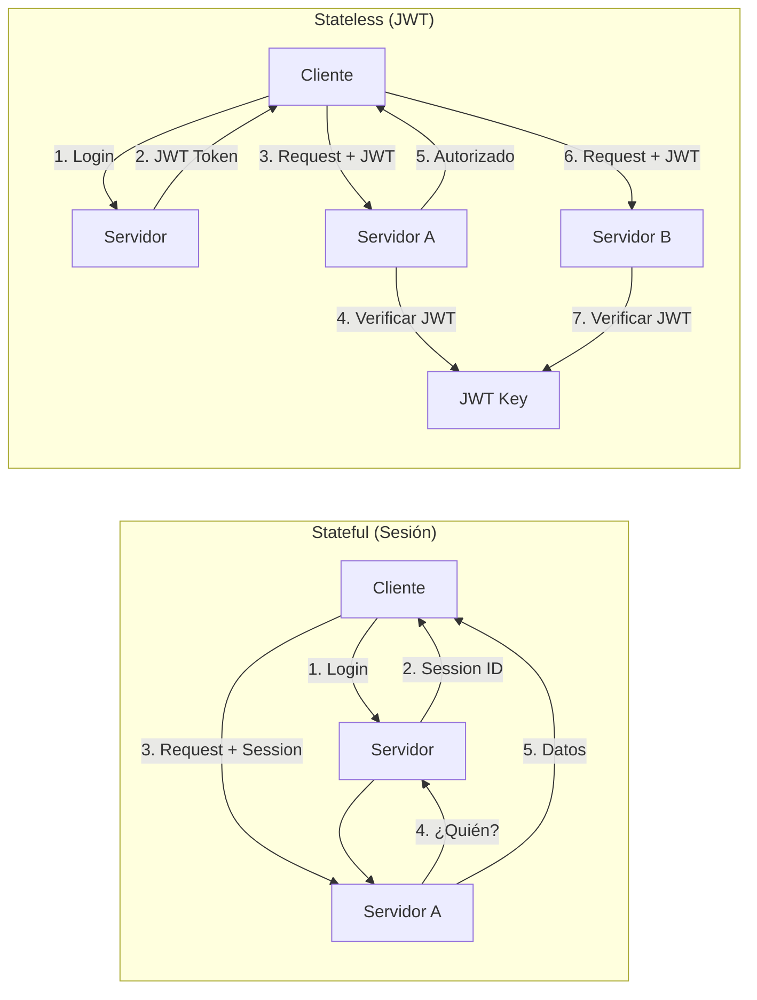

### ¿Por qué Stateless para APIs?

| Aspecto | Stateful | Stateless |
|---------|----------|-----------|
| **Escalabilidad** | Difícil (requiere sticky sessions) | Fácil (cualquier servidor) |
| **Almacenamiento** | Sesiones en servidor | Token en cliente |
| **Rendimiento** | Lookup de sesión | Verificación de firma |
| **Simplicidad** | Gestión de sesiones | JWT auto-contenido |
| **Mobile/API** | Incompatible | Ideal |

---

## 15.2. JWT (JSON Web Token) en Profundidad

### Estructura del JWT

Un JWT está compuesto por tres partes separadas por puntos:

```
HEADER.PAYLOAD.SIGNATURE
```

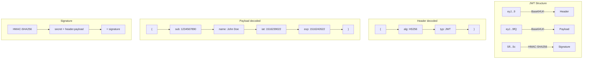

### Header

```json
{
  "alg": "HS256",
  "typ": "JWT"
}
```

| Campo | Descripción |
|-------|-------------|
| `alg` | Algoritmo de firma (HS256, RS256, ES256) |
| `typ` | Tipo de token (siempre "JWT") |

### Payload (Claims)

El payload contiene los **claims** (reclamaciones) sobre la entidad:

```json
{
  "sub": "1234567890",        // Subject (identificador del usuario)
  "name": "John Doe",         // Claim personalizada
  "email": "john@example.com", // Claim personalizada
  "roles": ["Admin", "User"], // Claim de roles
  "iat": 1516239022,          // Issued At (timestamp)
  "exp": 1516242622,          // Expiration Time (timestamp)
  "iss": "TiendaApi",         // Issuer (quién emite)
  "aud": "TiendaApiClients"   // Audience (para quién es)
}
```

#### Claims Registrados (Standard)

| Claim | Significado |
|-------|-------------|
| `sub` | Subject (identificador principal) |
| `iss` | Issuer (quién emite) |
| `aud` | Audience (para quién) |
| `exp` | Expiration Time |
| `nbf` | Not Before |
| `iat` | Issued At |
| `jti` | JWT ID (identificador único) |

### Signature (Firma)

La firma asegura que el token no ha sido modificado:

```csharp
// HS256 (HMAC con SHA-256)
var key = new SymmetricSecurityKey(Encoding.UTF8.GetBytes("secret"));
var creds = new SigningCredentials(key, SecurityAlgorithms.HmacSha256);

var token = new JwtSecurityToken(
        issuer: "TiendaApi",
        audience: "TiendaApiClients",
        claims: userClaims,
        expires: DateTime.UtcNow.AddMinutes(15),
        signingCredentials: creds
    );
```

> **Nota sobre algoritmos de firma:** Nuestro proyecto usa **HS256** (HMAC-SHA256) por su buen balance entre seguridad y rendimiento. La clave JWT de 94 caracteres excede ampliamente el mínimo requerido (32 bytes para HS256, 64 bytes para HS512). Para entornos con requisitos de cumplimiento normativo más estrictos (PCI-DSS, HIPAA), se podría cambiar a **HS512** (HMAC-SHA512) que ofrece fuerza criptográfica superior (2^512 vs 2^256), aunque la diferencia práctica con la tecnología actual es teórica (ambos son computacionalmente imposibles de romper).

---

## 15.3. Enfoque Manual: BCrypt + JWT

### 15.3.1. ¿Por Qué un Método Personalizado?

Nuestro proyecto TiendaDawApi implementa **autenticacion JWT personalizada** en lugar de usar ASP.NET Core Identity. Esto no es un error, sino una **decision arquitectonica deliberada**.

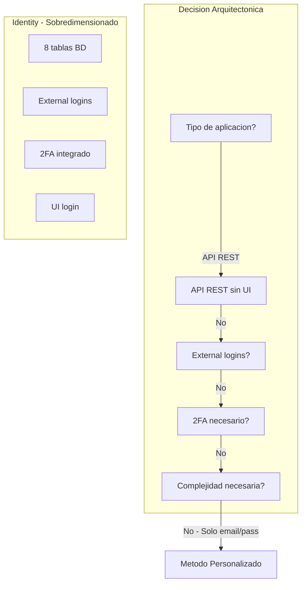

### 15.3.2. BCrypt: Qué Es y Por Qué Lo Usamos

**BCrypt** es un algoritmo de hashing de contraseñas diseñado para ser lento y costoso computacionalmente. Esto lo hace resistente a ataques de fuerza bruta.

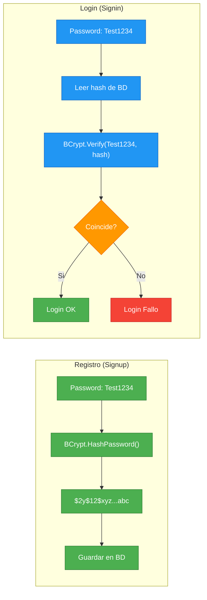

#### Caracteristicas de BCrypt

| Caracteristica | Descripcion |
|----------------|-------------|
| **Work Factor** | Configurable (12 por defecto). Mas alto = mas lento |
| **Salt Automatico** | Cada hash tiene un salt unico |
| **Resistente a Rainbow Tables** | El salt unico hace inutiles las tablas precalculadas |
| **Adaptive** | Puede incrementarse la complejidad con el tiempo |

#### Comparacion de Algoritmos

| Algoritmo | Velocidad | Resistencia | Recomendado |
|-----------|-----------|-------------|-------------|
| **MD5** | Muy rapido | Baja | ❌ No usar |
| **SHA-256** | Rapido | Media | ❌ No para passwords |
| **PBKDF2** | Lento | Buena | ✅ Aceptable |
| **BCrypt** | Muy lento | Excelente | ✅ Recomendado |
| **Argon2** | Muy lento | Excelente | ✅ El mejor |

### 15.3.3. Flujo de Registro (Signup)

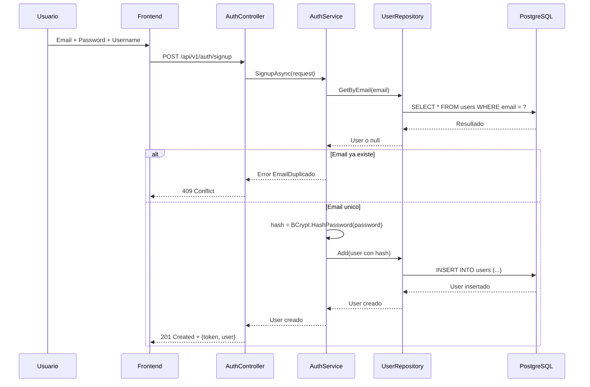

**Pasos del registro:**
1. Usuario envia email, password y username
2. Buscar si el email ya existe en la BD
3. Si existe → error 409
4. Si no existe → hashear password con BCrypt
5. Guardar usuario en la BD
6. Retornar 201 con usuario creado

### 15.3.4. Flujo de Login (Signin)

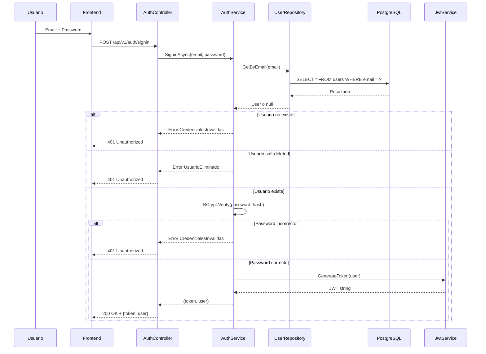

**Pasos del login:**
1. Usuario envia email y password
2. Buscar usuario por email en la BD
3. Si no existe o esta eliminado → error 401
4. Verificar password con BCrypt.Verify()
5. Si es incorrecto → error 401
6. Si es correcto → generar JWT
7. Retornar 200 con token y usuario

### 15.3.5. Flujo de Petición Autorizada

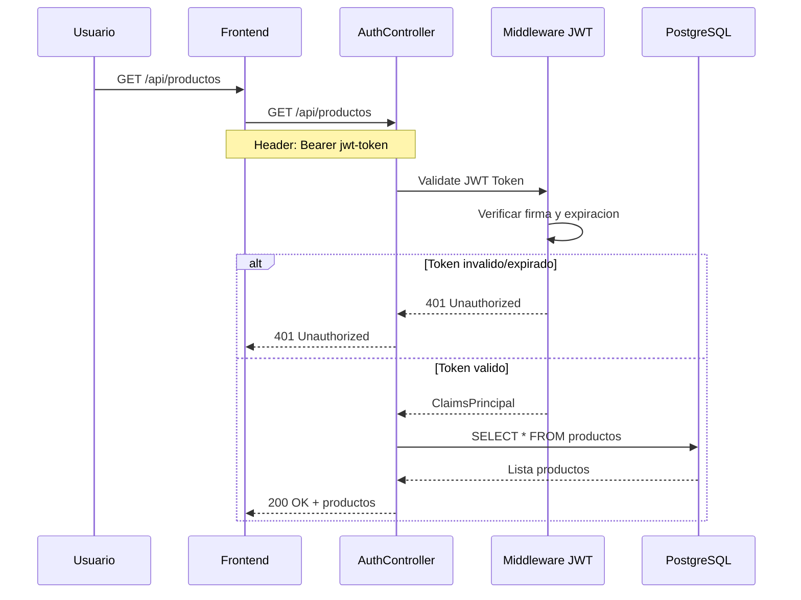

**Pasos de peticion autorizada:**
1. Cliente envia peticion con header Authorization: Bearer token
2. Middleware de JWT extrae y valida el token
3. Si el token es invalido o expirado → 401
4. Si el token es valido → continuar al controller
5. Controller ejecuta la logica y consulta BD
6. Retornar respuesta al cliente

### 15.3.6. Arquitectura de Nuestra Autenticación

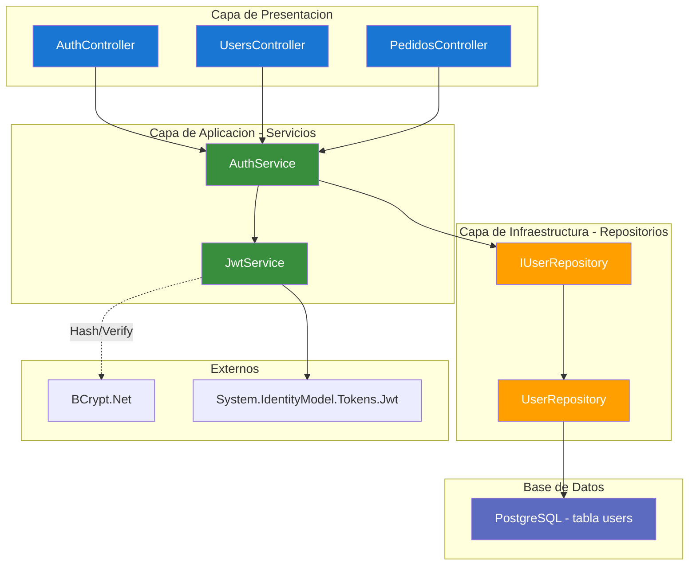

### 15.3.7. Tablas: Identity vs Nuestra Tabla

```mermaid
erDiagram
    %% Identity crea 8 tablas
    subgraph "ASP.NET Core Identity (8 tablas)"
        T1["AspNetUsers"] {
            bigint Id PK
            string UserName
            string Email
            string PasswordHash
            string SecurityStamp
            string ConcurrencyStamp
            boolean EmailConfirmed
            boolean TwoFactorEnabled
            int AccessFailedCount
        }
        T2["AspNetRoles"] {
            bigint Id PK
            string Name
        }
        T3["AspNetUserRoles"] {
            bigint UserId
            bigint RoleId
        }
        T4["AspNetUserClaims"] {
            int Id
            bigint UserId
        }
        T5["AspNetUserLogins"]
        T6["AspNetUserTokens"]
        T7["AspNetRoleClaims"]
    end
    
    %% Nuestra tabla
    subgraph "Nuestro Metodo (1 tabla)"
        U1["users"] {
            bigint Id PK
            string Username
            string Email
            string PasswordHash
            string Avatar
            string Role
            boolean IsDeleted
            timestamp CreatedAt
            timestamp UpdatedAt
        }
    end
    
    style T1 fill:#d32f2f,stroke:#b71c1c,color:#fff
    style T2 fill:#d32f2f,stroke:#b71c1c,color:#fff
    style T3 fill:#d32f2f,stroke:#b71c1c,color:#fff
    style T4 fill:#d32f2f,stroke:#b71c1c,color:#fff
    style T5 fill:#d32f2f,stroke:#b71c1c,color:#fff
    style T6 fill:#d32f2f,stroke:#b71c1c,color:#fff
    style T7 fill:#d32f2f,stroke:#b71c1c,color:#fff
    
    style U1 fill:#2e7d32,stroke:#1b5e20,color:#fff
```

### 15.3.8. Implementación del Método Personalizado

#### 1. Modelo de Usuario Simple

```csharp
// Models/User.cs
public class User : ITimestamped
{
    public long Id { get; set; }
    public string Username { get; set; } = string.Empty;
    public string Email { get; set; } = string.Empty;
    public string PasswordHash { get; set; } = string.Empty;
    public string Role { get; set; } = UserRoles.USER;
    public string? Avatar { get; set; }
    public bool IsDeleted { get; set; }
    public DateTime CreatedAt { get; init; } = DateTime.UtcNow;
    public DateTime UpdatedAt { get; init; } = DateTime.UtcNow;
}

public static class UserRoles
{
    public const string ADMIN = "ADMIN";
    public const string USER = "USER";
}
```

#### 2. Autenticación con BCrypt Directo

```csharp
// Services/AuthService.cs
public class AuthService
{
    private readonly IUserRepository _userRepository;
    
    public async Task<Result<(string token, User user), Error>> SigninAsync(
        string email, string password)
    {
        // Buscar usuario
        var user = await _userRepository.GetByEmailAsync(email);
        if (user == null)
            return Result.Failure<(string, User), Error>(
                Errors.Auth.CredencialesInvalidas);
        
        // Verificar soft-delete
        if (user.IsDeleted)
            return Result.Failure<(string, User), Error>(
                Errors.Auth.UsuarioEliminado);
        
        // BCrypt directo - sin abstracciones
        if (!BCrypt.Net.BCrypt.Verify(password, user.PasswordHash))
            return Result.Failure<(string, User), Error>(
                Errors.Auth.CredencialesInvalidas);
        
        // Generar JWT
        var token = _jwtService.GenerateToken(user);
        
        return Result.Success<(string, User), Error>((token, user));
    }
    
    public async Task<Result<User, Error>> SignupAsync(SignupRequest request)
    {
        // Verificar email único
        var existing = await _userRepository.GetByEmailAsync(request.Email);
        if (existing != null)
            return Result.Failure<User, Error>(
                Errors.Auth.EmailDuplicado);
        
        // Crear usuario con BCrypt hash
        var user = new User
        {
            Username = request.Username,
            Email = request.Email,
            PasswordHash = BCrypt.Net.BCrypt.HashPassword(request.Password),
            Role = UserRoles.USER
        };
        
        await _userRepository.AddAsync(user);
        return user;
    }
}
```

#### 3. Generación de JWT Manual

```csharp
// Services/JwtService.cs
public class JwtService
{
    public string GenerateToken(User user)
    {
        var key = new SymmetricSecurityKey(Encoding.UTF8.GetBytes(_secretKey));
        var creds = new SigningCredentials(key, SecurityAlgorithms.HmacSha256);
        
        var claims = new[]
        {
            new Claim(JwtRegisteredClaimNames.Sub, user.Id.ToString()),
            new Claim(JwtRegisteredClaimNames.Email, user.Email),
            new Claim(ClaimTypes.Role, user.Role),
            new Claim("username", user.Username),
            new Claim("jti", Guid.NewGuid().ToString())
        };
        
        var token = new JwtSecurityToken(
            issuer: _issuer,
            audience: _audience,
            claims: claims,
            expires: DateTime.UtcNow.AddHours(24),
            signingCredentials: creds
        );
        
        return new JwtSecurityTokenHandler().WriteToken(token);
    }
}
```

#### 4. Configuración Ligera

```csharp
// Infrastructures/AuthenticationConfig.cs
public static class AuthenticationConfig
{
    public static IServiceCollection AddAuthentication(
        this IServiceCollection services, 
        IConfiguration configuration)
    {
        var jwtKey = configuration["Jwt:Key"] 
            ?? throw new InvalidOperationException("JWT Key no configurada");

        // ⚠ Educativo: en ESTE proyecto la clave vive en appsettings.json
        // para que "clone y ejecuta" funcione sin configurar nada. En un proyecto
        // real la clave NO se versiona: va en user-secrets
        //   dotnet user-secrets set "Jwt:Key" "<clave>"
        // o en la variable de entorno Jwt__Key - quien lea este archivo puede
        // forjar tokens de cualquier usuario, admin incluido.
        
        // Solo JWT Bearer - sin Identity
        services.AddAuthentication(JwtBearerDefaults.AuthenticationScheme)
        .AddJwtBearer(options =>
        {
            options.TokenValidationParameters = new TokenValidationParameters
            {
                ValidateIssuerSigningKey = true,
                IssuerSigningKey = new SymmetricSecurityKey(
                    Encoding.UTF8.GetBytes(jwtKey)),
                ValidateIssuer = true,
                ValidIssuer = configuration["Jwt:Issuer"] ?? "TiendaApi",
                ValidateAudience = true,
                ValidAudience = configuration["Jwt:Audience"] ?? "TiendaApi",
                ValidateLifetime = true,
                ClockSkew = TimeSpan.Zero
            };
        });
        
        // Políticas de autorización simples
        services.AddAuthorizationBuilder()
            .AddPolicy("RequireAdminRole", 
                policy => policy.RequireRole(UserRoles.ADMIN))
            .AddPolicy("RequireUserRole", 
                policy => policy.RequireRole(UserRoles.USER, UserRoles.ADMIN));
        
        return services;
    }
}
```

### 15.3.9. Errores de Autenticación

> 📁 Código real: `TiendaApi.Api/Errors/Auth/AuthError.cs` + los tipos de error de dominio.

En modo Custom, los errores de autenticación se devuelven con el patrón **Result** (`CSharpFunctionalExtensions`) y cada tipo de error mapea a un código HTTP:

| Error de dominio | HTTP | Cuándo |
|------------------|------|--------|
| `UnauthorizedError` | 401 | Credenciales inválidas (login fallido) |
| `ConflictError` | 409 | Username o email ya registrados |
| `ValidationError` | 400 | Datos de registro/login inválidos (FluentValidation) |
| `BusinessRuleError` | 422 | Regla de negocio incumplida |

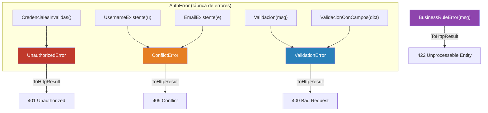

La extensión `ToHttpResult()` (patrón ROP) traduce cada error de dominio a su respuesta HTTP — el controller nunca arma respuestas de error a mano:

```csharp
// El controller es limpio: el Result decide el HTTP
[HttpPost("signin")]
public async Task<ActionResult<AuthResponseDto>> SignIn([FromBody] LoginDto dto)
    => (await _authService.SignInAsync(dto)).ToHttpResult();
```

```csharp
// 📁 TiendaApi.Api/Errors/Auth/AuthError.cs
public static class AuthError
{
    public static UnauthorizedError CredencialesInvalidas() =>
        UnauthorizedError.InvalidCredentials();

    public static ConflictError UsernameExistente(string username) =>
        ConflictError.Duplicate("nombre de usuario", username);

    public static ConflictError EmailExistente(string email) =>
        ConflictError.Duplicate("email", email);

    public static ValidationError Validacion(string mensaje) =>
        ValidationError.Create(mensaje);

    public static ValidationError ValidacionConCampos(Dictionary<string, string[]> errores) =>
        ValidationError.WithFieldErrors(errores);
}
```

🎓 **Detalle importante para el alumno**: en login respondemos **401 con el mismo mensaje** tanto si el usuario no existe como si la contraseña es incorrecta. Si distinguiéramos ambos casos, un atacante podría enumerar usuarios válidos probando emails (user enumeration). *La indistinguibilidad es una medida de seguridad.*

**En modo Identity**, `IdentityAuthService` devuelve exactamente los **mismos errores de dominio**: traduce `IdentityResult.Errors` a `ConflictError` (duplicados) o `BusinessRuleError` (política de password). El cliente no nota la diferencia — solo cambia el algoritmo interno.

### 15.3.10. Resultados Equivalentes

Aunque la implementación es diferente, **conseguimos los mismos objetivos de seguridad**:

| Objetivo | Con Identity | Con Nuestro Método |
|----------|-------------|-------------------|
| **Contraseñas seguras** | ✅ PBKDF2 con salt | ✅ BCrypt con salt |
| **JWT válido** | ✅ Generado por Identity | ✅ Generado manualmente |
| **Roles controlados** | ✅ IdentityRole<T> | ✅ String simple |
| **Protección SQL Injection** | ✅ EF Core parametrizes | ✅ EF Core parametrizes |
| **Soft-delete** | ✅ Configurable | ✅ Implementado manualmente |

> 📌 **¿Manual o Identity?** La tabla completa de decisión está en la sección [15.9 Cuándo Usar Cada Enfoque](#159-cuándo-usar-cada-enfoque). En resumen: APIs simples y educativas → manual; apps con 2FA/lockout/UI → Identity.

#### Conclusión

**Nuestra implementación no es "menos segura" ni "incorrecta".** Es simplemente más adecuada para una API REST sin UI que solo necesita:
- Registro/Login con email y contraseña
- Roles simples (USER/ADMIN)
- JWT para autenticación stateless

Si en el futuro necesitamos external logins o 2FA, podemos migrar a Identity sin perder funcionalidad. Pero para el caso de uso actual, el método personalizado es la elección correcta.

#### Recursos Adicionales

- BCrypt: https://github.com/BcryptNet/bcrypt.net
- JWT: https://jwt.io/
- RFC 7519: https://datatracker.ietf.org/doc/html/rfc7519

### 15.3.11. El Middleware de Autorización Funciona Igual

Una pregunta frecuente es: **"Si no usamos Identity, funciona igual el [Authorize]?"** La respuesta es **SI**. El middleware de autenticacion y autorizacion de ASP.NET Core funciona independientemente de como gestionemos los usuarios.

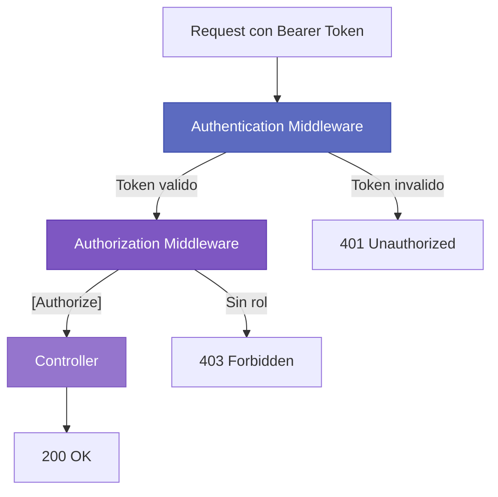

#### Comparacion: Middleware con Identity vs Personalizado

| Aspecto | Con Identity | Personalizado |
|---------|-------------|---------------|
| **Authentication Middleware** | `AddIdentityCookies()` | `AddJwtBearer()` |
| **Authorization Middleware** | `AddAuthorization()` | `AddAuthorization()` (igual) |
| **[Authorize] attribute** | ✅ | ✅ |
| **[Authorize(Roles="Admin")]** | ✅ | ✅ |
| **User.Identity.Name** | ✅ | ✅ |
| **User.IsInRole("ADMIN")** | ✅ | ✅ |

#### Codigo del Middleware (Igual en Ambos Casos)

```csharp
services.AddAuthentication(JwtBearerDefaults.AuthenticationScheme)
    .AddJwtBearer(options =>
    {
        options.TokenValidationParameters = new TokenValidationParameters
        {
            ValidateIssuerSigningKey = true,
            IssuerSigningKey = new SymmetricSecurityKey(
                Encoding.UTF8.GetBytes(configuration["Jwt:Key"])),
            ValidateIssuer = true,
            ValidIssuer = configuration["Jwt:Issuer"],
            ValidateAudience = true,
            ValidAudience = configuration["Jwt:Audience"],
            ValidateLifetime = true,
            ClockSkew = TimeSpan.Zero
        };
    });

services.AddAuthorization();  // EXACTAMENTE IGUAL

[Authorize]  // ✅ Funciona igual
public IActionResult GetAll() { }

[Authorize(Roles = "ADMIN")]  // ✅ Funciona igual
public IActionResult Create(ProductoRequest request) { }
```

#### Lo que Funciona Exactamente Igual

| Funcionabilidad | Identity | Personalizado |
|----------------|----------|---------------|
| `[Authorize]` | ✅ | ✅ |
| `[Authorize(Roles="ADMIN")]` | ✅ | ✅ |
| `User.Identity.IsAuthenticated` | ✅ | ✅ |
| `User.Identity.Name` | ✅ | ✅ |
| `User.IsInRole("ADMIN")` | ✅ | ✅ |

#### Conclusion: El Middleware No Sabe Como Generamos el Token

```
Request --> Authentication Middleware --> Authorization Middleware --> Controller
           Da igual como            Da igual como
           generemos el JWT         configuremos roles
```

**El middleware solo necesita:**
1. Un token JWT valido (lo validamos igual)
2. Claims con los roles necesarios (los ahadimos igual)
3. La configuracion de TokenValidationParameters (igual)

---

## 15.4. Enfoque con Identity: UserManager + PBKDF2

> 📁 En esta sección usamos el **código real del proyecto** (`TiendaApi.Api/Services/Auth/IdentityAuthService.cs`, `Models/User.cs`, `Infrastructures/AuthenticationConfig.cs`). El proyecto lo soporta vía el switch `Auth:Mode = "Identity"` (ver sección 15.8).

### 15.4.1. ¿Qué es ASP.NET Core Identity?

ASP.NET Core Identity es un sistema de membership que permite:
- Registrar/iniciar sesión de usuarios
- Almacenar usuarios en base de datos
- Gestionar passwords (hash, complejidad, lockout)
- Roles y autorización
- Confirmación de email
- Two-Factor Authentication
- External logins (Google, GitHub, etc.)

**Nuestra API usa Identity como opción alternativa**: el mismo endpoint `POST /api/v1/auth/signin` funciona igual, pero internamente la contraseña se verifica con `SignInManager` (PBKDF2) en lugar de `BCrypt.Verify()`.

### 15.4.2. La Entidad User : IdentityUser

Para que Identity funcione, `User` hereda de `IdentityUser<long>`:

```csharp
// 📁 TiendaApi.Api/Models/User.cs
public class User : IdentityUser<long>, ITimestamped
{
    // ── Heredados de IdentityUser<long> (NO redeclarar aquí) ──
    // public long Id              ← ya lo tenemos de IdentityUser<long>
    // public string Email          ← ya lo tenemos de IdentityUser<long>
    // public string PasswordHash   ← ya lo tenemos de IdentityUser<long>
    // public string UserName       ← ya lo tenemos (antes se llamaba Username)

    // ── Nuestros campos personalizados (los mantenemos) ──
    public string? Avatar { get; set; }
    public string Role { get; set; } = UserRoles.USER;
    public bool IsDeleted { get; set; }
    public DateTime CreatedAt { get; init; } = DateTime.UtcNow;
    public DateTime UpdatedAt { get; init; } = DateTime.UtcNow;
}
```

**Tres puntos clave**:

1. **`Username` → `UserName`**: Identity espera `UserName`. El DTO (`RegisterDto`/`LoginDto`) sigue exponiendo `Username` en el JSON — *los DTOs son tu API pública; la entidad es tu asunto interno*.

2. **NO redeclarar `PasswordHash` con `new`**: `UserStore` (genérico) escribe en la propiedad heredada de `IdentityUser`. Si la ocultamos con `new`, EF mapea **nuestra** propiedad y el hash real se pierde → nadie puede hacer login.

3. **`PasswordHash` es nullable**: los usuarios creados por OAuth no tienen contraseña. Por eso quitamos el `IsRequired()` del mapeo en el `DbContext`.

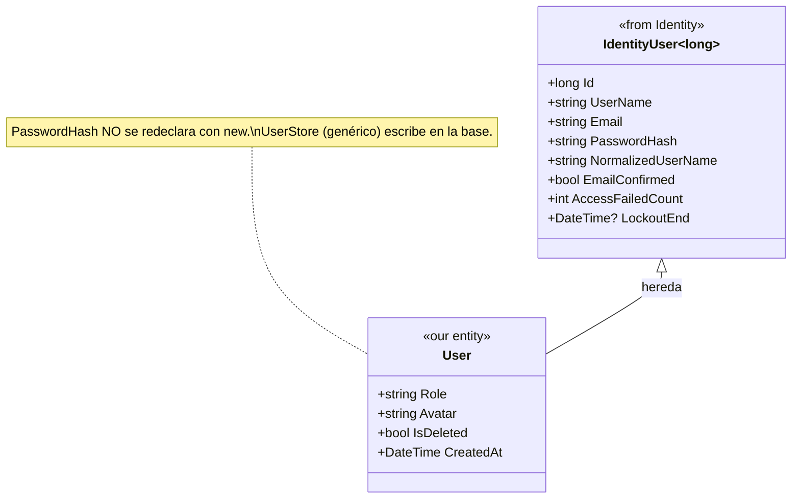

### 15.4.3. TiendaDbContext : IdentityDbContext

```csharp
// 📁 TiendaApi.Api/Data/TiendaDbContext.cs
public class TiendaDbContext : IdentityDbContext<User, IdentityRole<long>, long>
{
    public new DbSet<User> Users { get; set; } = null!;

    protected override void OnModelCreating(ModelBuilder modelBuilder)
    {
        base.OnModelCreating(modelBuilder);   // ⚠️ obligatorio: añade las tablas AspNet

        modelBuilder.Entity<User>(entity =>
        {
            entity.ToTable("users");
            entity.HasKey(u => u.Id);
            entity.Property(u => u.UserName).IsRequired().HasMaxLength(50);
            entity.Property(u => u.Email).IsRequired().HasMaxLength(100);
            entity.Property(u => u.PasswordHash);   // nullable: usuarios OAuth sin password
            entity.Property(u => u.Role).IsRequired().HasMaxLength(20);
            entity.HasIndex(u => u.UserName).IsUnique();
            entity.HasIndex(u => u.Email).IsUnique();
        });
        // ... resto del modelo (Productos, Categorías, Pedidos)
    }
}
```

`base.OnModelCreating(modelBuilder)` añade las tablas de Identity a la migración:

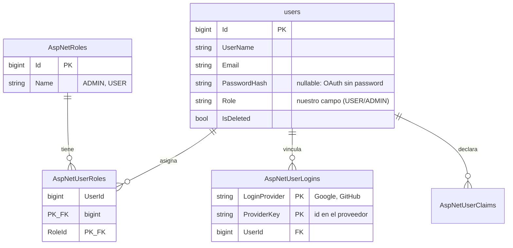

### 15.4.4. IdentityAuthService

Este servicio implementa `IAuthService` (el mismo contrato que `AuthService` del modo Custom) pero delega en `UserManager`/`SignInManager`:

```csharp
// 📁 TiendaApi.Api/Services/Auth/IdentityAuthService.cs
public class IdentityAuthService(
    UserManager<User> userManager,
    SignInManager<User> signInManager,
    IJwtService jwtService,
    ILogger<IdentityAuthService> logger
) : IAuthService
{
    public async Task<Result<AuthResponseDto, DomainError>> SignUpAsync(RegisterDto dto)
    {
        var user = new User
        {
            UserName = dto.Username,
            Email = dto.Email,
            Role = UserRoles.USER
        };

        var result = await userManager.CreateAsync(user, dto.Password!);

        if (!result.Succeeded)
        {
            var errors = string.Join(", ", result.Errors.Select(e => e.Description));

            if (result.Errors.Any(e => e.Code.Contains("Duplicate")))
                return Result.Failure<AuthResponseDto, DomainError>(AuthErrors.EmailExistente(dto.Email!));

            return Result.Failure<AuthResponseDto, DomainError>(new BusinessRuleError(errors));
        }

        return Result.Success<AuthResponseDto, DomainError>(GenerateAuthResponse(user));
    }

    public async Task<Result<AuthResponseDto, DomainError>> SignInAsync(LoginDto dto)
    {
        // Identity permite login por nombre O por email
        var user = await userManager.FindByNameAsync(dto.Username!)
            ?? await userManager.FindByEmailAsync(dto.Username!);

        if (user is null)
            return Result.Failure<AuthResponseDto, DomainError>(AuthErrors.CredencialesInvalidas());

        var result = await signInManager.CheckPasswordSignInAsync(user, dto.Password!, lockoutOnFailure: false);

        if (!result.Succeeded)
            return Result.Failure<AuthResponseDto, DomainError>(AuthErrors.CredencialesInvalidas());

        return Result.Success<AuthResponseDto, DomainError>(GenerateAuthResponse(user));
    }

    // LoginExternalAsync: ver sección 15.7.3

    private AuthResponseDto GenerateAuthResponse(User user)
    {
        var token = jwtService.GenerateToken(user);   // ← el MISMO JWT que modo Custom
        var userDto = new UserDto(
            user.Id, user.UserName ?? "", user.Email ?? "",
            user.Avatar ?? "", user.Role, user.CreatedAt);

        return new AuthResponseDto(token, userDto);
    }
}
```

🎓 **Observación**: `GenerateAuthResponse` es idéntico al de `AuthService`. **El JWT no cambia entre modos** — solo cambia cómo se verificó la contraseña antes de emitirlo.

### 15.4.5. Configuración: AuthenticationConfig en Modo Identity

```csharp
// 📁 TiendaApi.Api/Infrastructures/AuthenticationConfig.cs (resumen)
public static IServiceCollection AddAuthentication(this IServiceCollection services, IConfiguration configuration)
{
    var authMode = configuration["Auth:Mode"] ?? "Custom";

    if (authMode == "Identity")
        return AddIdentityAuthentication(services, configuration);

    return AddCustomAuthentication(services, configuration);
}

private static IServiceCollection AddIdentityAuthentication(IServiceCollection services, IConfiguration configuration)
{
    // 🎓 Mecanismo OFICIAL de Microsoft para APIs sin UI ("Identity without UI"):
    // AddIdentityCore registra UserManager/validadores/lockout SIN registrar el
    // esquema de cookies Identity.Application. Se completa con AddRoles (roles)
    // y AddSignInManager (CheckPasswordSignInAsync).
    services.AddIdentityCore<User>(options =>
    {
        options.Password.RequireDigit = true;
        options.Password.RequireLowercase = true;
        options.Password.RequireUppercase = true;
        options.Password.RequiredLength = 8;
        options.Password.RequireNonAlphanumeric = false;
        options.Lockout.MaxFailedAccessAttempts = 5;
        options.Lockout.DefaultLockoutTimeSpan = TimeSpan.FromMinutes(15);
    })
    .AddRoles<IdentityRole<long>>()
    .AddSignInManager()
    .AddEntityFrameworkStores<TiendaDbContext>()
    .AddDefaultTokenProviders();

    // 🎓 Defensa en profundidad: fijamos el DefaultScheme a Bearer explícitamente
    services.AddAuthentication(options =>
    {
        options.DefaultScheme = JwtBearerDefaults.AuthenticationScheme;
        options.DefaultAuthenticateScheme = JwtBearerDefaults.AuthenticationScheme;
        options.DefaultChallengeScheme = JwtBearerDefaults.AuthenticationScheme;
        options.DefaultForbidScheme = JwtBearerDefaults.AuthenticationScheme;
    });

    services.AddAuthentication(JwtBearerDefaults.AuthenticationScheme)
        .AddJwtBearer(options => { /* ... TokenValidationParameters igual que modo Custom ... */ });

    services.AddScoped<IAuthService, IdentityAuthService>();

    return services;
}
```

> ### AddIdentity o AddIdentityCore al combinar Identity + JWT
>
> ASP.NET Core ofrece dos formas de registrar Identity y la elección importa cuando Identity convive con JWT Bearer en la misma API:
>
> | | `AddIdentity` | `AddIdentityCore` |
> |---|---|---|
> | Orientado a | Aplicaciones con UI de login (cookies) | APIs sin UI |
> | Registra la cookie `Identity.Application` | Sí | No |
> | `SignInManager` | Incluido | Con `.AddSignInManager()` |
> | Roles | Incluidos | Con `.AddRoles<TRole>()` |
>
> **El matiz clave**: `AddIdentity` deja la cookie `Identity.Application` como `DefaultScheme` de autenticación. Los atributos `[Authorize(Roles = ...)]` construyen su política **sin esquemas explícitos** y usan ese DefaultScheme: en una API JWT, el handler de cookies atiende la petición en lugar de validar el Bearer, y responde con un redirect a `/Account/Login` (401). Nótese que el `[Authorize]` plano (sin roles) usa la política por defecto —que sí lleva esquema Bearer— y no padece el problema: por eso la diferencia solo se ve probando los endpoints con rol.
>
> ```mermaid
> flowchart LR
>     R["Request + Bearer JWT"] --> A{"[Authorize(Roles)]"}
>     A -->|sin esquema| D["DefaultScheme"]
>     D -->|"AddIdentity"| C["Cookie → redirect /Account/Login (401)"]
>     D -->|"AddIdentityCore"| B["Bearer → JWT válido → 200"]
> ```
>
> **Para APIs**: usa `AddIdentityCore` (Identity sin UI, el primitivo oficial de Microsoft) y declara además el esquema Bearer **explícitamente** en las políticas (`AuthorizationPolicyBuilder(JwtBearerDefaults.AuthenticationScheme)`) — así la política es autosuficiente ante cualquier cambio de configuración.

### 15.4.6. Flujos: Signup y Signin con Identity

**Registro con Identity:**

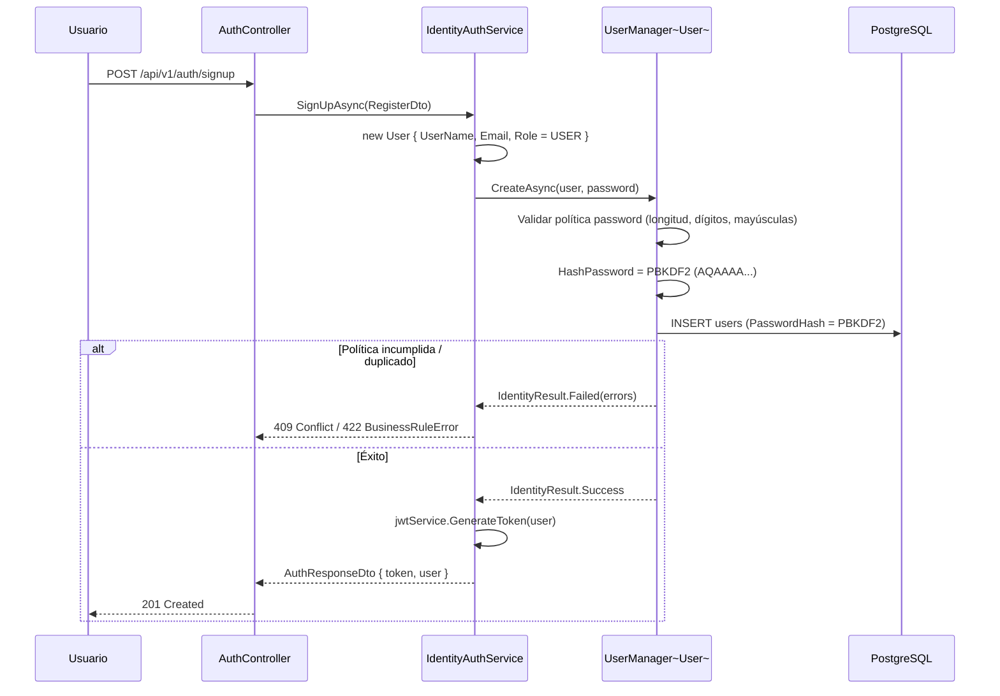

**Login con Identity:**

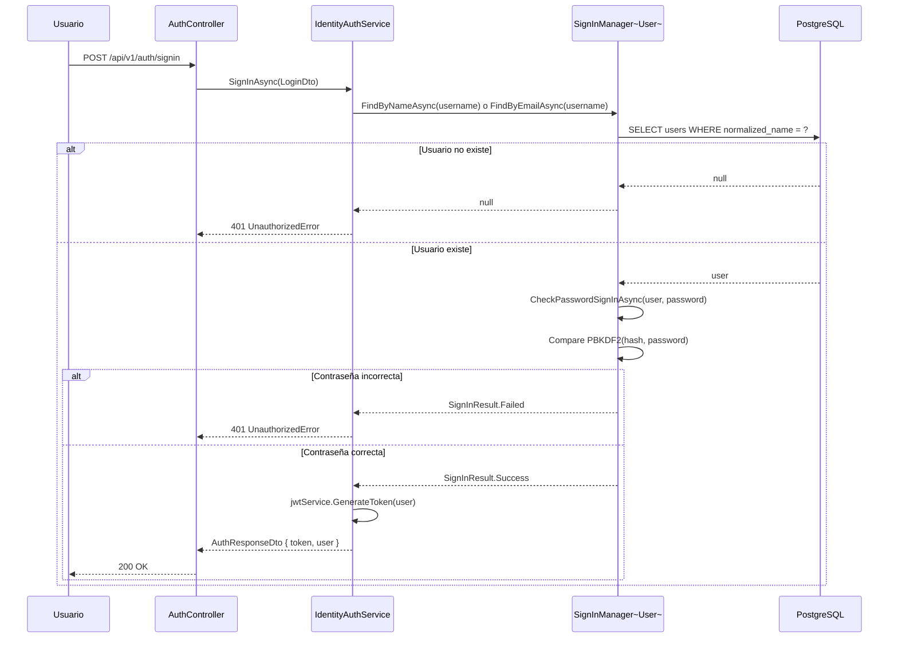

**Petición autorizada: idéntica al modo Custom** — el middleware JWT no sabe cómo se creó el token:

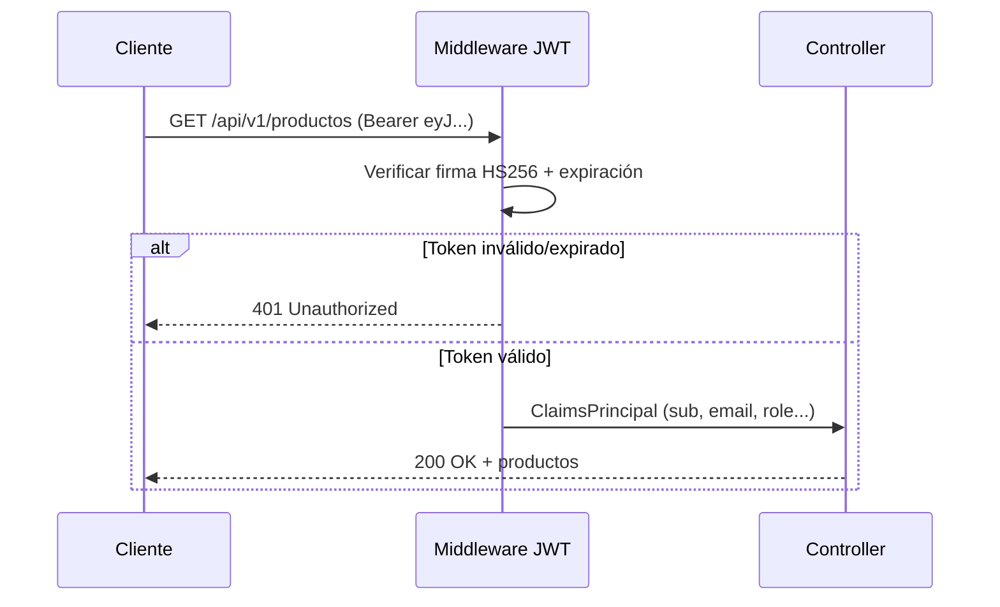

### 15.4.7. Comparativa: Cómo Validan la Contraseña

| Aspecto | Custom (BCrypt) | Identity (UserManager) |
|---------|-----------------|------------------------|
| **Al registrar** | `BCrypt.HashPassword(password)` | `userManager.CreateAsync(user, password)` |
| **Al hacer login** | `BCrypt.Verify(password, user.PasswordHash)` | `signInManager.CheckPasswordSignInAsync(user, password)` |
| **Algoritmo hash** | BCrypt (`$2a$11$...`) | PBKDF2 (`AQAAAAEAACcQ...`) |
| **Validación de contraseña** | Nosotros (FluentValidation) | Identity (longitud, mayúsculas, dígitos...) |
| **Lockout automático** | No | Sí (5 intentos → 15 min) |
| **Login por email** | Lo hacemos nosotros | `FindByNameAsync` + `FindByEmailAsync` |

> ⚠️ **Incompatibilidad de hashes**: un usuario creado en modo Custom (hash BCrypt) **no puede** hacer login en modo Identity (espera PBKDF2) y viceversa. Al cambiar de modo hay que re-hashear las contraseñas o re-sembrar los datos.

### 15.4.8. Opciones de Identity: Política de Contraseñas

La política se configura en `AuthenticationConfig` (ver 15.4.5) y afecta a **todo**: `CreateAsync`, `CheckPasswordSignInAsync` y hasta el seed:

| Opción | Valor en el proyecto | Efecto |
|--------|---------------------|--------|
| `Password.RequiredLength` | 8 | mínimo 8 caracteres (OWASP) |
| `Password.RequireDigit` | true | debe tener al menos un dígito |
| `Password.RequireUppercase` | true | debe tener mayúscula |
| `Password.RequireLowercase` | true | debe tener minúscula |
| `Password.RequireNonAlphanumeric` | false | no exige símbolos (las contraseñas fijas de tests/E2E no los usan todas) |
| `Lockout.MaxFailedAccessAttempts` | 5 | tras 5 fallos... |
| `Lockout.DefaultLockoutTimeSpan` | 15 min | ...bloquea 15 minutos |

🎓 **Consecuencia práctica**: `"admin"` (5 chars, sin dígito ni mayúscula) **no pasa la política**. Por eso las credenciales seed unificadas (`SeedCredentials.cs`) son `admin` / `Admin123!` y `userdaw` / `Userdaw123!` en **ambos modos** — cumplen la política y el modo solo cambia el algoritmo del hash (ver 15.8.4). Los validadores DTO (`RegisterValidator`) reflejan esta misma política para que Custom no acepte contraseñas que Identity rechaza.

---

## 15.5. OAuth 2.0: Conceptos y Arquitectura

> En la Parte II construimos la puerta principal (email + contraseña). Ahora añadimos **puertas alternativas**: login con Google, GitHub o Microsoft. Veremos primero los conceptos y el flujo (15.5), luego nuestra implementación manual (15.6) y por último la versión con Identity (15.7).


### 15.5.1. ¿Qué es OAuth 2.0 y por qué usarlo?

OAuth 2.0 es un **estándar de autorización** que permite a un usuario autenticarse con un proveedor externo (Google, GitHub, Microsoft) sin crear una contraseña nueva en nuestra aplicación.

**¿Qué aporta al proyecto?**

| Beneficio | Explicación |
|-----------|-------------|
| **UX mejorada** | El usuario no necesita crear ni recordar otra contraseña |
| **Registro automático** | Primer login crea la cuenta local sin formulario |
| **Seguridad delegada** | Google/Microsoft gestionan 2FA, detección de phishing, etc. |
| **Educación** | Los alumnos aprenden un estándar real usado en producción |

**¿Qué NO es OAuth 2.0?**

| Confusión común | Aclaración |
|----------------|-----------|
| OAuth ≠ OpenID Connect (OIDC) | OAuth es para autorización; OIDC es para identidad. ASP.NET Core los mezcla en el mismo middleware |
| OAuth ≠ SAML | SAML es XML-based, usado en empresas. OAuth es JSON/REST |
| OAuth ≠ API Key | API Key es estático; OAuth usa tokens temporales con flujo de redirect |


### 15.5.2. Arquitectura: Puertas Múltiples

OAuth 2.0 añade **puertas de login adicionales** al lado de la puerta principal (JWT). El cliente elige cuál usar. La clave es que **todas las puertas convergen en el mismo JWT**:

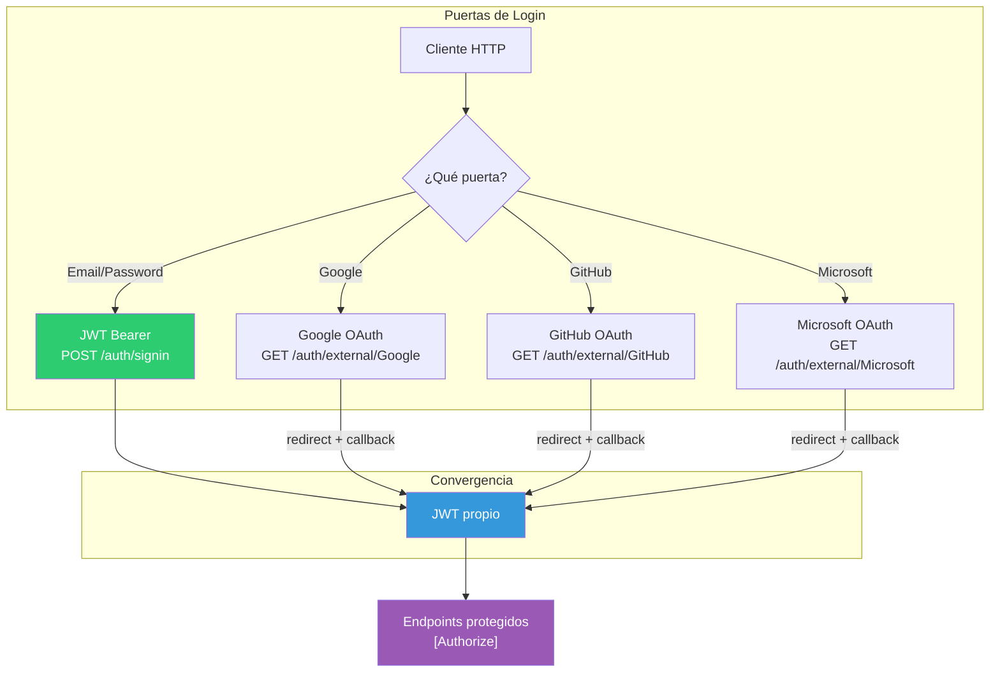

**¿Por qué convergen en el mismo JWT?**

Porque el middleware de autenticación **no sabe cómo se generó el token**. Solo valida:
1. Que el JWT sea firmado correctamente
2. Que tenga los claims necesarios (role, email, etc.)

Da igual si el usuario se logueó con password o con Google — el JWT resultante es **idéntico**.


### 15.5.3. Flujo OAuth Paso a Paso

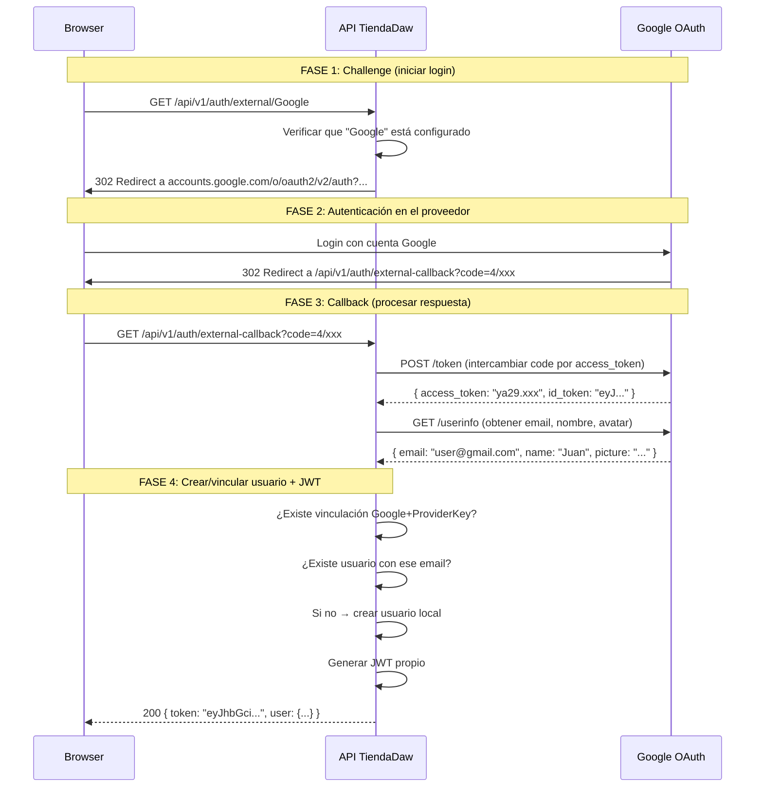


### 15.5.4. Tabla Comparativa de Proveedores

| Característica | Google | GitHub | Microsoft |
|---------------|:------:|:------:|:---------:|
| **Email siempre disponible** | ✅ Sí | ⚠️ Puede ser null | ✅ Sí |
| **Nombre disponible** | ✅ Sí | ✅ Sí | ✅ Sí |
| **Avatar disponible** | ✅ Sí | ✅ Sí | ✅ Sí |
| **PKCE recomendado** | ✅ Sí | No necesario | No necesario |
| **Paquete NuGet** | En caja SDK | Comunidad | En caja SDK |
| **Facilidad de setup** | Media (OAuth consent screen) | Fácil (5 min) | Media (entra.microsoft.com) |
| **Ideal para** | Todos los usuarios | Desarrolladores | Entornos educativos/corporativos |


## 15.6. OAuth Manual: Nuestra Implementación

> 📁 **Código real del proyecto**: `OAuthConfig.cs` (registro condicional de proveedores), `AuthController.ExternalLogin/ExternalLoginCallback` (challenge + callback), `Models/UserLogin.cs` + `UserLoginRepository` (vinculaciones) y `AuthService.LoginExternalAsync` (vincula por email con dummy hash). En modo Identity, el callback usa `IdentityAuthService.LoginExternalAsync` (sección 15.7).


### 15.6.1. Configuración Condicional (OAuthConfig.cs)


```csharp
// Solo se registra el esquema si Auth:{Proveedor}:Enabled = true
// Con la puerta cerrada, la app ni siquiera conoce al proveedor
if (configuration.GetValue<bool>("Auth:Google:Enabled"))
{
    auth.AddGoogle(options =>
    {
        options.ClientId = configuration["Google:ClientId"]
            ?? throw new InvalidOperationException("Google:ClientId no configurado");
        options.ClientSecret = configuration["Google:ClientSecret"]
            ?? throw new InvalidOperationException("Google:ClientSecret no configurado");
        options.UsePkce = true;  // Protección adicional aunque sea app web
    });
}
```

**¿Por qué condicional?** En producción quizás solo quieras Google. En desarrollo quizás los tres. La configuración decide, no el código.

### 15.6.2. Modelo de Datos: UserLogin

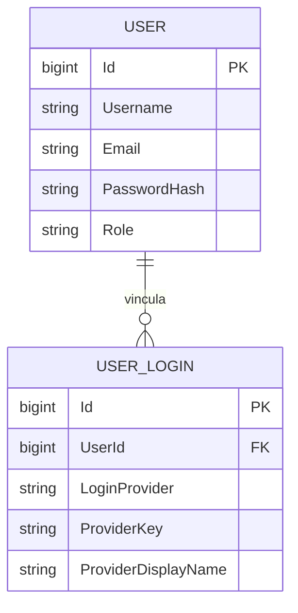

**¿Por qué una tabla separada?** Un usuario puede tener múltiples logins externos (Google + GitHub). La unicidad es `(LoginProvider, ProviderKey)` — un proveedor externo solo puede estar vinculado a un usuario local.

### 15.6.3. Lógica de LoginExternalAsync

```csharp
public async Task<Result<AuthResponseDto, DomainError>> LoginExternalAsync(
    ExternalLoginDto info)
{
    // 1. ¿Ya existe vinculación? → Buscar usuario directamente
    var userLogin = await userLoginRepository.FindByProviderAsync(
        info.LoginProvider, info.ProviderKey);

    // 2. ¿Existe usuario con ese email? → Vincular (no duplicar)
    if (user is null)
        user = await userRepository.FindByEmailAsync(info.Email);

    // 3. Primera vez → Crear cuenta local sin contraseña real
    if (user is null)
    {
        user = new User
        {
            Email = info.Email,
            PasswordHash = $"OAUTH-{info.LoginProvider}", // Dummy hash
            Role = "USER"
        };
        await userRepository.SaveAsync(user);
    }

    // 4. Vincular login externo
    await userLoginRepository.SaveAsync(new UserLogin { ... });

    // 5. Generar JWT propio (mismo flujo que login normal)
    return Result.Success(GenerateAuthResponse(user));
}
```

**¿Por qué dummy hash?** El campo `PasswordHash` es obligatorio (60 chars de BCrypt). Un usuario OAuth no tiene password, pero el campo no puede ser null. Con `"OAUTH-Google"` el login normal fallará (BCrypt no valida), pero no hay `NullReferenceException`.

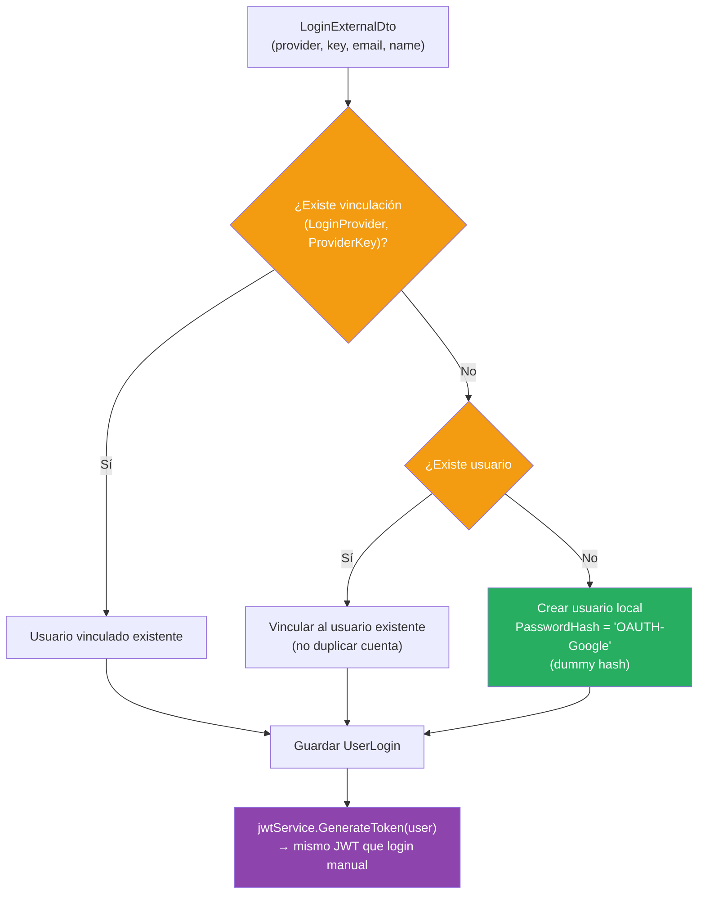

**Las tres ramas convergen en el mismo JWT** — el cliente no distingue si se autenticó con password o con Google.


#### La entidad UserLogin

```csharp
public class UserLogin
{
    public long Id { get; set; }
    public long UserId { get; set; }          // FK a User local
    public string LoginProvider { get; set; }  // "Google", "GitHub", "Microsoft"
    public string ProviderKey { get; set; }    // ID único en el proveedor
    public string? ProviderDisplayName { get; set; }
}
```


### 15.6.4. Configuración Completa Paso a Paso

#### Paso 1: Crear apps en los proveedores

| Proveedor | Dónde | URL de callback |
|-----------|-------|-----------------|
| **Google** | console.cloud.google.com → APIs & Services → Credentials | `http://localhost:5031/api/v1/auth/external-callback` |
| **GitHub** | github.com → Settings → Developer settings → OAuth Apps | `http://localhost:5031/api/v1/auth/external-callback` |
| **Microsoft** | entra.microsoft.com → App registrations | `http://localhost:5031/api/v1/auth/external-callback` |

#### Paso 2: Configurar user-secrets

```bash
cd TiendaApi.Api

# Google
dotnet user-secrets set "Google:ClientId" "xxxx.apps.googleusercontent.com"
dotnet user-secrets set "Google:ClientSecret" "GOCSPX-xxxx"

# GitHub
dotnet user-secrets set "GitHub:ClientId" "Iv1.xxxx"
dotnet user-secrets set "GitHub:ClientSecret" "xxxx"

# Microsoft
dotnet user-secrets set "Microsoft:ClientId" "xxxx"
dotnet user-secrets set "Microsoft:ClientSecret" "xxxx"
```

#### Paso 3: Activar proveedores

**appsettings.json** (producción — todo apagado):
```json
{
  "Auth": {
    "Google":    { "Enabled": false },
    "GitHub":    { "Enabled": false },
    "Microsoft": { "Enabled": false }
  }
}
```

**appsettings.Development.json** (desarrollo — todo activo):
```json
{
  "Auth": {
    "Google":    { "Enabled": true },
    "GitHub":    { "Enabled": true },
    "Microsoft": { "Enabled": true }
  }
}
```

#### Paso 4: Probar

```bash
# Abrir en navegador (no en Swagger — necesita redirect)
http://localhost:5031/api/v1/auth/external/Google
```


### 15.6.5. Puntos Clave para el Alumno

| Concepto | Explicación |
|----------|-------------|
| **No rompe JWT** | OAuth añade esquemas, no modifica el default scheme |
| **Dummy hash** | `"OAUTH-Google"` en PasswordHash — login normal falla sin crash |
| **Vinculación por email** | Si el email ya existe, se vincula en vez de crear duplicado |
| **Configuración condicional** | Solo se registra si `Auth:{Provider}:Enabled = true` |
| **GitHub sin email** | Si el perfil es privado, GitHub no devuelve email → error controlado |
| **PKCE** | Protección contra interceptación del code OAuth (recomendado en Google) |
| **ExternalLoginDto** | Nuestro DTO propio, sin depender de ASP.NET Core Identity |


## 15.7. OAuth con Identity: ExternalLoginInfo

> 📁 La API implementa el OAuth con Identity en `IdentityAuthService.LoginExternalAsync` (activo con `Auth:Mode = "Identity"`). La Web (TiendaDawWeb) usa Identity nativamente con cookies: `SignInManager.GetExternalLoginInfoAsync()` + `SignInManager.ExternalLoginSignInAsync()`.

### 15.7.1. El Mismo Middleware OAuth, Otra Vinculación

La parte "puerta" de OAuth (challenge/callback con Google, GitHub, Microsoft) **es idéntica en ambos modos**: el middleware OAuth de ASP.NET Core no sabe nada de Identity ni de nuestro BCrypt. Lo único que cambia es **qué pasa en el callback** cuando llegan los datos del proveedor:

```mermaid
flowchart TB
    subgraph "Idéntico en ambos modos"
        B[Browser] -->|GET /auth/external/Google| MW[Middleware OAuth<br/>challenge + callback]
        MW -->|code| P[Proveedor]
        P -->|claims: email, name, provider key| MW
    end

    MW --> J{¿Auth:Mode?}

    J -->|Custom| M1["Nuestro código:<br/>1. Buscar UserLogin por (provider, key)<br/>2. Si no, buscar usuario por email<br/>3. Si no, crear usuario dummy hash<br/>4. Vincular en tabla user_logins"]
    J -->|Identity| M2["Identity:<br/>1. GetExternalLoginInfoAsync()<br/>2. SignInManager.ExternalLoginSignInAsync()<br/>3. UserManager.AddLoginAsync()"]

    M1 --> T[JWT propio]
    M2 --> T

    T --> API["Endpoints protegidos<br/>[Authorize]"]

    style MW fill:#3498db,color:#fff
    style M1 fill:#2ecc71,color:#fff
    style M2 fill:#e67e22,color:#fff
    style T fill:#9b59b6,color:#fff
```

### 15.7.2. Tabla AspNetUserLogins : IdentityUserLogin

Identity trae su propia tabla de vinculaciones — `AspNetUserLogins` — mapeada a `IdentityUserLogin<TKey>`:

```mermaid
erDiagram
    users ||--o{ AspNetUserLogins : "vincula"

    users {
        bigint Id PK
        string UserName
        string Email
        string PasswordHash "nullable si el usuario es OAuth puro"
    }

    AspNetUserLogins {
        string LoginProvider PK "Google, GitHub, Microsoft"
        string ProviderKey PK "sub / id del proveedor"
        bigint UserId FK "→ users.Id"
        string ProviderDisplayName
    }
```

| Aspecto | OAuth Manual (15.6) | OAuth con Identity |
|---------|---------------------|--------------------|
| **Tabla** | `user_logins` (nuestra, con `Id` propio) | `AspNetUserLogins` (PK compuesta provider+key) |
| **Entidad** | `UserLogin` (nuestra) | `IdentityUserLogin<long>` (de Identity) |
| **Búsqueda de vinculación** | `userLoginRepository.FindByProviderAsync(...)` | `userManager.GetLoginsAsync(user)` / `FindLoginAsync(...)` |
| **Usuario duplicado** | Lo evitamos nosotros | `userManager.FindByEmailAsync(...)` |

> 🎓 Ambas tablas resuelven el mismo problema con la misma unicidad: **`(LoginProvider, ProviderKey)`**. Un proveedor externo solo puede estar vinculado a un usuario local.

### 15.7.3. LoginExternalAsync con Identity

```csharp
// 📁 TiendaApi.Api/Services/Auth/IdentityAuthService.cs
public async Task<Result<AuthResponseDto, DomainError>> LoginExternalAsync(ExternalLoginDto info)
{
    // 1. Sin email no podemos mapear a usuario local
    if (string.IsNullOrWhiteSpace(info.Email))
        return Result.Failure<AuthResponseDto, DomainError>(
            new BusinessRuleError("El proveedor no devolvió email"));

    // 2. ¿Existe usuario con ese email? (vinculación, no duplicado)
    var user = await userManager.FindByEmailAsync(info.Email);

    // 3. Primera vez → crear cuenta local (sin contraseña real)
    if (user is null)
    {
        user = new User
        {
            UserName = info.Email,      // Identity requiere UserName
            Email = info.Email,
            Nombre = info.Name ?? "",
            Role = UserRoles.USER
        };
        await userManager.CreateAsync(user);   // sin password → PasswordHash = null
    }

    // 4. Vincular login externo en AspNetUserLogins (si no lo estaba)
    var loginInfo = new UserLoginInfo(info.LoginProvider, info.ProviderKey, info.LoginProvider);
    var existingLogins = await userManager.GetLoginsAsync(user);
    if (!existingLogins.Any(l => l.LoginProvider == info.LoginProvider))
    {
        await userManager.AddLoginAsync(user, loginInfo);
    }

    // 5. Generar JWT propio (mismo flujo que login normal)
    return Result.Success<AuthResponseDto, DomainError>(GenerateAuthResponse(user));
}
```

**Diferencias respecto al OAuth manual (15.6.3)**:

| Paso | Manual | Con Identity |
|------|--------|--------------|
| Buscar vinculación | Repositorio propio `FindByProviderAsync` | `userManager.GetLoginsAsync(user)` |
| Usuario sin password | `PasswordHash = "OAUTH-Google"` (dummy hash) | `PasswordHash = null` (nullable en Identity) |
| Vincular | `userLoginRepository.SaveAsync(new UserLogin{...})` | `userManager.AddLoginAsync(user, new UserLoginInfo(...))` |
| JWT final | `jwtService.GenerateToken(user)` | **igual** |

> 📚 En la Web (Razor/Blazor con cookies), Identity va un paso más allá: `SignInManager.ExternalLoginSignInAsync()` crea la sesión con cookie directamente. En la API JWT no usamos SignInManager para la sesión — solo para verificar contraseñas — porque **la sesión es el token, no la cookie**.

### 15.7.4. Flujo Completo OAuth + Identity

```mermaid
sequenceDiagram
    participant B as Browser
    participant API as API (Auth:Mode=Identity)
    participant G as Google OAuth
    participant DB as PostgreSQL

    Note over B,G: FASE 1: Challenge
    B->>API: GET /api/v1/auth/external/Google
    API->>API: OAuthConfig: ¿Google:Enabled? → AddGoogle
    API-->>B: 302 Redirect a accounts.google.com

    Note over B,G: FASE 2: Autenticación en el proveedor
    B->>G: Login con cuenta Google
    G-->>B: 302 Redirect a /external-callback?code=4/xxx

    Note over B,DB: FASE 3: Callback con Identity
    B->>API: GET /external-callback?code=4/xxx
    API->>G: Intercambiar code por tokens
    G-->>API: { id_token, access_token }
    API->>API: Middleware OAuth extrae claims (email, name, sub)

    Note over API,DB: FASE 4: IdentityAuthService.LoginExternalAsync
    API->>DB: FindByEmailAsync(email)
    alt Usuario nuevo
        DB-->>API: null
        API->>DB: CreateAsync(user sin password → hash null)
        API->>DB: AddLoginAsync(user, UserLoginInfo(Google, sub))
    else Usuario existente
        DB-->>API: user
        API->>DB: GetLoginsAsync(user) → ¿ya vinculado?
        API->>DB: AddLoginAsync solo si no existía
    end

    API->>API: jwtService.GenerateToken(user)  ← MISMO JWT
    API-->>B: 200 { token: "eyJhbGci...", user: {...} }
```

### 15.7.5. Comparativa: OAuth Manual vs OAuth con Identity

| Criterio | OAuth Manual (15.6) | OAuth con Identity (15.7) |
|----------|---------------------|---------------------------|
| **Código necesario** | Repositorio propio + lógica | `UserManager` hace el trabajo |
| **Tabla de vinculaciones** | Nuestra `user_logins` | `AspNetUserLogins` |
| **Usuario sin password** | Dummy hash `"OAUTH-Google"` | `PasswordHash = null` |
| **Para la API** | Tan válido como Identity | Ligeramente más limpio |
| **Para la Web (cookies)** | Habría que inventar la sesión | `SignInManager.ExternalLoginSignInAsync()` listo |
| **Dependencia** | Ninguna extra | Requiere `Auth:Mode = Identity` |

**Conclusión**: para una API JWT, ambos son igual de correctos. La diferencia real aparece en **apps con UI**: ahí Identity aporta la sesión con cookies, 2FA y password reset sin escribir código nuevo.

---

## 15.8. Auth:Mode — Los Cuatro Caminos en el Mismo Proyecto

> 🎓 **Actualización**: ya no hay que elegir. La API soporta **ambos enfoques** con un switch de configuración: `Auth:Mode`.

### 15.8.1. El Problema que Resuelve

La sección 15.3.1 explicó por qué el proyecto nació sin Identity. Pero en clase también queremos **enseñar Identity**. ¿Cómo tener ambos sin duplicar el proyecto?

**Solución**: un switch en configuración que selecciona qué servicio de autenticación se registra:

```json
{
  "Auth": {
    "Mode": "Custom"   // "Custom" (BCrypt) o "Identity" (UserManager)
  }
}
```

### 15.8.2. Arquitectura: El Patrón Strategy Detrás del Switch

Ambos servicios implementan la misma interfaz `IAuthService`:

```mermaid
classDiagram
    class IAuthService {
        <<interface>>
        +SignUpAsync(RegisterDto) Result~AuthResponseDto~
        +SignInAsync(LoginDto) Result~AuthResponseDto~
        +LoginExternalAsync(ExternalLoginDto) Result~AuthResponseDto~
    }
    class AuthService {
        -BCrypt.HashPassword()
        -BCrypt.Verify()
    }
    class IdentityAuthService {
        -UserManager~User~
        -SignInManager~User~
    }
    IAuthService <|.. AuthService : AuthMode Custom
    IAuthService <|.. IdentityAuthService : AuthMode Identity
    AuthService --> BCryptNet : usa
    IdentityAuthService --> Identity : usa
```

El **patrón clave**: el código que consume `IAuthService` (el controller, el OAuth handler) **no sabe ni le importa** qué modo está activo. Solo recibe un `Result<AuthResponseDto, DomainError>`.

### 15.8.3. El Switch en AuthenticationConfig

`AuthenticationConfig.AddAuthentication()` lee `Auth:Mode` y registra un servicio u otro. Este es el **único punto de decisión** de toda la autenticación — ocurre una vez, al arrancar:

```mermaid
flowchart TB
    START["Program.cs arranca"] --> CFG["Configuration['Auth:Mode']"]
    CFG --> SW{"¿Modo?"}

    SW -->|"Identity"| ID["AddIdentityAuthentication()<br/>• AddIdentity&lt;User, IdentityRole&gt;<br/>• AddEntityFrameworkStores<br/>• AddJwtBearer (mismo que Custom)<br/>• IAuthService → IdentityAuthService"]
    SW -->|"Custom (default)"| CU["AddCustomAuthentication()<br/>• AddJwtBearer<br/>• IAuthService → AuthService"]

    ID --> PIPE["Mismo pipeline:<br/>UseAuthentication() → UseAuthorization()<br/>Mismas políticas: RequireAdminRole, AdminOnly"]
    CU --> PIPE

    PIPE --> EP["Mismos endpoints:<br/>POST /api/v1/auth/signup<br/>POST /api/v1/auth/signin"]
    EP --> JWT["Mismo JWT Bearer<br/>[Authorize] no nota la diferencia"]

    style SW fill:#f39c12,color:#fff
    style ID fill:#e67e22,color:#fff
    style CU fill:#27ae60,color:#fff
    style JWT fill:#8e44ad,color:#fff
```

```csharp
public static IServiceCollection AddAuthentication(this IServiceCollection services, IConfiguration configuration)
{
    var authMode = configuration["Auth:Mode"] ?? "Custom";

    if (authMode == "Identity")
    {
        return AddIdentityAuthentication(services, configuration);  // IdentityAuthService
    }

    return AddCustomAuthentication(services, configuration);        // AuthService (BCrypt)
}
```

Ambos caminos registran **exactamente lo mismo** para el middleware:

- `AddAuthentication(JwtBearerDefaults.AuthenticationScheme)` — el middleware JWT
- `AddAuthorizationBuilder()` — políticas `RequireAdminRole`, `RequireUserRole`, `AdminOnly`

**La única diferencia** es la línea de registro:

| Modo | Registro |
|------|----------|
| Custom | `services.AddScoped<IAuthService, AuthService>()` |
| Identity | `services.AddIdentity<User, IdentityRole<long>>(...).AddEntityFrameworkStores<TiendaDbContext>()` + `services.AddScoped<IAuthService, IdentityAuthService>()` |

### 15.8.4. El Seed Condicional

`SqlSeeder` lee `Auth:Mode` para crear los usuarios con el algoritmo correcto:

```mermaid
flowchart TD
    A[SqlSeeder.SeedAsync] --> B{Auth:Mode?}
    B -->|Custom| C[Crear User con<br/>PasswordHash = BCrypt de SeedCredentials]
    B -->|Identity| D[Crear User con<br/>userManager.CreateAsync user, password]
    C --> E[✅ Login funciona]
    D --> F[✅ Login funciona]
```

En modo Identity, el seeder usa `IServiceScopeFactory` para resolver `UserManager<User>` (porque el seeder está en un scope diferente al del request).

> ✅ **Credenciales unificadas**: AMBOS modos usan las mismas credenciales (`SeedCredentials.cs`: `admin`/`Admin123!` y `userdaw`/`Userdaw123!`). El modo solo cambia el algoritmo del hash (BCrypt vs PBKDF2), nunca quién puede entrar — así las suites E2E pasan igual en los dos modos.

> 🔧 **Bug que enseñamos en clase**: al principio declarábamos `public new string PasswordHash` en `User` para darle un default. ¡Error! `UserStore` (genérico de Identity) escribe en la propiedad heredada de `IdentityUser`, mientras EF mapeaba **nuestra** propiedad oculta → el hash real se perdía en una propiedad fantasma y nadie podía hacer login. Lección: **no ocultes propiedades de una clase base que un framework genérico escribe por ti**. En su lugar, `PasswordHash` es nullable (los usuarios OAuth no tienen contraseña) y quitamos el `IsRequired()` del mapeo.

### 15.8.5. Puntos Clave para el Alumno

1. **El patrón Strategy**: dos implementaciones de una interfaz, seleccionadas en tiempo de arranque por configuración. Es el mismo principio detrás de `IPaymentService`, `IEmailService`, etc.

2. **El middleware JWT no cambia**: tanto Custom como Identity producen un JWT Bearer. El middleware solo valida el token; no sabe cómo se creó la sesión.

3. **Identity no es mala** — es una herramienta con un coste (más tablas, más abstracción) y un beneficio (features de auth listas). Elegir es un **trade-off**, no una religión.

4. **El DTO protege el contrato externo**: renombrar `Username` → `UserName` en la entidad no rompió ningún cliente porque el DTO sigue exponiendo `Username`. *Los DTOs son tu API pública; la entidad es tu asunto interno.*

### 15.8.6. Estrategia de Testing del Auth:Mode

Los tests del switch viven en tres archivos (27 tests):

| Archivo | Qué prueba | Técnica |
|---------|-----------|---------|
| `IdentityAuthServiceTests` | SignUp/SignIn/LoginExternal en modo Identity | Identity **real** + EF InMemory; solo `IJwtService` mockeado |
| `AuthenticationConfigTests` | El switch selecciona el servicio correcto | Inspección de `ServiceCollection` (descriptores) |
| `SqlSeederTests` | Seed BCrypt vs PBKDF2 según el modo | Contenedor DI mínimo + `CheckPasswordAsync` real |

🎓 **Por qué Identity real en vez de mocks**: `SignInManager` tiene un constructor que Moq no puede proxyar en .NET 10, y — más importante — probar con mocks solo verificaría que *nuestro mock* devuelve true. Con Identity real validamos que la contraseña se verifica con el algoritmo correcto (PBKDF2) y que un hash BCrypt **no** pasa por `UserManager`.

**Tests de regresión clave**:

- `SeedAsync_ModoIdentity_NoDebeSembrarUsuariosConHashBcrypt` — caza el error de reutilizar los hashes hardcoded en modo Identity
- `SignUpAsync_ConDatosValidos_DebeGuardarHashPbkdf2NoBcrypt` — el hash guardado empieza por `AQAAAA` (PBKDF2), nunca `$2a$` (BCrypt)
- `LoginExternalAsync_UsuarioCreadoPorOAuth_NoDebePoderLoginConPassword` — un usuario OAuth no tiene contraseña

**Ver también**: [OAuth 2.0 Externo](16-oauth2-external-login.md)

## 15.9. Cuándo Usar Cada Enfoque

El proyecto enseña **cuatro combinaciones posibles**. Todas producen el mismo JWT Bearer:

```mermaid
flowchart TB
    subgraph "Parte II: Usuario + Contraseña"
        A1[" Manual<br/>BCrypt + JWT<br/>15.3"] --> J[JWT Bearer]
        A2[" Identity<br/>UserManager + PBKDF2<br/>15.4"] --> J
    end
    subgraph "Parte III: OAuth 2.0"
        B1[" Manual<br/>OAuthConfig + user_logins<br/>15.6"] --> J
        B2[" Identity<br/>OAuth + AspNetUserLogins<br/>15.7"] --> J
    end

    J --> M["Middleware JWT<br/>[Authorize] — IGUAL en los 4 casos"]

    style A1 fill:#2ecc71,color:#fff
    style A2 fill:#e67e22,color:#fff
    style B1 fill:#3498db,color:#fff
    style B2 fill:#9b59b6,color:#fff
    style J fill:#16a085,color:#fff
    style M fill:#7f8c8d,color:#fff
```

### ¿Qué aporta cada uno?

| Enfoque | Aporta | Coste |
|---------|--------|-------|
| **Manual + BCrypt (15.3)** | Control total, enseña el flujo desde cero | Te encargas de todo (validación, lockout...) |
| **Identity + PBKDF2 (15.4)** | Lockout, política de passwords, tablas estándar | 7 tablas AspNet, hashes no compatibles con BCrypt |
| **OAuth manual (15.6)** | Login externo sin depender de Identity | Tabla propia + vinculación manual |
| **OAuth + Identity (15.7)** | `GetLoginsAsync`/`AddLoginAsync` listos | Requiere `Auth:Mode = Identity` |

### Tabla de decisiones

| Escenario | Recomendación | Razón |
|-----------|---------------|-------|
| **API educativa / demo** | Manual (Custom) | Enseña BCrypt y el flujo completo |
| **API REST simple en producción** | Manual (Custom) | Ligero, control total, menos tablas |
| **App con 2FA, lockout, password reset** | Identity | Identity ya lo trae todo |
| **Equipo que conoce Identity** | Identity | Estándar de la industria |
| **Razor Pages / Blazor Server (Web)** | Identity + Cookies | UI de login + `SignInManager` (así lo hace la Web de la tienda) |
| **SPA + API backend** | Manual en la API | JWT es natural para SPAs |
| **Migrar sistema existente con Identity** | Identity | No arrastrar conversión de hashes |
| **API con login externo y poca base** | OAuth manual | Sin tablas AspNet |

### Regla general

- **¿Tiene UI de login?** → Identity (cookies + SignInManager).
- **¿Es solo API + necesitas enseñar/entender los fundamentos?** → Manual.
- **¿Necesitas features de auth "de serie" (2FA, lockout, reset)?** → Identity.
- **¿Dudas?** → Empieza manual (aprenderás más) y cambia a Identity con `Auth:Mode` cuando lo necesites — el switch existe precisamente para eso.

---

## 15.10. Resumen y Buenas Prácticas

### Puntos Clave del Módulo

| Concepto | Descripción |
|----------|-------------|
| **Stateless** | Cada request contiene toda la información de autenticación |
| **JWT** | Token autocontenido con claims firmados cryptográficamente |
| **Identity** | Framework completo de gestión de usuarios |
| **Access Token** | Token corto (15-30 min) para acceso a APIs |
| **Refresh Token** | Token largo (7-30 días) para renovar access tokens |

### Flujo de Autenticación Completo

```mermaid
sequenceDiagram
    participant U as Cliente
    participant A as Auth API
    participant DB as PostgreSQL
    participant J as JWT Service
    
    U->>A: POST /auth/login {email, password}
    A->>DB: Validar credentials
    DB-->>A: Usuario encontrado
    A->>J: GenerateTokens(usuario)
    J-->>A: Access + Refresh tokens
    A-->>U: {accessToken, refreshToken}
    
    Note over U: Cliente almacena tokens
    
    U->>A: GET /api/productos (Bearer token)
    A->>J: ValidateAccessToken(token)
    J-->>A: Claims principal
    A->>DB: Consultar productos
    DB-->>A: Lista productos
    A-->>U: 200 OK
    
    Note over U, A: Cuando access token expira
    
    U->>A: POST /auth/refresh {accessToken, refreshToken}
    A->>J: RefreshTokens(access, refresh)
    J-->>A: Nuevos tokens
    A-->>U: {newAccessToken, newRefreshToken}
```

### Buenas Prácticas de Seguridad

```mermaid
flowchart TB
    subgraph "Token Security"
        A1["HTTPS siempre"]
        A2["Secret >= 32 caracteres"]
        A3["Expiration corto (15-30 min)"]
        A4["ClockSkew = 0"]
    end
    
    subgraph "Password Security"
        B1["Hash con bcrypt/argon2"]
        B2["Complexity requirements"]
        B3["Rate limiting"]
        B4["Max failed attempts"]
    end
    
    subgraph "Refresh Token"
        C1["Almacenar en BD"]
        C2["Revocar en logout"]
        C3["Rotar en cada refresh"]
        C4["Expiration más largo"]
    end
    
    subgraph "Monitoring"
        D1["Log de logins"]
        D2["Alertas de actividad sospechosa"]
        D3["Métricas de uso"]
        D4["Audit trail"]
    end
    
    A1 --> A2 --> A3 --> A4
    B1 --> B2 --> B3 --> B4
    C1 --> C2 --> C3 --> C4
    D1 --> D2 --> D3 --> D4
```

### Siguientes Pasos

Con JWT dominado, el siguiente paso es aprender sobre autorización y roles.

### Recursos Adicionales

- JWT.io: https://jwt.io/
- RFC 7519 (JWT): https://datatracker.ietf.org/doc/html/rfc7519
- ASP.NET Core Identity: https://learn.microsoft.com/aspnet/core/security/authentication/
- Microsoft JWT Authentication: https://learn.microsoft.com/aspnet/core/security/authentication/jwt-authn

---
