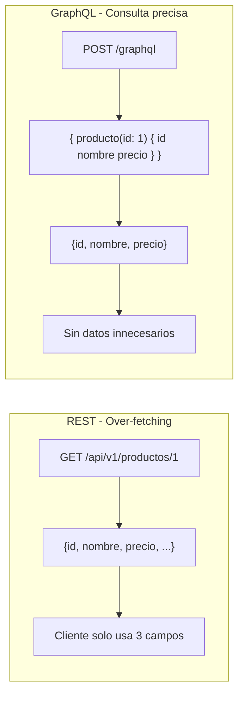
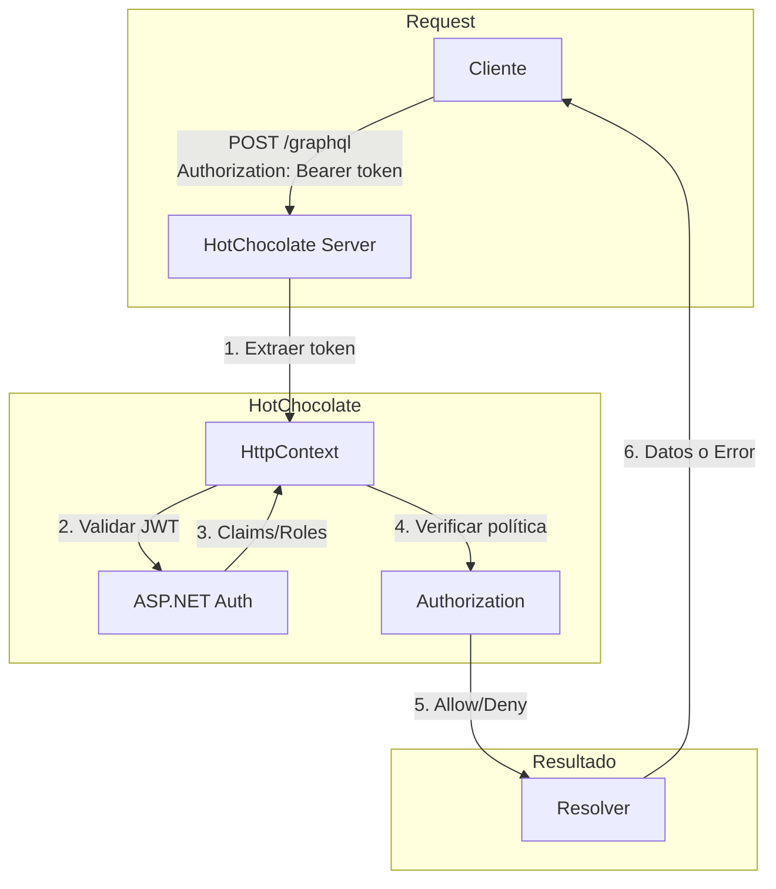
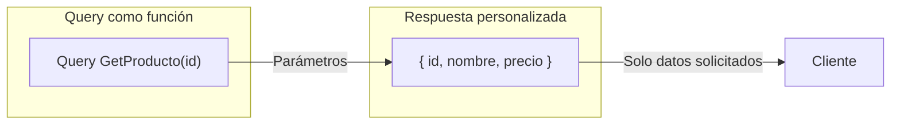
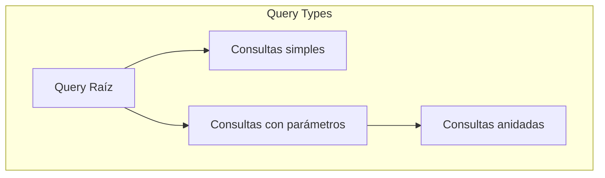
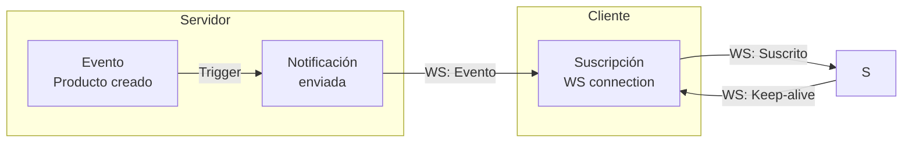
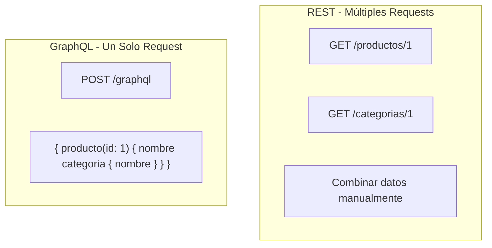
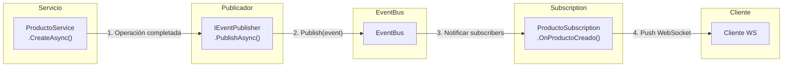
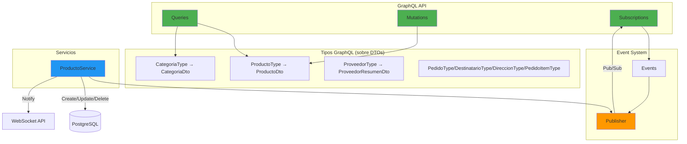
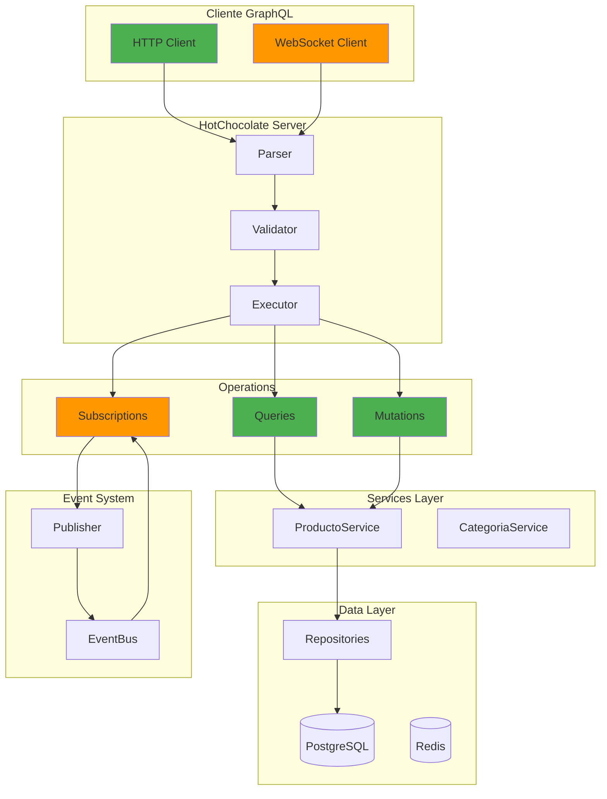
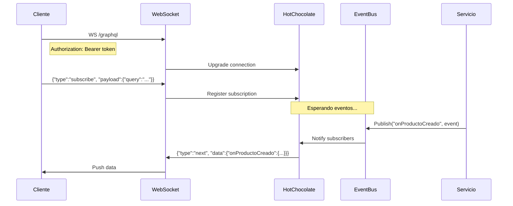

# 19. GraphQL con HotChocolate

## Índice

[19. GraphQL con HotChocolate](#19-graphql-con-hotchocolate)
  - [19.1. ¿Qué es GraphQL?](#191-qué-es-graphql)
  - [19.2. Instalación de HotChocolate](#192-instalación-de-hotchocolate)
  - [19.3. Configuración en Program.cs](#193-configuración-en-programcs)
  - [19.3.1. Autenticación y Autorización con HotChocolate](#1931-autenticación-y-autorización-con-hotchocolate)
  - [19.4. Conceptos de Queries](#194-conceptos-de-queries)
  - [19.5. TiendaQuery: Consultas del Proyecto](#195-tiendaquery-consultas-del-proyecto)
  - [19.6. Tipos de GraphQL](#196-tipos-de-graphql)
  - [19.7. Tipos de Datos en GraphQL](#197-tipos-de-datos-en-graphql)
  - [19.8. GraphiQL: Herramienta de Desarrollo](#198-graphiql-herramienta-de-desarrollo)
  - [19.9. Consultas de Ejemplo](#199-consultas-de-ejemplo)
  - [19.10. Mutations](#1910-mutations)
  - [19.11. Subscriptions](#1911-subscriptions)
  - [19.12. Comparación REST vs GraphQL](#1912-comparación-rest-vs-graphql)
  - [19.13. Input Types](#1913-input-types)
  - [19.14. Events: Payloads de Eventos](#1914-events-payloads-de-eventos)
  - [19.15. Publishers: Sistema Pub/Sub](#1915-publishers-sistema-pubsub)
  - [19.16. Estructura de Carpetas GraphQL](#1916-estructura-de-carpetas-graphql)
  - [19.17. Patrones Utilizados](#1917-patrones-utilizados)
  - [19.18. Estado Actual del Proyecto](#1918-estado-actual-del-proyecto)
  - [19.19. Resumen Completo](#1919-resumen-completo)

---

## 19.1. ¿Qué es GraphQL?

**GraphQL** es un lenguaje de consulta para APIs desarrollado por Facebook. A diferencia de REST, GraphQL permite al cliente especificar exactamente qué datos necesita, evitando el over-fetching y under-fetching.



### Comparación REST vs GraphQL

| Aspecto | REST | GraphQL |
|---------|------|---------|
| **Endpoint** | Multiple endpoints | Un solo endpoint |
| **Datos** | Respuesta fija | Consulta flexible |
| **Over-fetching** | Sí | No |
| **Under-fetching** | Sí | No |
| **Versionado** | En URL (/v1/) | Sin versionado típico |
| **Documentación** | Swagger/OpenAPI | Introspection |
| **Curva aprendizaje** | Baja | Media |

---

## 19.2. Instalación de HotChocolate

### Paquetes Necesarios

Versiones fijadas en `Directory.Packages.props` (central package management):

```bash
HotChocolate.AspNetCore               16.6.7   # servidor + GraphiQL
HotChocolate.AspNetCore.Authorization 16.6.7   # [Authorize] / policies
HotChocolate.Data                     16.6.7   # utilidades de datos
```

> En este proyecto **no** se usa `HotChocolate.Stitching` (no hay
> federación de esquemas).

### Dependencias en el Proyecto

Del archivo `Infrastructures/GraphQLConfig.cs` (llamado desde `Program.cs`
con `builder.Services.AddGraphQL(environment)`):

```csharp
Log.Information("🔍 Configurando GraphQL con HotChocolate...");

services.AddGraphQLPubSub();

builder.Services
    .AddGraphQLServer()
    .AddAuthorization()
    .AddQueryType<TiendaQuery>()
    .AddMutationType<ProductoMutation>()
    .AddSubscriptionType<ProductoSubscription>()
    .AddInMemorySubscriptions()
    .AddType<ProductoType>()
    .AddType<CategoriaType>()
    .ModifyRequestOptions(opt => opt.IncludeExceptionDetails = environment.IsDevelopment());
```

### Endpoint de GraphQL

```csharp
// Extensión MapGraphQLEndpoints (GraphQLConfig.cs)
app.MapGraphQL();          // → http://localhost:5031/graphql (GraphiQL + endpoint)
app.MapGraphQLWebSocket(); // → suscripciones por WS
```

---

## 19.3. Configuración en Program.cs

### Configuración Básica

```csharp
// Agregar GraphQL (la forma mínima; el proyecto usa GraphQLConfig.AddGraphQL)
builder.Services
    .AddGraphQLServer()
    .AddQueryType<TiendaQuery>();
```

### Configuración Completa

La configuración real vive en `Infrastructures/GraphQLConfig.cs`
(extensión `AddGraphQL`); resumen:

```csharp
services.AddGraphQLPubSub();                  // IEventPublisher

var builder = services
    .AddGraphQLServer()
    .AddAuthorization()                       // Habilita [Authorize]
    .AddQueryType<TiendaQuery>()              // Tipo de consulta raíz
    .AddMutationType<ProductoMutation>()      // Mutaciones
    .AddSubscriptionType<ProductoSubscription>() // Suscripciones
    .AddInMemorySubscriptions()
    .AddType<ProductoType>()                  // Tipos sobre DTOs
    .AddType<CategoriaType>()
    .AddType<ProveedorType>()
    .AddType<PedidoType>()
    .AddType<DestinatarioType>()
    .AddType<DireccionType>()
    .AddType<PedidoItemType>()
    .ModifyOptions(o => o.RemoveUnreachableTypes = true)

    // 🛡️ Límite de profundidad de ejecución: evita queries anidadas
    // infinitas que consuman memoria/CPU. 10 niveles es más que
    // suficiente para cualquier consulta legítima de este proyecto.
    .AddMaxExecutionDepthRule(
        maxAllowedExecutionDepth: 10,
        skipIntrospectionFields: true)

    // Configuración de errores (detalle solo en desarrollo)
    .ModifyRequestOptions(opt =>
        opt.IncludeExceptionDetails = environment.IsDevelopment());

// Introspección: deshabilitada fuera de desarrollo
if (!environment.IsDevelopment())
    builder.DisableIntrospection();
```

### Diferentes Entornos

```csharp
// Desarrollo: Mostrar detalles de errores
.ModifyRequestOptions(opt => opt.IncludeExceptionDetails = true)

// Producción: Ocultar detalles
.ModifyRequestOptions(opt => opt.IncludeExceptionDetails = false)
```

---

## 19.3.1. Autenticación y Autorización con HotChocolate

HotChocolate se integra de forma **transparente** con el sistema de autenticación y autorización de ASP.NET Core (Identity, JWT, Claims). Esto significa que puedes usar los mismos atributos y políticas de autorización que en los controladores REST.

### Conceptos Clave

HotChocolate permite proteger:
- **Queries**: Controlar quién puede leer datos
- **Mutations**: Controlar quién puede modificar datos
- **Fields**: Controlar acceso a campos específicos

### Integración con ASP.NET Core Identity

La integración es transparente porque HotChocolate lee el `HttpContext` y los claims de usuario autenticado:

```csharp
builder.Services
    .AddAuthentication(JwtBearerDefaults.AuthenticationScheme)
    .AddJwtBearer(...);

builder.Services
    .AddAuthorization();

// HotChocolate lee automáticamente el contexto de autenticación
builder.Services
    .AddGraphQLServer()
    .AddAuthorization()  // ← Habilita soporte para [Authorize]
    .AddQueryType<TiendaQuery>();
```

### Proteger Queries con [Authorize]

```csharp
public class TiendaQuery
{
    // Query pública - cualquiera puede ver productos
    public async Task<IReadOnlyList<ProductoDto>> GetProductos(
        [Service] IProductoRepository productoRepository)
    {
        var productos = await productoRepository.FindAllAsync();
        return productos.ToDtoList().ToList();
    }

    // Query protegida - solo administradores (pedidos = visibles solo por admin)
    [Authorize(policy: "AdminOnly")]  // ← Policy que requiere rol Admin
    public async Task<IReadOnlyList<PedidoDto>> GetPedidos(
        [Service] IPedidosRepository pedidosRepository)
    {
        var pedidos = await pedidosRepository.FindAllAsync();
        return pedidos.Select(p => p.ToDto()).ToList();
    }

    // Query del propio usuario - cualquier autenticado, filtrada por su claim
    [Authorize]  // ← Requiere JWT válido
    public async Task<IReadOnlyList<PedidoDto>> GetMisPedidos(
        ClaimsPrincipal user,          // ← inyectado por HotChocolate
        [Service] IPedidosRepository pedidosRepository)
    {
        var claim = user.FindFirst(ClaimTypes.NameIdentifier)?.Value;
        if (claim is null || !long.TryParse(claim, out var userId))
            throw new GraphQLException("Falta el claim NameIdentifier.");

        var pedidos = await pedidosRepository.FindByUserIdAsync(userId);
        return pedidos.Select(p => p.ToDto()).ToList();
    }
}
```

### Proteger Mutations con Roles

Del archivo `GraphQL/Mutations/ProductoMutation.cs` (resumen):

```csharp
public class ProductoMutation
{
    // Solo administradores pueden crear productos
    [Authorize(policy: "AdminOnly")]  // ← Policy que requiere rol Admin
    public async Task<ProductoDto> CreateProducto(
        CreateProductoInput input,
        [Service] IProductoService service)
    {
        var dto = new ProductoRequestDto
        {
            Nombre = input.Nombre,
            Descripcion = input.Descripcion ?? string.Empty,
            Precio = input.Precio,
            Stock = input.Stock,
            Imagen = input.Imagen,
            CategoriaId = input.CategoriaId,
            ProveedorCodigo = input.ProveedorCodigo
        };
        var result = await service.CreateAsync(dto);
        if (result.IsFailure)
            throw new Exception(result.Error.Message);   // ← errors[] en GraphQL

        return result.Value;
    }

    // Actualización parcial (merge de campos null) — también ADMIN
    [Authorize(policy: "AdminOnly")]
    public async Task<ProductoDto> UpdateProducto(
        long id,
        UpdateProductoInput input,
        [Service] IProductoService service) { /* … map to ProductoPatchDto … */ }

    // Eliminación (soft delete) — también ADMIN
    [Authorize(policy: "AdminOnly")]
    public async Task<bool> DeleteProducto(
        long id,
        [Service] IProductoService service) { /* … */ }
}
```

> 🎓 El mutation es **delgado**: mapea el input al DTO y delega en el
> servicio (la misma capa que usa REST). Si el `Result` falla se lanza
> excepción para que el cliente lo vea en `errors`.

### Proteger Fields Individuales

```csharp
// Opción "un solo contrato": el type va sobre el DTO, con BindFieldsExplicitly.
// Un campo solo se expone si se declara aquí; para añadir protección a un
// campo concreto se usa .Authorize(...) en su descriptor:
public class ProductoType : ObjectType<ProductoDto>
{
    protected override void Configure(IObjectTypeDescriptor<ProductoDto> descriptor)
    {
        descriptor.BindFieldsExplicitly();

        descriptor.Field(p => p.Id).Description("Identificador del producto");
        descriptor.Field(p => p.Nombre).Description("El nombre del producto");

        // Ejemplo de campo restringido (si existiera en el DTO):
        // descriptor.Field(p => p.PrecioCoste).Authorize(new[] { "AdminOnly" });
    }
}
```

### Proteger Subscriptions

En este proyecto **las suscripciones de productos son públicas** (el catálogo
de productos también lo es en REST). Si alguna vez quisieras restringirlas,
el patrón de HotChocolate es añadir `[Authorize]` al resolver:

```csharp
public class ProductoSubscription
{
    // Ejemplo: exigir JWT válido en una suscripción
    // [Authorize]
    [Subscribe]
    [Topic("onProductoCreado")]
    public ProductoCreadoEvent OnProductoCreado(
        [EventMessage] ProductoCreadoEvent message) => message;
}
```

### Definir Políticas de Autorización

```csharp
// Program.cs
builder.Services.AddAuthorization(options =>
{
    options.AddPolicy("AdminOnly", policy =>
        policy.RequireAssertion(ctx =>
            ctx.User.IsInRole("Admin") ||
            ctx.User.HasClaim(c => c.Type == "role" && c.Value == "Admin")));

    options.AddPolicy("UserOrAdmin", policy =>
        policy.RequireAssertion(ctx =>
            ctx.User.IsInRole("User") ||
            ctx.User.IsInRole("Admin")));
    
    options.AddPolicy("PremiumUser", policy =>
        policy.RequireAssertion(ctx =>
            ctx.User.HasClaim("subscription_tier", "premium")));
});
```

### Claims Personalizados en GraphQL

Puedes acceder a los claims del usuario desde cualquier resolver:

```csharp
public class TiendaQuery
{
    public async Task<List<Producto>> GetMisProductos(
        [Service] IProductoRepository productoRepository,
        [GlobalState("userId")] long userId)  // ← Injectado automáticamente
    {
        // Obtener productos del usuario actual
        return await productoRepository.GetByUserIdAsync(userId);
    }
}

// Configurar para inyectar claims
builder.Services
    .AddGraphQLServer()
    .AddAuthorization()
    .AddHttpRequestInterceptor((ctx, builder) =>
    {
        if (ctx.User.Identity?.IsAuthenticated == true)
        {
            var userId = ctx.User.FindFirst("sub")?.Value;
            if (long.TryParse(userId, out var id))
            {
                builder.SetGlobalState("userId", id);
            }
        }
        return ValueTask.CompletedTask;
    });
```

### Autorización Basada en Claims

```csharp
public class PedidoMutation
{
    // Solo usuarios con claim "can_manage_orders" pueden acceder
    [Authorize(policy: "ManageOrders")]
    public async Task<Result<Pedido, DomainError>> CreatePedido(...)
    {
        // ...
    }
}

// Definir política basada en claim
builder.Services.AddAuthorization(options =>
{
    options.AddPolicy("ManageOrders", policy =>
        policy.RequireClaim("can_manage_orders", "true"));
});
```

### Tabla de Atributos de Autorización

| Atributo | Descripción | Ejemplo |
|----------|-------------|---------|
| `[Authorize]` | Requiere autenticación | Cualquier usuario logueado |
| `[Authorize(Roles = "Admin")]` | Requiere rol específico | Solo administradores |
| `[Authorize(Roles = "User,Admin")]` | Requiere uno de los roles | Usuario o administrador |
| `[Authorize(Policy = "AdminOnly")]` | Requiere política personalizada | Configurada en Program.cs |
| `[Authorize(Policy = "PremiumUser")]` | Policy con claims personalizados | Usuarios premium |

### Flujo de Autorización en GraphQL



### Manejo de Errores de Autorización

HotChocolate devuelve errores GraphQL cuando la autorización falla:

```json
{
  "errors": [
    {
      "message": "Authorization denied.",
      "extensions": {
        "code": "UNAUTHORIZED"
      }
    }
  ]
}
```

### Configuración Completa de Seguridad

```csharp
builder.Services
    .AddGraphQLServer()
    .AddAuthorization(options =>
    {
        options.DefaultPolicy = new AuthorizationPolicyBuilder(
            JwtBearerDefaults.AuthenticationScheme)
            .RequireAuthenticatedUser()
            .Build();
        
        options.AddPolicy("AdminOnly", policy =>
            policy.RequireRole("Admin"));
    })
    .AddQueryType<TiendaQuery>()
    .AddMutationType<ProductoMutation>()
    .AddSubscriptionType<ProductoSubscription>()
    .AddInMemorySubscriptions();
```

### Resumen

| Aspecto | Implementación |
|---------|----------------|
| **Autenticación** | JWT via ASP.NET Core Authentication |
| **Autorización** | `[Authorize]`, `[Authorize(Roles)]`, Policies |
| **Roles** | "Admin", "User" (desde Identity) |
| **Claims** | Accesibles desde el HttpContext |
| **Transparencia** | HotChocolate lee el mismo contexto que Controllers |

---

## 19.4. Conceptos de Queries

Las **Queries** (consultas) son el mecanismo principal para **leer datos** en GraphQL. Son el equivalente a las operaciones GET en REST, pero con una diferencia fundamental: el cliente define exactamente qué campos quiere recibir.

### Concepto de Query

A diferencia de REST donde el servidor define la estructura de la respuesta, en GraphQL el cliente decide qué datos necesita. Esto elimina el over-fetching (recibir datos innecesarios) y under-fetching (necesitar múltiples llamadas).



### Anatomía de una Query

```graphql
# Estructura básica
query NombreQuery($id: Long!) {
  producto(id: $id) {
    id          # Campo solicitado
    nombre      # Campo solicitado
    precio      # Campo solicitado
    # descripcion no se incluye → no se envía
  }
}
```

### Componentes de una Query

| Componente | Descripción | Ejemplo |
|------------|-------------|---------|
| `query` | Tipo de operación (también puede ser `subscription`) | `query { ... }` |
| `nombre` | Identificador opcional de la query | `query GetProducto { ... }` |
| `parámetros` | Variables de entrada | `$id: Long!` |
| `campos` | Datos que se solicitan | `id, nombre, precio` |

### Queries vs Mutations

| Aspecto | Query | Mutation |
|---------|-------|----------|
| **Propósito** | Leer datos | Modificar datos |
| **Efecto** | Sin cambios en el servidor | Puede crear/actualizar/eliminar |
| **Orden** | Se pueden ejecutar en paralelo | Se ejecutan en orden secuencial |
| **Ejemplo REST** | GET /productos/1 | POST /productos |

### Patrones de Queries

**1. Query simple - Un recurso:**
```graphql
query {
  producto(id: 1) {
    id
    nombre
    precio
  }
}
```

**2. Query con múltiples campos:**
```graphql
query {
  productos {
    id
    nombre
    precio
    stock
  }
}
```

**3. Query anidada - Relaciones:**
```graphql
query {
  productos {
    id
    nombre
    categoria {
      id
      nombre
    }
  }
}
```

**4. Query con paginación (argumentos propios, base 1):**
```graphql
query {
  productosPaged(page: 2, size: 5) {
    items {
      id
      nombre
      precio
    }
    totalCount
    page
    pageSize
  }
}
```

**5. Query paginada de categorías:**
```graphql
query {
  categoriasPaged(page: 1, size: 10) {
    items {
      id
      nombre
      descripcion
    }
    totalCount
  }
}
```

> **Nota:** este API **no** expone argumentos `where`/`first`/`offset` de
> HotChocolate Data: los filtros se resuelven en el repositorio (REST
> `GET /api/v1/productos?precioMax=…`) y GraphQL ofrece paginación explícita
> con `page`/`size` sobre `productosPaged` y `categoriasPaged`.

### Tipos de Query en GraphQL



### Ventajas de las Queries en GraphQL

1. **Flexibilidad**: El cliente elige qué campos necesita
2. **Eficiencia**: Una sola request para datos relacionados
3. **Tipado**: El esquema define exactamente qué está disponible
4. **Documentación automática**: Introspection muestra todas las queries disponibles
5. **Versionado innecesario**: Se añaden campos, no se rompen queries existentes

---

## 19.5. TiendaQuery: Consultas del Proyecto

Del archivo `GraphQL/Queries/TiendaQuery.cs` (versión resumida; el archivo
real lleva XML doc completo):

```csharp
using System.Security.Claims;
using HotChocolate;
using HotChocolate.Authorization;
using HotChocolate.Types;
using TiendaApi.Api.Dtos.Categorias;
using TiendaApi.Api.Dtos.Common;
using TiendaApi.Api.Dtos.Pedidos;
using TiendaApi.Api.Dtos.Productos;
using TiendaApi.Api.Mappers;
using TiendaApi.Api.Repositories.Categorias;
using TiendaApi.Api.Repositories.Pedidos;
using TiendaApi.Api.Repositories.Productos;

namespace TiendaApi.Api.GraphQL.Queries;

// 🎓 Seguridad: GraphQL solo expone DTOs, nunca entidades del modelo de
// escritura. Así el cliente no puede componer consultas arbitrarias sobre
// la BD interna.
public class TiendaQuery
{
    // Productos (público) — devuelve DTOs, no entidades
    public async Task<IReadOnlyList<ProductoDto>> GetProductos(
        [Service] IProductoRepository productoRepository)
    {
        var productos = await productoRepository.FindAllAsync();
        return productos.ToDtoList().ToList();
    }

    public async Task<ProductoDto?> GetProducto(
        long id,
        [Service] IProductoRepository productoRepository)
    {
        var producto = await productoRepository.FindByIdAsync(id);
        return producto?.ToDto();
    }

    // Paginación: GraphQL usa página BASE 1; el repositorio trabaja en
    // base 0 (Skip(Page*Size)), así que se convierte aquí.
    public async Task<PagedResult<ProductoDto>> GetProductosPaged(
        [Service] IProductoRepository productoRepository,
        int page = 1,
        int size = 10)
    {
        var filter = new ProductoFilterDto(
            Nombre: null, Categoria: null, IsDeleted: null,
            PrecioMax: null, StockMin: null,
            Page: Math.Max(page - 1, 0), Size: size);

        var result = await productoRepository.FindAllPagedAsync(filter);
        return new PagedResult<ProductoDto>
        {
            Items = result.Items.Select(p => p.ToDto()),
            TotalCount = result.TotalCount,
            Page = page,
            PageSize = size
        };
    }

    // Categorías (público): listado, por id y paginado (mismo patrón)

    // ══════════ PEDIDOS (solo queries: sin mutations ni subscriptions) ════
    // · pedidos    → solo ADMIN (lista completa)
    // · misPedidos → cualquier autenticado, FILTRADO por su propio claim
    //                (un usuario jamás ve pedidos ajenos por GraphQL)

    [Authorize(policy: "AdminOnly")]
    public async Task<IReadOnlyList<PedidoDto>> GetPedidos(
        [Service] IPedidosRepository pedidosRepository)
    {
        var pedidos = await pedidosRepository.FindAllAsync();
        return pedidos.Select(p => p.ToDto()).ToList();
    }

    [Authorize]
    public async Task<IReadOnlyList<PedidoDto>> GetMisPedidos(
        ClaimsPrincipal user,          // ← HotChocolate inyecta los claims
        [Service] IPedidosRepository pedidosRepository)
    {
        var claim = user.FindFirst(ClaimTypes.NameIdentifier)?.Value;
        if (claim is null || !long.TryParse(claim, out var userId))
            throw new GraphQLException("No se pudo identificar al usuario autenticado (falta el claim NameIdentifier).");

        var pedidos = await pedidosRepository.FindByUserIdAsync(userId);
        return pedidos.Select(p => p.ToDto()).ToList();
    }
}
```

> **Nota (HotChocolate 16):** `IResolverContext.User` ya no existe; los
> claims se inyectan como parámetro `ClaimsPrincipal` del resolver.
> `misPedidos` nunca lista todos los pedidos: solo consulta
> `FindByUserIdAsync(userId)` con el userId del JWT.

### Variante CQRS (repo `TiendaDawApi-Cqrs-MediatR-NetCore`)

El contrato GraphQL es **idéntico** (mismos tipos, mismas queries, mismos
nombres); lo único que cambia es que cada resolver delega en MediatR, igual
que los controladores REST:

```csharp
[Authorize(policy: "AdminOnly")]
public async Task<IReadOnlyList<PedidoDto>> GetPedidos(
    [Service] IMediator mediator,
    CancellationToken ct = default)
{
    var result = await mediator.Send(new GetAllPedidosListQuery(), ct);
    if (result.IsFailure)
        throw new Exception(result.Error.Message);

    return result.Value.ToList();
}

[Authorize]
public async Task<IReadOnlyList<PedidoDto>> GetMisPedidos(
    ClaimsPrincipal user,
    [Service] IMediator mediator,
    CancellationToken ct = default)
{
    var claim = user.FindFirst(ClaimTypes.NameIdentifier)?.Value;
    if (claim is null || !long.TryParse(claim, out var userId))
        throw new GraphQLException("No se pudo identificar al usuario autenticado (falta el claim NameIdentifier).");

    var result = await mediator.Send(new GetMyPedidosQuery(userId), ct);
    if (result.IsFailure)
        throw new Exception(result.Error.Message);

    return result.Value.ToList();
}
```

En CQRS, `GetPedidos` usa `GetAllPedidosListQuery` (la misma query que el
endpoint REST `GET /api/v1/pedidos` del admin) y `misPedidos` usa
`GetMyPedidosQuery(userId)` (el de `GET /api/v1/pedidos/me`).

### Queries expuestas en la raíz

| Query | Descripción | Auth |
|-------|-------------|------|
| `productos` | Todos los productos (DTOs) | Pública |
| `producto(id)` | Un producto por ID | Pública |
| `productosPaged(page, size)` | Productos paginados (base 1) | Pública |
| `categorias` | Todas las categorías | Pública |
| `categoria(id)` | Una categoría por ID | Pública |
| `categoriasPaged(page, size)` | Categorías paginadas (base 1) | Pública |
| `pedidos` | Todos los pedidos | **Solo admin** (`AdminOnly`) |
| `misPedidos` | Pedidos del usuario autenticado | Cualquier autenticado (claim `NameIdentifier`) |

### Atributos de HotChocolate

| Atributo | Descripción |
|----------|-------------|
| `[Authorize]` | Requiere usuario autenticado (JWT) |
| `[Authorize(policy: "...")]` | Requiere una política concreta (p. ej. `AdminOnly`) |
| `[Service]` | Inyecta dependencias (repositorios, IMediator…) |
| `ClaimsPrincipal` | Parámetro del resolver con los claims del JWT |
| `CancellationToken ct` | Parámetro de cancelación (se inyecta solo) |

---

## 19.6. Tipos de GraphQL

### ProductoType

Del archivo `ProductoType.cs`:

```csharp
using HotChocolate.Types;
using TiendaApi.Api.Dtos.Productos;

namespace TiendaApi.Api.GraphQL.Types;

// 🎓 Opción "un solo contrato": el type se construye sobre el DTO (la MISMA
// salida que REST), con BindFieldsExplicitly. Los campos internos de la
// entidad (isDeleted, rowVersion, categoriaId…) NO se exponen: si algún día
// hacen falta, se añaden al DTO y los ganan REST y GraphQL a la vez.
public class ProductoType : ObjectType<ProductoDto>
{
    protected override void Configure(IObjectTypeDescriptor<ProductoDto> descriptor)
    {
        descriptor.Name("ProductoDto");
        descriptor.Description("Producto tal como lo sirve la API (mismo contrato que REST).");
        descriptor.BindFieldsExplicitly();

        descriptor.Field(p => p.Id).Description("Identificador del producto");
        descriptor.Field(p => p.Nombre).Description("El nombre del producto");
        descriptor.Field(p => p.Descripcion).Description("La descripción del producto");
        descriptor.Field(p => p.Precio).Description("El precio del producto");
        descriptor.Field(p => p.Stock).Description("Cantidad en stock");
        descriptor.Field(p => p.Imagen).Description("URL de la imagen (null si no tiene)");
        descriptor.Field(p => p.Categoria).Description("La categoría del producto (resumen: id, nombre y descripción)");
        descriptor.Field(p => p.Proveedor).Description("El proveedor del producto (resumen: código, nombre y descripción; null si no tiene)");
        descriptor.Field(p => p.CreatedAt).Description("Fecha de creación");
        descriptor.Field(p => p.UpdatedAt).Description("Fecha de última actualización");
    }
}
```

### CategoriaType

Del archivo `CategoriaType.cs`:

```csharp
using HotChocolate.Types;
using TiendaApi.Api.Dtos.Categorias;

namespace TiendaApi.Api.GraphQL.Types;

// 🎓 Opción "un solo contrato": sobre el DTO, con BindFieldsExplicitly.
// El campo `productos` de la entidad NO se expone: el listado de productos
// de una categoría se pide por la query `productos` (REST: GET
// /api/v1/productos/categoria/{id}), no por navegación anidada.
public class CategoriaType : ObjectType<CategoriaDto>
{
    protected override void Configure(IObjectTypeDescriptor<CategoriaDto> descriptor)
    {
        descriptor.Name("CategoriaDto");
        descriptor.Description("Categoría tal como la sirve la API (mismo contrato que REST).");
        descriptor.BindFieldsExplicitly();

        descriptor.Field(c => c.Id).Description("El ID de la categoría");
        descriptor.Field(c => c.Nombre).Description("El nombre de la categoría");
        descriptor.Field(c => c.Descripcion).Description("La descripción de la categoría");
        descriptor.Field(c => c.CreatedAt).Description("Fecha de creación");
        descriptor.Field(c => c.UpdatedAt).Description("Fecha de última actualización");
    }
}
```

---

## 19.7. Tipos de Datos en GraphQL

### Escalares

| GraphQL | .NET | Descripción |
|---------|------|-------------|
| `ID` | `string` | Identificador único |
| `String` | `string` | Cadena de texto |
| `Int` | `int` | Entero de 32 bits |
| `Float` | `double` | Número decimal |
| `Boolean` | `bool` | Verdadero/Falso |
| `DateTime` | `DateTime` | Fecha y hora |
| `Decimal` | `decimal` | Decimal preciso |

### Tipos No Nulos

```csharp
// Campo obligatorio (NonNull)
descriptor.Field(p => p.Nombre)
    .Type<NonNullType<StringType>>()

// Campo opcional
descriptor.Field(p => p.Descripcion)
    .Type<StringType>()
```

---

## 19.8. GraphiQL: Herramienta de Desarrollo

HotChocolate sirve GraphiQL en el **mismo endpoint** `/graphql`
(`app.MapGraphQL()` en `MapGraphQLEndpoints`). No hay endpoint aparte
`/graphiql`.

### Acceso a GraphiQL

```
Desarrollo: http://localhost:5031/graphql
Producción: https://tu-dominio/graphql   (introspección deshabilitada)
```

En desarrollo también puedes probar el esquema con el cliente incluido en
el repo (`TiendaApi.Clients/graphql-client-js/index.html`) apuntando a
`http://localhost:5031/graphql`.

---

## 19.9. Consultas de Ejemplo

### Obtener Todos los Productos

```graphql
query {
  productos {
    id
    nombre
    precio
    stock
  }
}
```

### Obtener Producto Específico

```graphql
query {
  producto(id: 1) {
    id
    nombre
    descripcion
    precio
    categoria {
      nombre
    }
  }
}
```

### Con Paginación

```graphql
query {
  productosPaged(page: 1, size: 10) {
    items {
      id
      nombre
      precio
    }
    totalCount
    page
    pageSize
  }
}
```

### Con Filtrado

Los filtros viven en REST (`GET /api/v1/productos?precioMax=…`); GraphQL
ofrece las queries de listado y por ID:

```graphql
query {
  productos {
    id
    nombre
    precio
  }
}
```

### Con Ordenamiento

Este API no expone argumentos `order`/`where` de HotChocolate Data: el
orden lo decide el repositorio (mismo criterio que REST).

---

## 19.10. Mutations (Crear, Actualizar, Eliminar)

Las mutations son operaciones que modifican datos en el servidor. Son el equivalente a los métodos POST, PUT, PATCH y DELETE en REST. En GraphQL, las mutations se definen en una clase separada llamada `Mutation` y se registran en el esquema.

### Estructura de una Mutation

Una mutation típica sigue el patrón de entrada-salida: recibe un input, procesa la operación, y devuelve un resultado. En este proyecto el mutation **no toca repositorios directamente**: es una capa de traducción delgada que mapea el input a un DTO y delega en el servicio (la misma capa que usa REST).

```csharp
public class ProductoMutation
{
    [Authorize(policy: "AdminOnly")]
    public async Task<ProductoDto> CreateProducto(
        CreateProductoInput input,
        [Service] IProductoService service)
    {
        var dto = new ProductoRequestDto
        {
            Nombre = input.Nombre,
            Descripcion = input.Descripcion ?? string.Empty,
            Precio = input.Precio,
            Stock = input.Stock,
            Imagen = input.Imagen,
            CategoriaId = input.CategoriaId,
            ProveedorCodigo = input.ProveedorCodigo
        };

        var result = await service.CreateAsync(dto);
        if (result.IsFailure)
            throw new Exception(result.Error.Message);  // ← errors[] en GraphQL

        return result.Value;
    }

    [Authorize(policy: "AdminOnly")]
    public async Task<ProductoDto> UpdateProducto(
        long id,
        UpdateProductoInput input,
        [Service] IProductoService service)
    {
        var patch = new ProductoPatchDto
        {
            Nombre = input.Nombre,
            Descripcion = input.Descripcion,
            Precio = input.Precio,
            Stock = input.Stock,
            Imagen = input.Imagen,
            CategoriaId = input.CategoriaId,
            ProveedorCodigo = input.ProveedorCodigo
        };

        var result = await service.UpdatePartialAsync(id, patch);  // read-before-write
        if (result.IsFailure)
            throw new Exception(result.Error.Message);

        return result.Value;
    }

    [Authorize(policy: "AdminOnly")]
    public async Task<bool> DeleteProducto(
        long id,
        [Service] IProductoService service)
    {
        var result = await service.DeleteAsync(id);
        if (result.IsFailure)
            throw new Exception(result.Error.Message);

        return true;
    }
}
```

### Input Types para Mutations

Los input types son objetos que agrupan los parámetros de una mutation. Usar input types es preferible a pasar muchos parámetros sueltos porque facilita la evolución del esquema sin romper consultas existentes.

```csharp
// Inputs del proyecto (GraphQL/Inputs/ProductoInput.cs) — record por clase,
// todos los campos mutables son init-only. En ambos, ProveedorCodigo es
// OPCIONAL (null = sin proveedor / no tocar el actual).
public record CreateProductoInput
{
    public string Nombre { get; init; } = string.Empty;
    public string? Descripcion { get; init; }
    public decimal Precio { get; init; }
    public int Stock { get; init; }
    public string? Imagen { get; init; }
    public long CategoriaId { get; init; }          // obligatorio, debe existir
    public string? ProveedorCodigo { get; init; }   // opcional
}

// Input para actualizar producto (todos los campos son opcionales)
public record UpdateProductoInput
{
    public string? Nombre { get; init; }            // null = no tocar
    public string? Descripcion { get; init; }
    public decimal? Precio { get; init; }
    public int? Stock { get; init; }
    public string? Imagen { get; init; }
    public long? CategoriaId { get; init; }
    public string? ProveedorCodigo { get; init; }
}
```

### Mutation Completa con Validación

Esta implementación muestra cómo integrar validación y manejo de errores en las mutations, siguiendo el patrón de Result que usa el proyecto (el ejemplo real completo está en §19.6 «Proteger Mutations con Roles»):

```csharp
public class ProductoMutation
{
    [Authorize(policy: "AdminOnly")]
    public async Task<ProductoDto> CreateProducto(
        CreateProductoInput input,
        [Service] IProductoService productoService)
    {
        var dto = new ProductoRequestDto
        {
            Nombre = input.Nombre,
            Descripcion = input.Descripcion ?? string.Empty,
            Precio = input.Precio,
            Stock = input.Stock,
            Imagen = input.Imagen,
            CategoriaId = input.CategoriaId,
            ProveedorCodigo = input.ProveedorCodigo
        };

        var result = await productoService.CreateAsync(dto);
        if (result.IsFailure)
            throw new Exception(result.Error.Message);   // ← errors[] en GraphQL

        return result.Value;
    }

    [Authorize(policy: "AdminOnly")]
    public async Task<bool> DeleteProducto(
        long id,
        [Service] IProductoService productoService)
    {
        var result = await productoService.DeleteAsync(id);
        if (result.IsFailure)
            throw new Exception(result.Error.Message);

        return true;
    }
}
```

### Registrar Mutations en el Servidor

```csharp
services
    .AddGraphQLServer()
    .AddQueryType<TiendaQuery>()
    .AddMutationType<ProductoMutation>()  // Añadir mutations
    .AddType<ProductoType>()
    .AddType<CategoriaType>()
    .AddType<ProveedorType>()
    .AddType<PedidoType>()
    .AddType<DestinatarioType>()
    .AddType<DireccionType>()
    .AddType<PedidoItemType>();
```

### Ejemplos de Mutations en GraphQL

**Crear producto:**

```graphql
mutation CreateProducto($input: CreateProductoInput!) {
  createProducto(input: $input) {
    id
    nombre
    precio
    stock
  }
}
```

**Variables:**

```json
{
  "input": {
    "nombre": "Nuevo Producto",
    "descripcion": "Descripción del producto",
    "precio": 99.99,
    "stock": 50,
    "categoriaId": 1
  }
}
```

**Respuesta:**

```json
{
  "data": {
    "createProducto": {
      "id": 10,
      "nombre": "Nuevo Producto",
      "precio": 99.99,
      "stock": 50
    }
  }
}
```

**Actualizar producto:**

```graphql
mutation UpdateProducto($id: Long!, $input: UpdateProductoInput!) {
  updateProducto(id: $id, input: $input) {
    id
    nombre
    precio
    stock
  }
}
```

**Variables:**

```json
{
  "id": 1,
  "input": {
    "precio": 1199.99,
    "stock": 15
  }
}
```

**Eliminar producto:**

```graphql
mutation DeleteProducto($id: Long!) {
  deleteProducto(id: $id)
}
```

**Respuesta:**

```json
{
  "data": {
    "deleteProducto": true
  }
}
```

---

## 19.11. Subscriptions (Tiempo Real)

Las subscriptions permiten recibir actualizaciones en tiempo real cuando ocurren eventos en el servidor. Son ideales para notificaciones, dashboards en vivo, y aplicaciones que requieren datos actualizados instantáneamente. HotChocolate usa WebSockets para implementar subscriptions.

### Concepto de Subscriptions

A diferencia de las queries y mutations que siguen el patrón request-response, las subscriptions mantienen una conexión abierta y el servidor envía datos cuando ocurren eventos. El cliente se suscribe a eventos específicos y recibe notificaciones cuando estos ocurren.



### Implementación de Suscripciones

Del archivo `GraphQL/Subscriptions/ProductoSubscription.cs`:

```csharp
using HotChocolate;
using HotChocolate.Types;
using TiendaApi.Api.GraphQL.Events;

namespace TiendaApi.Api.GraphQL.Subscriptions;

public class ProductoSubscription
{
    [Subscribe]
    [Topic("onProductoCreado")]
    public ProductoCreadoEvent OnProductoCreado(
        [EventMessage] ProductoCreadoEvent message) => message;

    [Subscribe]
    [Topic("onProductoActualizado")]
    public ProductoActualizadoEvent OnProductoActualizado(
        [EventMessage] ProductoActualizadoEvent message) => message;

    [Subscribe]
    [Topic("onProductoEliminado")]
    public ProductoEliminadoEvent OnProductoEliminado(
        [EventMessage] ProductoEliminadoEvent message) => message;

    [Subscribe]
    [Topic("onStockBajo")]
    public ProductoStockBajoEvent OnStockBajo(
        [EventMessage] ProductoStockBajoEvent message) => message;
}
```

Los eventos (del archivo `GraphQL/Events/ProductoEvent.cs`) son planos:

```csharp
public record ProductoCreadoEvent
{
    public long ProductoId { get; init; }
    public string Nombre { get; init; } = string.Empty;
    public decimal Precio { get; init; }
    public int Stock { get; init; }
    public DateTime CreatedAt { get; init; }
}
```

> **Nota:** en GraphQL **no hay suscripciones de pedidos**. Los cambios de
> pedido se transmiten por **WebSocket propio** (`/ws/pedidos`) y
> **SignalR** (`/hubs/pedidos`), que sí filtran por usuario/rol en el
> servidor. GraphQL solo suscribe eventos de productos.

### Registro de Suscripciones

Del archivo `Infrastructures/GraphQLConfig.cs`:

```csharp
builder.Services
    .AddGraphQLServer()
    .AddAuthorization()
    .AddQueryType<TiendaQuery>()
    .AddMutationType<ProductoMutation>()
    .AddSubscriptionType<ProductoSubscription>()
    .AddInMemorySubscriptions()
    .AddType<ProductoType>()
    .AddType<CategoriaType>()
    .AddType<ProveedorType>()
    .AddType<PedidoType>()
    .AddType<DestinatarioType>()
    .AddType<DireccionType>()
    .AddType<PedidoItemType>()
    .ModifyOptions(options => options.RemoveUnreachableTypes = true)
    …;
```

`RemoveUnreachableTypes = true` elimina del esquema cualquier tipo
registrado al que ninguna operación pueda llegar (evita tipos fantasma en
la introspección).

### Ejemplo de Suscripción en Cliente

**Suscribirse a nuevos productos:**

```graphql
subscription OnProductoCreado {
  onProductoCreado {
    productoId
    nombre
    precio
    stock
    createdAt
  }
}
```

**Respuesta cuando se crea un producto:**

```json
{
  "data": {
    "onProductoCreado": {
      "productoId": 11,
      "nombre": "Producto en Tiempo Real",
      "precio": 49.99,
      "stock": 10,
      "createdAt": "2026-01-17T10:30:00Z"
    }
  }
}
```

### Otras suscripciones disponibles

```graphql
subscription OnStockBajo {
  onStockBajo {
    productoId
    nombre
    stockActual
    umbralStock
    detectedAt
  }
}
```

También existen `onProductoActualizado` (campos `productoId`, `nombre`,
`precio`, `stock`, `updatedAt`) y `onProductoEliminado` (`productoId`,
`deletedAt`).

---

## 19.12. Comparación REST vs GraphQL



### Cuándo Usar GraphQL

| Escenario | Recomendación |
|-----------|---------------|
| **Clientes móviles** | ✅ GraphQL (menos datos, mejor rendimiento) |
| **Dashboards complejos** | ✅ GraphQL (una sola query) |
| **API pública** | ✅ GraphQL (flexibilidad para clientes) |
| **CRUD simple** | ⚪ REST (más simple) |
| **Arquitectura de microservicios** | ✅ GraphQL (stitching) |
| **Streaming en tiempo real** | ✅ GraphQL + Subscriptions |

### Cuándo Usar REST

| Escenario | Recomendación |
|-----------|---------------|
| **Endpoints simples** | ✅ REST (más directo) |
| **Documentación con Swagger** | ✅ REST (integración nativa) |
| **Cacheo con CDNs** | ✅ REST (URLs únicas) |
| **Equipo nuevo** | ✅ REST (mayor familiaridad) |

---

## 19.13. Input Types: Estructuras de Entrada

Los **Input Types** son objetos que agrupan los parámetros de entrada para mutations. Son equivalentes a los DTOs en REST y permiten mantener las mutations organizadas y evolutivas.

### Concepto

A diferencia de pasar parámetros sueltos, los input types permiten:
- Agrupar campos relacionados
- Añadir campos sin romper queries existentes
- Validación centralizada
- Documentación automática

### Input Types del Proyecto

**CreateProductoInput:**
```csharp
namespace TiendaApi.Api.GraphQL.Inputs;

public record CreateProductoInput
{
    public string Nombre { get; init; } = string.Empty;
    public string? Descripcion { get; init; }
    public decimal Precio { get; init; }
    public int Stock { get; init; }
    public string? Imagen { get; init; }
    public long CategoriaId { get; init; }
    public string? ProveedorCodigo { get; init; }   // opcional (null = sin proveedor)
}
```

**UpdateProductoInput:**
```csharp
public record UpdateProductoInput
{
    public string? Nombre { get; init; }
    public string? Descripcion { get; init; }
    public decimal? Precio { get; init; }
    public int? Stock { get; init; }
    public string? Imagen { get; init; }
    public long? CategoriaId { get; init; }
    public string? ProveedorCodigo { get; init; }   // opcional (null = no tocar)
}
```

### GraphQL Schema Generado

```graphql
input CreateProductoInput {
  nombre: String!
  descripcion: String
  precio: Float!
  stock: Int!
  imagen: String
  categoriaId: Long!
  proveedorCodigo: String
}

input UpdateProductoInput {
  nombre: String
  descripcion: String
  precio: Float
  stock: Int
  imagen: String
  categoriaId: Long
  proveedorCodigo: String
}
```

### Diferencia con Output Types

| Aspecto | Input Type | Output Type (Type) |
|---------|------------|---------------------|
| Uso | Mutations (entrada) | Queries/Mutations (salida) |
| Campos | Pueden ser opcionales | Siempre no-nulos en responses |
| Ejemplo | `CreateProductoInput` | `ProductoDto` |

---

## 19.14. Events: Payloads de Eventos

Los **Events** son los payloads que se publican cuando ocurre algo en el sistema. Son necesarios para las subscriptions y permiten que los clientes reciban datos estructurados.

### Concepto de Evento

Un evento representa "algo que pasó" en el sistema. Los eventos son publicados por los servicios y consumidos por las subscriptions.



### Eventos del Proyecto

**ProductoCreadoEvent:**
```csharp
public record ProductoCreadoEvent
{
    public long ProductoId { get; init; }
    public string Nombre { get; init; } = string.Empty;
    public decimal Precio { get; init; }
    public int Stock { get; init; }
    public DateTime CreatedAt { get; init; }
}
```

**ProductoActualizadoEvent:**
```csharp
public record ProductoActualizadoEvent
{
    public long ProductoId { get; init; }
    public string? Nombre { get; init; }
    public decimal? Precio { get; init; }
    public int? Stock { get; init; }
    public DateTime UpdatedAt { get; init; }
}
```

**ProductoEliminadoEvent:**
```csharp
public record ProductoEliminadoEvent
{
    public long ProductoId { get; init; }
    public DateTime DeletedAt { get; init; }
}
```

**ProductoStockBajoEvent:**
```csharp
public record ProductoStockBajoEvent
{
    public long ProductoId { get; init; }
    public string Nombre { get; init; } = string.Empty;
    public int StockActual { get; init; }
    public int UmbralStock { get; init; }
    public DateTime DetectedAt { get; init; }
}
```

---

## 19.15. Publishers: Sistema Pub/Sub

Los **Publishers** son el mecanismo que conecta los eventos con las subscriptions. HotChocolate incluye un sistema de Pub/Sub integrado.

### IEventPublisher

```csharp
namespace TiendaApi.Api.GraphQL.Publishers;

public interface IEventPublisher
{
    Task PublishAsync<T>(string topic, T payload);
}
```

### Implementación

Del archivo `GraphQL/Publishers/EventPublisher.cs` (resumen): resuelve un
ámbito de servicios por publicación para usar el remitente de tópicos
(HotChocolate lo registra como singleton).

```csharp
using HotChocolate.Subscriptions;

namespace TiendaApi.Api.GraphQL.Publishers;

public class EventPublisher : IEventPublisher
{
    private readonly IServiceScopeFactory _scopeFactory;

    public EventPublisher(IServiceScopeFactory scopeFactory)
        => _scopeFactory = scopeFactory;

    public async Task PublishAsync<T>(string topic, T payload)
    {
        using var scope = _scopeFactory.CreateScope();
        var sender = scope.ServiceProvider.GetRequiredService<ITopicEventSender>();
        await sender.SendAsync(topic, payload);
    }
}

// Registro (extensión AddGraphQLPubSub, llamada desde GraphQLConfig):
// services.AddSingleton<IEventPublisher, EventPublisher>();
```

### Integración en el Servicio

```csharp
public class ProductoService(
    // ... otros parámetros
    IProductoEffects effects          // 🎓 los efectos viven en su clase propia (SRP)
) : IProductoService
{
    public async Task<Result<ProductoDto, DomainError>> CreateAsync(ProductoRequestDto dto)
    {
        // ... validar y guardar
        var saved = await productoRepository.SaveAsync(dto.ToEntity());
        var resultDto = saved.ToDto();

        await RegistrarPrecioEnCassandra(saved);   // punto de nacimiento en la serie (Q-A)
        await InvalidarCacheProductoAsync();       // purga los tags de salida

        return Result.Success<ProductoDto, DomainError>(resultDto)
            .Tap( dto =>
            {
                // Efectos secundarios delegados: el servicio decide QUÉ pasa,
                // IProductoEffects decide CÓMO (WS, SignalR, email, suscripción)
                effects.NotificarWebSocketProductoCreado(dto);
                effects.NotificarSignalRProductoCreado(dto);
                effects.EnviarEmailProductoCreado(saved);

                // 🚀 Publicar evento para GraphQL Subscription
                effects.EventoSuscripcionProductoCreado(dto);
            });
    }
    
    // 🎓 El motor vive en ProductoEffects.cs (clase propia inyectada por
    // IProductoEffects); el servicio solo lo llama desde el Tap de arriba.
    // Internamente (ProductoEffects.cs):
    //   public void EventoSuscripcionProductoCreado(ProductoDto producto)
    //   {
    //       _ = Task.Run(async () =>
    //       {
    //           try
    //           {
    //               await eventPublisher.PublishAsync("onProductoCreado", new ProductoCreadoEvent
    //               {
    //                   ProductoId = producto.Id,
    //                   Nombre = producto.Nombre,
    //                   Precio = producto.Precio,
    //                   Stock = producto.Stock,
    //                   CreatedAt = DateTime.UtcNow
    //               });
    //           }
    //           catch (Exception ex)
    //           {
    //               logger.LogWarning(ex, "Error publicando evento GraphQL Subscription");
    //           }
    //       });
    //   }
}
```

### Configuración en GraphQLConfig

Del archivo `Infrastructures/GraphQLConfig.cs`:

```csharp
services.AddGraphQLPubSub();   // ← IEventPublisher (antes del builder)

var builder = services
    .AddGraphQLServer()
    .AddAuthorization()
    .AddQueryType<TiendaQuery>()
    .AddMutationType<ProductoMutation>()
    .AddSubscriptionType<ProductoSubscription>()
    .AddInMemorySubscriptions()  // ← Necesario para Pub/Sub
    .AddType<ProductoType>()
    .AddType<CategoriaType>()
    .AddType<ProveedorType>()
    .AddType<PedidoType>()
    .AddType<DestinatarioType>()
    .AddType<DireccionType>()
    .AddType<PedidoItemType>()
    .ModifyOptions(options => options.RemoveUnreachableTypes = true)
    .AddMaxExecutionDepthRule(maxAllowedExecutionDepth: 10,
                              skipIntrospectionFields: true);

// Introspección: solo en desarrollo
if (!environment.IsDevelopment())
    builder.DisableIntrospection();
```

---

## 19.16. Estructura de Carpetas GraphQL

```
GraphQL/
├── Queries/
│   └── TiendaQuery.cs              # Queries: productos, categorías y pedidos
│
├── Mutations/
│   └── ProductoMutation.cs          # Mutations de productos
│
├── Subscriptions/
│   └── ProductoSubscription.cs      # Suscripciones en tiempo real (productos)
│
├── Events/
│   └── ProductoEvent.cs            # Payloads de eventos
│
├── Inputs/
│   ├── CategoriaInput.cs           # Input types de categorías
│   └── ProductoInput.cs            # Input types de productos
│
├── Publishers/
│   ├── IEventPublisher.cs          # Interfaz del publisher
│   └── EventPublisher.cs           # Implementación Pub/Sub
│
└── Types/
    ├── ProductoType.cs             # Tipo GraphQL de ProductoDto
    ├── CategoriaType.cs            # Tipo GraphQL de CategoriaDto
    ├── ProveedorType.cs            # Tipo GraphQL de ProveedorResumenDto
    ├── PedidoType.cs               # Tipo GraphQL de PedidoDto (solo queries)
    ├── DestinatarioType.cs         # Tipo GraphQL de DestinatarioDto
    ├── DireccionType.cs            # Tipo GraphQL de DireccionDto
    └── PedidoItemType.cs           # Tipo GraphQL de PedidoItemDto
```

### Responsabilidades por Carpeta

| Carpeta | Responsabilidad | Ejemplo |
|---------|-----------------|---------|
| **Queries** | Lectura de datos | `productos { id nombre }` |
| **Mutations** | Escritura de datos | `createProducto(...)` |
| **Subscriptions** | Tiempo real | `onProductoCreado { ... }` |
| **Events** | Formato de eventos | `ProductoCreadoEvent` |
| **Inputs** | Estructuras de entrada | `CreateProductoInput` |
| **Publishers** | Pub/Sub mechanism | `IEventPublisher` |
| **Types** | Tipos GraphQL | `ProductoType` |

---

## 19.17. Patrones Utilizados

### 1. Result Pattern

Todas las operaciones devuelven `Result<T, DomainError>` para manejo tipado de errores.

```csharp
public async Task<Result<ProductoDto, DomainError>> CreateAsync(ProductoRequestDto dto)
{
    var validation = await ValidateAsync(dto);
    if (validation.IsFailure)
        return Result.Failure<ProductoDto, DomainError>(validation.Error);
    
    var saved = await repository.SaveAsync(dto.ToEntity());
    return Result.Success<ProductoDto, DomainError>(saved.ToDto());
}
```

### 2. Tap Pattern (Functional Extensions)

Los efectos secundarios se ejecutan con `.Tap()`:

```csharp
return Result.Success<ProductoDto, DomainError>(resultDto)
    .Tap(dto =>
    {
        InvalidarCacheProducto("productos:all");
        EventoSuscripcionProductoCreado(dto);
    });
```

### 3. Pub/Sub Pattern

Publicación de eventos para tiempo real:

```csharp
await eventPublisher.PublishAsync("onProductoCreado", new ProductoCreadoEvent
{
    ProductoId = producto.Id,
    Nombre = producto.Nombre,
    CreatedAt = DateTime.UtcNow
});
```

### 4. Dependency Injection con HotChocolate

HotChocolate resuelve automáticamente dependencias con `[Service]`:

```csharp
public async Task<ProductoDto?> GetProducto(
    long id,
    [Service] IProductoRepository repository)  // ← Inyectado automáticamente
{
    var producto = await repository.FindByIdAsync(id);
    return producto?.ToDto();
}
```

#### Por qué los mutations NO deben inyectar por constructor

HotChocolate registra el tipo de mutation (la clase `ProductoMutation`, `CategoriaMutation`...) con **lifetime singleton**: se crea una sola vez y vive todo el proceso. Eso tiene una consecuencia importante para la inyección de dependencias:

| Dónde se inyecta | Lifetime de la dependencia | Resultado |
|------------------|---------------------------|-----------|
| **Constructor** | Se captura en la instancia singleton | Una dependencia **scoped** (cualquier servicio o repositorio con `DbContext`) conserva el **mismo objeto durante todo el proceso** |
| **Parámetro `[Service]`** | HotChocolate la resuelve del scope de **cada petición** | La dependencia vive lo que vive la petición: `DbContext` creado y dispuesto correctamente |

Un `DbContext` capturado por un singleton queda **dispuesto** tras la primera petición (su scope se cierra), y cualquier petición posterior recibe un error:

```
System.InvalidOperationException:
Cannot access a disposed context instance.
```

Es un error **difícil de interpretar** porque aparece "de golpe" en la segunda o tercera operación, no en la primera. La regla para los mutations del proyecto:

```csharp
// ❌ Mal: el repositorio quedaría capturado en el singleton
public class ProductoMutation(IProductoRepository repository) { ... }

// ✅ Bien: mutation DELGADO, delega en el servicio
public class ProductoMutation
{
    public async Task<ProductoDto> UpdateProducto(
        long id,
        UpdateProductoInput input,
        [Service] IProductoService service)  // scope de esta petición
    {
        var patch = new ProductoPatchDto { Nombre = input.Nombre, /* ...resto null = no tocar */ };
        var result = await service.UpdatePartialAsync(id, patch);  // el servicio hace el read-before-write
        if (result.IsFailure)
            throw new Exception(result.Error.Message);
        return result.Value;
    }
}
```

**La regla tiene dos partes**:

1. **Inyección**: las dependencias scoped van por `[Service]`, nunca por constructor (lifetime singleton de HotChocolate).
2. **Capas**: el mutation es una capa de traducción **delgada** — mapea el input y delega en el servicio. La lectura previa, el merge de campos null y cualquier regla de negocio viven en el **servicio** (aquí `UpdatePartialAsync` hace el read-before-write, exactamente como el endpoint REST PATCH). Un mutation que inyecta repositorios se está saltando la capa de servicio y duplica lógica de negocio entre REST y GraphQL.

---

## 19.18. Estado Actual del Proyecto ✅

### Queries Implementadas ✅

| Query | Descripción | Auth |
|-------|-------------|------|
| `productos` | Todos los productos | No |
| `producto(id: Long!)` | Producto por ID | No |
| `productosPaged(page: Int, size: Int)` | Productos paginados (base 1) | No |
| `categorias` | Todas las categorías | No |
| `categoria(id: Long!)` | Categoría por ID | No |
| `categoriasPaged(page: Int, size: Int)` | Categorías paginadas (base 1) | No |
| `pedidos` | Todos los pedidos | **ADMIN** |
| `misPedidos` | Pedidos del usuario autenticado (claim) | JWT |

### Mutations Implementadas ✅

| Mutation | Descripción | Auth |
|----------|-------------|------|
| `createProducto(input: CreateProductoInput!)` | Crear producto | ADMIN |
| `updateProducto(id: Long!, input: UpdateProductoInput!)` | Actualizar producto | ADMIN |
| `deleteProducto(id: Long!)` | Eliminar producto | ADMIN |

### Subscriptions Implementadas ✅

| Subscription | Descripción | Auth |
|--------------|-------------|------|
| `onProductoCreado` | Notificación cuando se crea un producto | No (pública) |
| `onProductoActualizado` | Notificación cuando se actualiza | No (pública) |
| `onProductoEliminado` | Notificación cuando se elimina | No (pública) |
| `onStockBajo` | Notificación de stock bajo umbral | No (pública) |

### Arquitectura Actual



---

## 19.19. Resumen Completo

### Arquitectura GraphQL



### Operaciones por Tipo

| Tipo | HTTP | WebSocket | Descripción |
|------|------|-----------|-------------|
| **Query** | ✅ POST /graphql | ❌ | Request-Response |
| **Mutation** | ✅ POST /graphql | ❌ | Request-Response |
| **Subscription** | ❌ | ✅ WS /graphql | Push en tiempo real |

### Códigos de Error

| Código | Significado | Ejemplo |
|--------|-------------|---------|
| `NOT_FOUND` | Recurso no existe | Producto con ID 999 |
| `VALIDATION` | Datos inválidos | Precio negativo |
| `CONFLICT` | Conflicto de negocio | Nombre duplicado |
| `BUSINESS_RULE_VIOLATION` | Regla violada | Categoría con productos |

### Conexión de Suscripciones



### Recursos Adicionales

- HotChocolate Docs: https://chillicream.com/docs/hotchocolate
- GraphQL.org: https://graphql.org
- GraphQL Subscriptions: https://www.apollographql.com/docs/react/data/subscriptions
- CSharpFunctionalExtensions: https://github.com/vkohade/CSharpFunctionalExtensions
