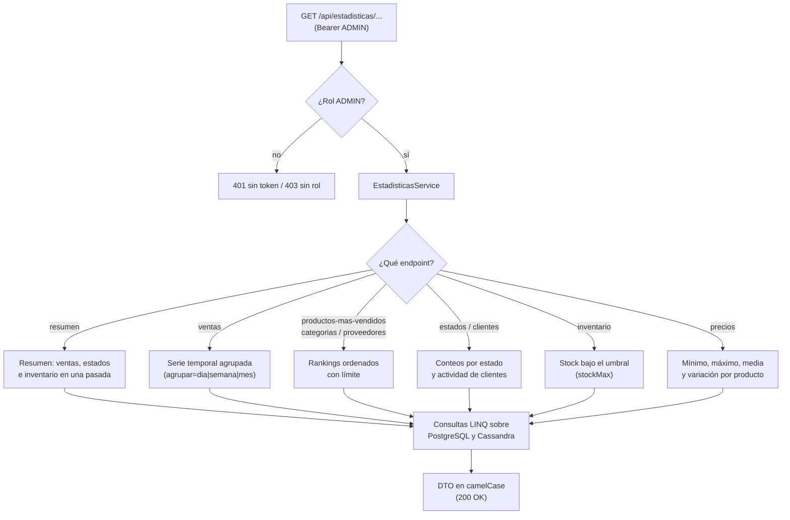

# 31. Estadísticas: Cálculo al Vuelo

## Índice

[31. Estadísticas: Cálculo al Vuelo](#31-estadísticas-cálculo-al-vuelo)
  - [31.1. Visión General](#311-visión-general)
  - [31.2. ¿Por Qué al Vuelo?](#312-por-qué-al-vuelo)
  - [31.3. Flujo de una Petición](#313-flujo-de-una-petición)
  - [31.4. Los Nueve Endpoints](#314-los-nueve-endpoints)
  - [31.5. Reglas de Cálculo](#315-reglas-de-cálculo)
  - [31.6. Series Temporales con Huecos a Cero](#316-series-temporales-con-huecos-a-cero)
  - [31.7. Seguridad y Rendimiento](#317-seguridad-y-rendimiento)
  - [31.8. Pruebas](#318-pruebas)
  - [31.9. Resumen](#319-resumen)

---

## 31.1. Visión General

El módulo de estadísticas expone **nueve endpoints de solo lectura** con cifras de negocio (ventas, inventario, rankings y precios). Todos son **de solo ADMIN**, porque incluyen datos de clientes y cifras económicas, y todos calculan su resultado **en cada petición**, directamente sobre los datos existentes.

No hay tablas de agregados, triggers ni trabajos de fondo que mantengan contadores precalculados: la cifra que se devuelve refleja exactamente el estado actual de la base de datos.

## 31.2. ¿Por Qué al Vuelo?

| Enfoque | Ventaja | Inconveniente |
| --- | --- | --- |
| **Tabla de agregados** (precalcular) | Lecturas muy rápidas | Escrituras dobles, jobs de sincronización, cifras que se desincronican |
| **Cálculo al vuelo** (elegido) | Una sola fuente de verdad, sin infraestructura extra | El coste de CPU se paga en cada petición |

Para el volumen de datos de este proyecto (catálogo pequeño, pedidos acotados) el cálculo directo con consultas LINQ es más que suficiente y elimina toda una capa de sincronización que podría fallar sin aviso. Si las cifras algún día se calculan sobre millones de filas, el cambio de estrategia se concentraría en `EstadisticasService`, sin tocar controladores ni DTOs.

## 31.3. Flujo de una Petición

El controlador solo valida, delega en `EstadisticasService` y devuelve el DTO; el servicio construye las consultas con EF Core (PostgreSQL) o el driver de Cassandra (histórico de precios) y ensambla la respuesta.

## 31.4. Los Nueve Endpoints

| Endpoint | Método | Auth | Qué calcula |
| --- | --- | --- | --- |
| `/api/estadisticas/resumen` | GET | ADMIN | Resumen general: ventas, estados e inventario |
| `/api/estadisticas/ventas` | GET | ADMIN | Serie temporal (`agrupar=dia\|semana\|mes`) con huecos a cero |
| `/api/estadisticas/productos-mas-vendidos` | GET | ADMIN | Ranking de productos por unidades y facturación |
| `/api/estadisticas/categorias` | GET | ADMIN | Ranking de categorías por ventas |
| `/api/estadisticas/proveedores` | GET | ADMIN | Ranking de proveedores por ventas |
| `/api/estadisticas/estados` | GET | ADMIN | Embudo de estados del pedido (cuántos hay de cada uno) |
| `/api/estadisticas/clientes` | GET | ADMIN | Actividad de clientes (pedidos y gasto) |
| `/api/estadisticas/inventario` | GET | ADMIN | Productos con stock por debajo de `stockMax` (defecto 5) |
| `/api/estadisticas/precios` | GET | ADMIN | Histórico de precios por producto (mínimo, máximo, media, variación) |

## 31.5. Reglas de Cálculo

Dos decisiones que conviene fijar, porque de ellas dependen las cifras:

- **La recaudación suma el `Total` de los pedidos que NO están `CANCELADO`.** Un pedido cancelado no genera ingreso, pero sigue contando en el embudo de estados.
- **Los rankings se calculan sobre los pedidos no cancelados**, agrupando por la relación del item con producto, categoría o proveedor, y devuelven las N primeras posiciones.

## 31.6. Series Temporales con Huecos a Cero

Al agrupar por día, semana o mes, los periodos sin ventas no deben desaparecer: un gráfico con huecos distorsiona la lectura. El servicio genera la rejilla completa de periodos del rango pedido y rellena con cero los que no tengan pedidos, de modo que la serie es continua.

| Entrada | Salida |
| --- | --- |
| Rango con ventas solo el lunes y el jueves | `lunes=n, martes=0, miercoles=0, jueves=m, ...` |
| `agrupar=semana` | Un punto por ISO-semana del rango |

## 31.7. Seguridad y Rendimiento

- **Solo ADMIN** en los nueve endpoints (mismo criterio que backup): son lecturas, pero exponen cifras de negocio y datos de clientes.
- **Sin OutputCache**: cada petición debe reflejar el estado actual; una caché HTTP solo tendría sentido con una política de caducidad explícita, que este módulo no necesita.
- **Sin tocar GraphQL**: las estadísticas son una superficie REST admin, no una consulta abierta.
- El coste está en las consultas; con índices sobre las columnas de fecha y estado que ya soportan los listados, el cómputo en memoria es marginal.

## 31.8. Pruebas

- **Unitarias (22 por repositorio)**: cada endpoint con datos sembrados — recálculo de totales, embudo de estados, rankings ordenados, series con huecos, límites de `stockMax` y variación de precios.
- **E2E**: peticiones reales con token de ADMIN (200 y shape del DTO) y sin rol ADMIN (401/403), en los runners de Automation, Newman y Bruno.

## 31.9. Resumen

Las estadísticas son **nueve lecturas admin calculadas al vuelo**: sin tablas de agregados, sin jobs y sin caché, a cambio de pagar el CPU en cada petición — decisión correcta para este volumen. La regla de negocio clave es que **la recaudación ignora los pedidos cancelados**, y las series temporales se devuelven siempre completas, con cero en los periodos sin ventas. El cálculo vive concentrado en `EstadisticasService`, de modo que un cambio de estrategia futuro no afectaría a controladores ni contratos.
