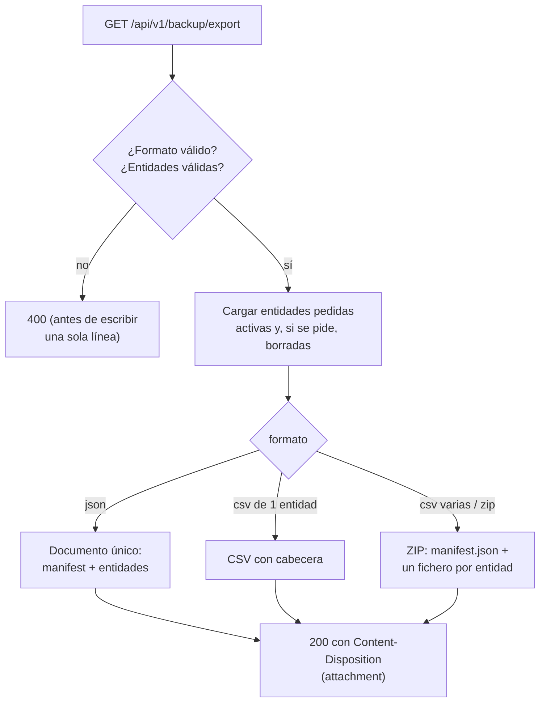
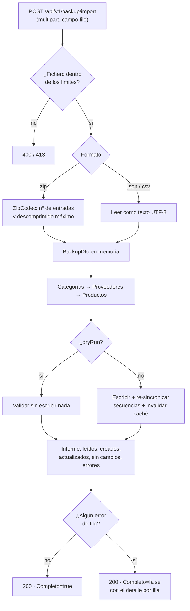

# 32. Backup y Restore

## Índice

[32. Backup y Restore](#32-backup-y-restore)
  - [32.1. Visión General](#321-visión-general)
  - [32.2. Los Tres Endpoints](#322-los-tres-endpoints)
  - [32.3. Flujo de Exportación](#323-flujo-de-exportación)
  - [32.4. Flujo de Importación](#324-flujo-de-importación)
  - [32.5. Upsert por Clave y Orden de Importación](#325-upsert-por-clave-y-orden-de-importación)
  - [32.6. Restaurar con IDs Explícitos](#326-restaurar-con-ids-explícitos)
  - [32.7. CSV según RFC 4180](#327-csv-según-rfc-4180)
  - [32.8. Límites de Seguridad](#328-límites-de-seguridad)
  - [32.9. E/S Síncrona en la Descarga](#329-e-s-síncrona-en-la-descarga)
  - [32.10. Pruebas](#3210-pruebas)
  - [32.11. Resumen](#3211-resumen)

---

## 32.1. Visión General

El módulo de backup exporta e importa las entidades maestras de la tienda —**productos, categorías y proveedores**— en **zip, json o csv**, sin dependencias externas para leer ni escribir los formatos. Es una superficie **solo ADMIN** en sus tres endpoints, con la subida limitada a 10 MB.

Dos propiedades lo diferencian de un volcado a medida:

- **Round-trip fiel**: se conservan los IDs originales, las marcas de borrado lógico y las fechas; importar un backup exportado de la misma base no cambia nada (`sinCambios` en todas las filas).
- **Tolerancia a errores de fila**: una fila inválida se registra en el informe y no aborta la importación; `Completo` indica si todo entró limpio.

## 32.2. Los Tres Endpoints

| Endpoint | Método | Auth | Qué hace |
| --- | --- | --- | --- |
| `/api/v1/backup/export` | GET | ADMIN | Descarga (`formato=zip\|json\|csv`, `entidades=...`, `incluirBorrados`) |
| `/api/v1/backup/import` | POST | ADMIN | Subida multipart con `dryRun` y `formato`; devuelve el informe |
| `/api/v1/backup/formatos` | GET | ADMIN | Catálogo: formatos, entidades, límites y reglas |

El catálogo de `formatos` documenta el contrato sin leer el código: qué formatos admite, qué campos tiene cada entidad, qué claves usa el upsert y cuáles son los límites.

## 32.3. Flujo de Exportación



El manifest (`manifest.json`) viaja dentro del propio backup —versión, fecha de generación, recuento por entidad, si incluyó borrados y el formato— para poder interpretar el fichero sin contexto externo. Las entidades no pedidas salen en `null` (no en lista vacía), de modo que el cliente distingue *«no lo pedí»* de *«no hay nada»*.

## 32.4. Flujo de Importación



Tres detalles del camino:

- **El orden importa**: primero categorías y proveedores, después productos, porque estos últimos referencian a las otras dos.
- **Los errores no abortan**: cada fila inválida acumula `fila`, `campo` y `mensaje` en el informe; las filas válidas de la misma tanda sí entran.
- **`dryRun=true` ejecuta exactamente el mismo camino** (lectura, validación, upsert simulado) sin escribir nada: sirve para verificar un backup antes de restaurarlo en producción.

## 32.5. Upsert por Clave y Orden de Importación

| Entidad | Clave | Si no existe | Si existe y cambió | Si no cambió |
| --- | --- | --- | --- | --- |
| categorias | `id` | Se crea con su ID | Se actualiza | `sinCambios` |
| proveedores | `codigo` | Se crea | Se actualiza | `sinCambios` |
| productos | `id` | Se crea con su ID | Se actualiza | `sinCambios` |

La detección de «sin cambios» compara todos los campos de negocio: si el backup y la base coinciden, no se emite ninguna escritura (por eso un round-trip perfecto deja `creados=0` y `actualizados=0`).

## 32.6. Restaurar con IDs Explícitos

Las columnas `Id` de categorías y productos están declaradas **`GENERATED ALWAYS AS IDENTITY`** en PostgreSQL: rechazan un `INSERT` con valor explícito. Restaurar con los IDs originales es imprescindible (los productos referencian `categoriaId`), así que el alta con ID propio pasa por SQL directo:

```sql
INSERT INTO "categorias" (...)
OVERRIDING SYSTEM VALUE   -- antes de VALUES, como exige PostgreSQL
VALUES (...);
```

Y después, **una vez al final de la importación** (solo si hubo altas con ID explícito), se re-sincroniza la secuencia:

```sql
SELECT setval(pg_get_serial_sequence('categorias', 'Id'), COALESCE(MAX("Id"), 1));
```

Sin ese `setval`, la siguiente creación normal generaría un ID ya ocupado y fallaría por clave duplicada. Este es el punto más delicado del módulo, y está cubierto por un test de integración que inserta un ID explícito y después crea otro por el camino normal.

## 32.7. CSV según RFC 4180

El codificador CSV es propio (sin paquetes NuGet) e implementa las reglas de la RFC 4180:

- Separador por coma; los campos con coma, comilla o salto de línea se entrecomillan.
- Las comillas dentro de un campo entrecomillado se duplican (`""`).
- La lectura acepta finales de línea LF y CRLF, y no produce filas fantasma con líneas vacías.
- Se escribe **UTF-8 con BOM** para que Excel abra los acentos bien, y números/fechas en **cultura invariante** (punto decimal, ISO 8601) para que el fichero sea legible en cualquier configuración regional.
- Una celda vacía se interpreta como `NULL`, no como cadena vacía — de lo contrario el round-trip marcaría todos los registros como cambiados.

## 32.8. Límites de Seguridad

Un backup llega de fuera: el servidor no puede fiarse de lo que declara el fichero.

| Límite | Valor | Protege contra |
| --- | --- | --- |
| Fichero subido | 10 MB | Subidas gigantes |
| Tamaño descomprimido | 50 MB | **Zip bombs** (pocos bytes que explotan al abrir) |
| Entradas del ZIP | 50 | Zip con miles de ficheros |

El tamaño descomprimido se comprueba **dos veces**: por lo que declaran las cabeceras del ZIP (sin descomprimir nada) y por lo que se lee de verdad, por si el declarado miente. El límite de entradas se aplica antes de tocar el contenido.

## 32.9. E/S Síncrona en la Descarga

Kestrel no admite operaciones de E/S síncrona (`AllowSynchronousIO=false`), pero `StreamWriter` y `ZipArchive` hacen **flush síncrono al cerrar**. Sin habilitarlo, la descarga en csv o zip se cortaba a mitad con una excepción en el cliente. El controlador de export permite la E/S síncrona **solo durante la descarga** (via `IHttpBodyControlFeature`) y la restaura al salir, de modo que el resto de la API mantiene el comportamiento por defecto.

## 32.10. Pruebas

- **Unitarias (9 + 5 por repositorio)**: round-trip del CSV (comillas, comas, saltos, CRLF, BOM, cultura invariante) y del ZIP, más los límites de entradas y de zip bomb.
- **Integración (7 por repositorio)**: export en json/csv, formato desconocido sin escribir nada, `dryRun` intacto, errores de fila sin abortar, round-trip CSV y —el importante— **que la secuencia queda operativa tras restaurar IDs explícitos**.
- **E2E**: Automation cubre el ciclo completo (export json/csv/zip, errores 400, import `dryRun` y real con `creados=0`), Newman las 10 peticiones de la colección y Bruno las peticiones GET del catálogo y del export.

## 32.11. Resumen

Backup y restore en tres endpoints admin y tres formatos, con lectura y escritura en la propia BCL y sus límites aplicados. La clave técnica del módulo es **restaurar con los IDs originales en columnas `GENERATED ALWAYS`**: SQL con `OVERRIDING SYSTEM VALUE` y re-sincronización de la secuencia después. A eso se suman el upsert por clave con detección de cambios, los errores de fila que no abortan, el `dryRun` para validar antes de tocar nada y la E/S síncrona permitida únicamente durante la descarga.
